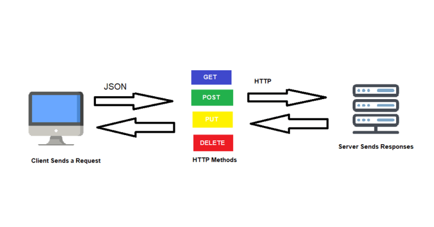
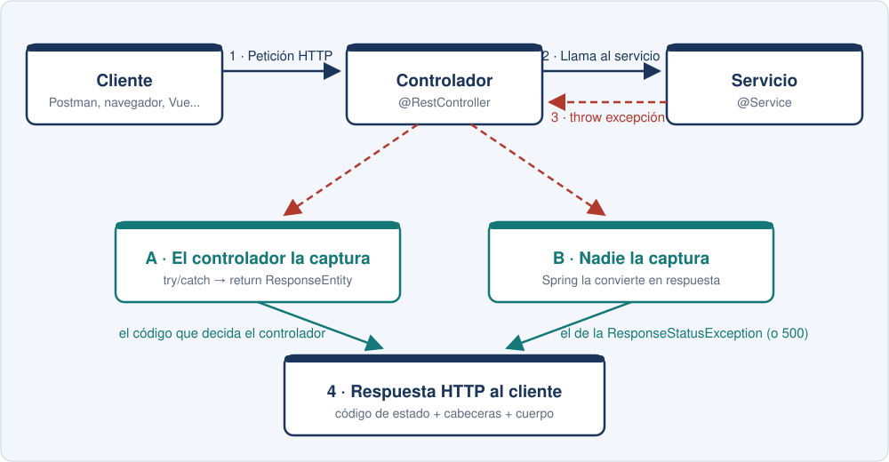
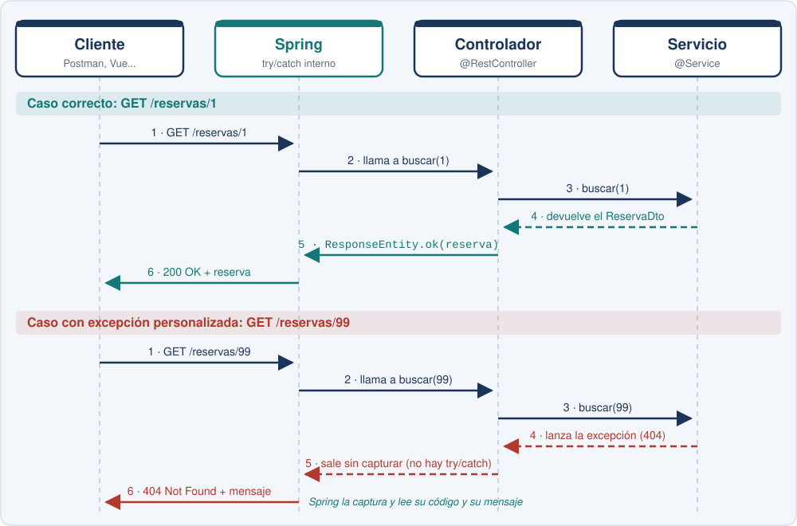

[⌂ Volver al inicio](index.md)

## Índice

1. [HTTP y APIs REST](#1-http-y-apis-rest)
    - [1.1 ResponseEntity](#11-responseentity)
2. [DTOs y modelos](#2-dtos-y-modelos)
    - [2.2 El modelo](#22-el-modelo)
    - [2.3 El DTO](#23-el-dto)
3. [Servicios y organización por capas](#3-servicios-y-organización-por-capas)
4. [Inyección de dependencias](#4-inyección-de-dependencias)
5. [Parámetros de ruta y de consulta](#5-parámetros-de-ruta-y-de-consulta)
6. [Operaciones CRUD](#6-operaciones-crud)
7. [Manejo de excepciones](#7-manejo-de-excepciones)
8. [Actividades](#8-actividades)
    - [Actividad 1: catálogo de productos con ResponseEntity](#actividad-1-catálogo-de-productos-con-responseentity)
    - [Actividad 2: API de biblioteca con DTOs y modelos](#actividad-2-api-de-biblioteca-con-dtos-y-modelos)
    - [Actividad 3: calculadora con PathVariable y excepciones](#actividad-3-calculadora-con-pathvariable-y-excepciones)
9. [Actividades de ampliación](#9-actividades-de-ampliación)
    - [Ampliación 1: reservas de una sala](#ampliación-1-reservas-de-una-sala)
    - [Ampliación 2: telemetría de un rover](#ampliación-2-telemetría-de-un-rover)

## 1. HTTP y APIs REST



Una aplicación web intercambia mensajes mediante el protocolo HTTP. El navegador u otro cliente envía una petición al servidor Spring Boot, y el servidor devuelve una respuesta. Cada operación se dirige a una URL y utiliza un método HTTP que expresa la intención: consultar, crear, reemplazar o borrar un recurso.

| Método | Intención | Ejemplo |
|---|---|---|
| `GET` | Consultar un recurso o una lista | `GET /reservas/12` |
| `POST` | Crear un recurso | `POST /reservas` |
| `PUT` | Reemplazar o actualizar un recurso | `PUT /reservas/12` |
| `DELETE` | Eliminar un recurso | `DELETE /reservas/12` |

Una respuesta HTTP tiene tres componentes:

1. **Código de estado:** informa del resultado general. Por ejemplo, `200 OK`, `404 Not Found` o `500 Internal Server Error`.
2. **Cabeceras:** metadatos de la respuesta, como `Content-Type: application/json`.
3. **Cuerpo:** los datos devueltos, normalmente JSON en una API REST, o HTML en una aplicación con vistas.

En Chrome se puede inspeccionar el tráfico desde las herramientas de desarrollador: abre Network (Red), genera una petición y selecciona la fila correspondiente para consultar estado, cabeceras y cuerpo.

### Códigos de estado habituales

| Código | Significado | Uso habitual en una API |
|---|---|---|
| `200 OK` | Operación correcta | Consulta, actualización o resultado con cuerpo |
| `201 Created` | Recurso creado | Alta correcta mediante `POST` |
| `202 Accepted` | Petición aceptada | Trabajo que se procesará más adelante |
| `204 No Content` | Operación correcta sin cuerpo | Borrado correcto |
| `400 Bad Request` | Petición no válida | Datos mal formados o reglas de entrada incumplidas |
| `401 Unauthorized` | No hay autenticación válida | Falta un token o no se puede validar |
| `403 Forbidden` | Identidad reconocida, sin permiso | Acceso denegado |
| `404 Not Found` | Recurso inexistente | No se encuentra el identificador solicitado |
| `409 Conflict` | Conflicto con el estado actual | Horario ocupado o recurso duplicado |
| `410 Gone` | Recurso ya no disponible | Estado terminal, como un rover destruido |
| `500 Internal Server Error` | Error inesperado del servidor | Fallo no previsto durante el procesamiento |

El estado HTTP forma parte del contrato de la API. No conviene responder `200 OK` con un texto que diga que hubo un error: el cliente debe poder interpretar correctamente el resultado sin analizar mensajes.

### 1.1 ResponseEntity

`ResponseEntity` es la clase de Spring que representa la respuesta HTTP completa: código de estado, cabeceras y cuerpo. Es el elemento que permite al controlador decidir exactamente qué envía al cliente.

#### Por qué se necesita

Cuando un método de un controlador devuelve directamente un objeto, Spring lo convierte a JSON y responde siempre `200 OK`:

```java
@GetMapping("/ultima")
public ReservaDto ultima() {
    return reservaService.ultima();   // siempre 200 OK
}
```

Esto es suficiente en casos simples, pero no permite elegir otro código (`201`, `204`, `404`...) ni añadir cabeceras. Con `ResponseEntity` el método devuelve un objeto que describe la respuesta entera:

```java
@GetMapping("/ultima")
public ResponseEntity<ReservaDto> ultima() {
    ReservaDto reserva = reservaService.ultima();
    return ResponseEntity.ok(reserva);   // 200 OK + cuerpo JSON
}
```

#### El tipo genérico `ResponseEntity<T>`

`ResponseEntity` es una clase genérica: el tipo entre `< >` indica la clase del cuerpo.

| Declaración | Significado |
|---|---|
| `ResponseEntity<ReservaDto>` | El cuerpo es un `ReservaDto` |
| `ResponseEntity<List<ReservaDto>>` | El cuerpo es una lista de `ReservaDto` |
| `ResponseEntity<Void>` | No hay cuerpo (por ejemplo, un `204 No Content`) |
| `ResponseEntity<?>` | El tipo del cuerpo puede variar (ver más abajo) |

El tipo no cambia el código de estado; solo documenta y comprueba en compilación qué se puede poner en el cuerpo. Spring serializa ese cuerpo a JSON con Jackson, igual que si se devolviera directamente.

#### Cómo se construye una respuesta

`ResponseEntity` ofrece métodos estáticos que funcionan como *builders*: se encadenan para componer la respuesta y terminan con `body(...)` o `build()`.

```java
ResponseEntity.status(HttpStatus.CREATED)   // 1. el código de estado
        .body(reservaCreada);               // 2. el cuerpo, que cierra la construcción
```

Los atajos más habituales:

| Método | Código | Cierre | Uso típico |
|---|---|---|---|
| `ResponseEntity.ok(cuerpo)` | `200 OK` | — | Consulta o actualización correcta |
| `ResponseEntity.status(HttpStatus.CREATED).body(cuerpo)` | `201 Created` | `body` | Alta correcta mediante `POST` |
| `ResponseEntity.accepted().body(cuerpo)` | `202 Accepted` | `body` | Trabajo aceptado, procesado después |
| `ResponseEntity.noContent().build()` | `204 No Content` | `build` | Borrado correcto |
| `ResponseEntity.badRequest().body(error)` | `400 Bad Request` | `body` | Datos de entrada incorrectos |
| `ResponseEntity.notFound().build()` | `404 Not Found` | `build` | Recurso inexistente |
| `ResponseEntity.status(codigo).body(cuerpo)` | El indicado | `body` | Cualquier otro código (`409`, `410`...) |

La diferencia entre `build()` y `body(...)`: `body(x)` cierra la respuesta incluyendo un cuerpo; `build()` la cierra sin cuerpo. Por eso `notFound()` y `noContent()` solo admiten `build()` (no tienen cuerpo), mientras que `badRequest()` y `status(...)` permiten `body(...)`. `HttpStatus` es la enumeración con los códigos (`HttpStatus.CREATED`, `HttpStatus.CONFLICT`...).

#### `Optional<T>` y respuestas `200`/`404`

Una consulta puede no encontrar nada. Java representa «puede haber un valor o no» con `Optional<T>`: un contenedor que o bien guarda un valor, o bien está vacío (`Optional.empty()`). Evita devolver `null`, que fuerza a comprobaciones constantes y provoca `NullPointerException`.

Un servicio que devuelve la última reserva registrada puede no tener ninguna (si aún no se ha creado nada), así que declara su resultado como `Optional`:

```java
public Optional<ReservaDto> ultima() {
    if (reservas.isEmpty()) {
        return Optional.empty();
    }
    return Optional.of(reservas.get(reservas.size() - 1));
}
```

Los métodos básicos de `Optional` son:

| Método | Qué hace |
|---|---|
| `Optional.of(x)` | Crea un `Optional` con `x` (no puede ser `null`) |
| `Optional.ofNullable(x)` | Crea un `Optional` con `x`, o vacío si `x` es `null` |
| `Optional.empty()` | Crea un `Optional` vacío |
| `isPresent()` | Devuelve `true` si hay valor |
| `isEmpty()` | Devuelve `true` si está vacío |
| `orElse(alternativa)` | Devuelve el valor si lo hay; si está vacío, devuelve la `alternativa` indicada |
| `orElseThrow(() -> excepcion)` | Devuelve el valor si lo hay; si está vacío, lanza la excepción indicada |

`orElse` es la forma más sencilla de sacar el valor de un `Optional`: se le indica qué devolver cuando no hay nada. En un controlador, lo habitual es usar `null` como alternativa y comprobarlo después para decidir el código de estado:

```java
@GetMapping("/ultima")
public ResponseEntity<ReservaDto> ultima() {
    ReservaDto reserva = reservaService.ultima().orElse(null);

    if (reserva == null) {
        return ResponseEntity.notFound().build();   // 404 Not Found
    }
    return ResponseEntity.ok(reserva);              // 200 OK + la reserva
}
```

Se lee así: «obtén la última reserva o `null` si no hay ninguna; si es `null`, responde `404 Not Found`; si no, respóndela con `200 OK`». Aquí el `null` queda acotado a una sola línea del controlador: el servicio sigue sin devolver `null`.

`orElse` también sirve para dar un valor por defecto, por ejemplo `numero.orElse(0)`.

`orElseThrow` evita el `if`: si no hay valor, lanza una excepción. Con una excepción que lleve asociado el código `404` (apartado 7), el controlador ya no necesita comprobar nada:

```java
ReservaDto reserva = reservaService.ultima()
        .orElseThrow(() -> new RecursoNoEncontradoException("No hay reservas"));
```

`() -> new ...` es una expresión lambda sin parámetros: indica «cuando haga falta, crea esta excepción». Basta con copiar esta forma; no hace falta dominar las lambdas para usarla.

#### El comodín `?`: `ResponseEntity<?>`

Un método declarado como `ResponseEntity<ReservaDto>` solo puede devolver un `ReservaDto` en el cuerpo. Pero a veces la misma operación devuelve cuerpos de clases distintas: un DTO si todo va bien y un `ErrorDto` si falla.

```java
@PostMapping
public ResponseEntity<?> crear(@RequestBody ReservaCrearDto entrada) {
    if (entrada.duracionHoras() <= 0) {
        return ResponseEntity.badRequest()
                .body(new ErrorDto("La duración debe ser positiva"));  // cuerpo: ErrorDto
    }
    ReservaDto creada = reservaService.crear(entrada);
    return ResponseEntity.status(HttpStatus.CREATED).body(creada);     // cuerpo: ReservaDto
}
```

`?` es el comodín de los genéricos: significa «cualquier tipo». Así, `ResponseEntity<?>` admite un cuerpo de cualquier clase. Tiene un coste: se pierde la comprobación de tipos en compilación y la firma ya no documenta qué devuelve la API. Por eso:

- Úsalo solo cuando el cuerpo realmente pueda tener tipos distintos.
- Para errores es preferible lanzar una excepción (apartado 7) y mantener el tipo preciso `ResponseEntity<ReservaDto>`.

#### `ResponseEntity` o excepciones

Hay dos formas de producir una respuesta de error:

| Enfoque | Cómo | Cuándo |
|---|---|---|
| Devolver un `ResponseEntity` | `return ResponseEntity.notFound().build();` | El resultado «no encontrado» es normal y lo decide el controlador |
| Lanzar una excepción | `throw new RecursoNoEncontradoException(...)` | La regla de negocio se incumple en el servicio; el controlador queda sin condicionales |

Ambos se pueden combinar en la misma API. Lo importante es que cada situación devuelva siempre el código HTTP adecuado.

#### Ejemplo completo

Un buscador de palabras sobre un array fijo, sin clases propias: los cuerpos de las respuestas son simplemente textos (`String`) o listas de textos (`List<String>`). Reúne lo visto en este apartado: `Optional`, `orElse` y distintos códigos de estado (`200`, `201`, `400`, `404`, `409`). Las anotaciones de clase y de método se explican en los apartados siguientes; por ahora basta con leer qué responde cada método. El valor que aparece tras `?` en la URL (por ejemplo, `?texto=gat`) llega al método como parámetro, mediante `@RequestParam`, que se explica en el apartado 5.

```java
@RestController
@RequestMapping("/palabras")
public class PalabraController {

    private final List<String> palabras = new ArrayList<>(List.of("casa", "perro", "gato", "coche", "libro", "camino"));

    // 200 OK con todas las palabras
    @GetMapping
    public ResponseEntity<List<String>> listar() {
        return ResponseEntity.ok(palabras);
    }

    // 200 OK con la primera palabra que contiene el texto, o 404 Not Found con un mensaje
    @GetMapping("/buscar")
    public ResponseEntity<String> buscar(@RequestParam String texto) {
        Optional<String> resultado = Optional.empty();
        for (String palabra : palabras) {
            if (palabra.contains(texto)) {
                resultado = Optional.of(palabra);
                break;
            }
        }
        String encontrada = resultado.orElse(null);

        if (encontrada == null) {
            return ResponseEntity.status(HttpStatus.NOT_FOUND)
                    .body("Ninguna palabra contiene \"" + texto + "\"");
        }
        return ResponseEntity.ok(encontrada);
    }

    // 400 Bad Request si la palabra está en blanco, 409 Conflict si ya existe,
    // o 201 Created con la palabra añadida
    @PostMapping("/anadir")
    public ResponseEntity<String> anadir(@RequestParam String palabra) {
        if (palabra.isBlank()) {
            return ResponseEntity.badRequest().body("Indica una palabra");
        }

        for (String existente : palabras) {
            if (existente.equals(palabra)) {
                return ResponseEntity.status(HttpStatus.CONFLICT)
                        .body("La palabra \"" + palabra + "\" ya existe");
            }
        }

        palabras.add(palabra);
        return ResponseEntity.status(HttpStatus.CREATED).body(palabra);
    }
}
```

Qué responde cada petición:

| Petición | Situación | Estado | Cuerpo |
|---|---|---|---|
| `GET /palabras` | Siempre | `200 OK` | Lista con las 6 palabras |
| `GET /palabras/buscar?texto=at` | Hay una palabra que contiene «at» | `200 OK` | `gato` |
| `GET /palabras/buscar?texto=zz` | Ninguna la contiene | `404 Not Found` | Mensaje de texto |
| `POST /palabras/anadir?palabra=uva` | La palabra no existe | `201 Created` | `uva` |
| `POST /palabras/anadir?palabra=casa` | La palabra ya existe | `409 Conflict` | Mensaje de texto |
| `POST /palabras/anadir?palabra=` | Palabra vacía | `400 Bad Request` | Mensaje de texto |

Por ejemplo, `POST /palabras/anadir?palabra=uva` devuelve:

```http
HTTP/1.1 201 Created
Content-Type: text/plain;charset=UTF-8

uva
```

y `GET /palabras/buscar?texto=zz`:

```http
HTTP/1.1 404 Not Found
Content-Type: text/plain;charset=UTF-8

Ninguna palabra contiene "zz"
```

Observa tres detalles:

- `listar`, `buscar` y `anadir` declaran un tipo concreto (`List<String>` y `String`), porque siempre devuelven el mismo tipo de cuerpo, aunque `buscar` y `anadir` lo usen tanto para el éxito como para el error.
- En `buscar`, el `Optional<String>` expresa «puede haber una palabra o no». Se convierte en `404` o `200` con `orElse(null)`.
- `anadir` es un `POST`: modifica datos, por eso responde `201 Created` cuando la palabra se añade y `409 Conflict` cuando ya existía.

## 2. DTOs y modelos

### 2.1. Dos tipos de clases con propósitos distintos

En una aplicación Spring hay clases que sirven para representar datos. A primera vista pueden parecerse mucho (ambas tienen un nombre, una hora, una duración...), pero cumplen funciones diferentes y conviene no confundirlas:

- El modelo representa un elemento dentro de la aplicación: una reserva, un producto, un usuario. Es lo que utilizan el servicio y las reglas de negocio.
- El DTO (*Data Transfer Object*) representa los datos tal como viajan por la API: lo que el cliente envía y lo que recibe.

```text
Cliente  <--JSON-->  [ DTO ]  <-- Controlador / Servicio -->  [ Modelo ]  <-->  Base de datos
        (fuera de la aplicación)                              (dentro de la aplicación)
```

El modelo vive en el interior y el DTO en la frontera. Todo lo que sigue desarrolla esta idea.

---

### 2.2. El modelo

#### ¿Qué es?

El modelo (también llamado *dominio*) agrupa las clases que representan los conceptos con los que trabaja la aplicación. Si estás construyendo un sistema de reservas de salas, tu modelo contendrá la clase `Reserva`; si es una tienda, `Producto`, `Pedido`, `Cliente`...

#### Características

- Contiene todos los datos que la aplicación necesita, incluidos los internos que el cliente nunca debería ver.
- Puede incluir lógica y reglas de negocio propias del concepto (comprobaciones, cálculos).
- Está pensado para cómo trabaja la aplicación, no para cómo se comunica con el exterior.
- Cambia cuando cambia el negocio o la forma de almacenar los datos.
- Suele ubicarse en el paquete `model`.

#### Ejemplo

```java
public class Reserva {

    private final long id;
    private final String nombre;
    private final int horaInicio;
    private final int duracionHoras;
    private final String notasInternas;   // dato interno: el cliente no debe verlo

    public Reserva(long id, String nombre, int horaInicio,
                   int duracionHoras, String notasInternas) {
        if (duracionHoras <= 0) {
            throw new IllegalArgumentException("La duración debe ser positiva");
        }
        this.id = id;
        this.nombre = nombre;
        this.horaInicio = horaInicio;
        this.duracionHoras = duracionHoras;
        this.notasInternas = notasInternas;
    }

    public long getId() {
        return id;
    }

    public String getNombre() {
        return nombre;
    }

    public int getHoraInicio() {
        return horaInicio;
    }

    public int getDuracionHoras() {
        return duracionHoras;
    }

    public String getNotasInternas() {
        return notasInternas;
    }

    public int horaFin() {
        return horaInicio + duracionHoras;
    }

    public boolean solapaCon(Reserva otra) {
        return horaInicio < otra.horaFin() && otra.horaInicio < horaFin();
    }
}
```

Observa qué hace de `Reserva` un modelo:

- Tiene `notasInternas`, un campo que solo le interesa a la aplicación.
- Protege su propia coherencia: no admite duraciones negativas o cero.
- Sabe responder preguntas del dominio: cuándo termina (`horaFin`) y si choca con otra reserva (`solapaCon`).

#### Modelo y entidad de base de datos

Cuando la aplicación guarda datos en una base de datos con JPA, el modelo suele ser una entidad: una clase anotada con `@Entity` y ligada a una tabla. Sigue siendo parte del interior de la aplicación y, además de representar el dominio, define cómo se almacena. Todo lo dicho sobre el modelo se aplica también a las entidades.

---

### 2.3. El DTO

#### ¿Qué es?

Un DTO (*Data Transfer Object*, objeto de transferencia de datos) es una clase sencilla que representa los datos que cruzan el límite de la API: lo que entra en la petición y lo que sale en la respuesta.

Separa el contrato HTTP de las clases internas de negocio y permite controlar qué información se expone.

#### Características

- Contiene solo los datos necesarios para esa operación concreta.
- **No tiene lógica de negocio**: es un contenedor de datos.
- Define el contrato de la API: qué campos acepta y qué campos devuelve.
- Cambia cuando cambia lo que la API ofrece, no cuando cambia el interior de la aplicación.
- Suele ubicarse en el paquete `dto`.
- Se define como una clase Java normal, con atributos privados, constructores, *getters* y *setters*. Spring (mediante Jackson) los utiliza para convertirla a JSON y desde JSON.

#### Tipos habituales de DTO

| Tipo | Sentido | Para qué sirve | Ejemplo |
|---|---|---|---|
| **De entrada** | Cliente → API | Los datos que el cliente aporta para crear o modificar algo. | `ReservaCrearDto` |
| **De salida** | API → Cliente | Los datos que se devuelven al cliente. | `ReservaDto` |
| **De resumen** | API → Cliente | Una versión reducida, para listados. | `ReservaResumenDto` |
| **De error** | API → Cliente | Un mensaje de error con formato uniforme. | `ErrorDto` |

#### Ejemplo

```java
// DTO de entrada
public class ReservaCrearDto {

    private String nombre;
    private int horaInicio;
    private int duracionHoras;

    public ReservaCrearDto() {
    }

    public ReservaCrearDto(String nombre, int horaInicio, int duracionHoras) {
        this.nombre = nombre;
        this.horaInicio = horaInicio;
        this.duracionHoras = duracionHoras;
    }

    public String getNombre() {
        return nombre;
    }

    public void setNombre(String nombre) {
        this.nombre = nombre;
    }

    public int getHoraInicio() {
        return horaInicio;
    }

    public void setHoraInicio(int horaInicio) {
        this.horaInicio = horaInicio;
    }

    public int getDuracionHoras() {
        return duracionHoras;
    }

    public void setDuracionHoras(int duracionHoras) {
        this.duracionHoras = duracionHoras;
    }
}
```

```java
// DTO de salida
public class ReservaDto {

    private final long id;
    private final String nombre;
    private final int horaInicio;
    private final int duracionHoras;

    public ReservaDto(long id, String nombre, int horaInicio, int duracionHoras) {
        this.id = id;
        this.nombre = nombre;
        this.horaInicio = horaInicio;
        this.duracionHoras = duracionHoras;
    }

    public long getId() {
        return id;
    }

    public String getNombre() {
        return nombre;
    }

    public int getHoraInicio() {
        return horaInicio;
    }

    public int getDuracionHoras() {
        return duracionHoras;
    }
}
```

```java
// DTO de resumen (para listados)
public class ReservaResumenDto {

    private final long id;
    private final String nombre;

    public ReservaResumenDto(long id, String nombre) {
        this.id = id;
        this.nombre = nombre;
    }

    public long getId() {
        return id;
    }

    public String getNombre() {
        return nombre;
    }
}
```

```java
// DTO de error
public class ErrorDto {

    private final String mensaje;

    public ErrorDto(String mensaje) {
        this.mensaje = mensaje;
    }

    public String getMensaje() {
        return mensaje;
    }
}
```

Observa qué hace de estas clases DTOs:

- `ReservaCrearDto` no necesita un identificador: ese valor lo asigna el servidor. El DTO de respuesta sí puede incluirlo.
- Ninguno incluye `notasInternas`: ese dato no forma parte del contrato de la API.
- No tienen métodos de negocio: solo transportan datos.
- Existen varios DTOs para una misma entidad, cada uno adaptado a una situación.

#### Qué necesita cada DTO para funcionar con JSON

Jackson convierte las clases a JSON y desde JSON usando sus constructores, *getters* y *setters*, así que cada DTO necesita lo adecuado a su sentido:

| DTO | Qué necesita | Por qué |
|---|---|---|
| **De entrada** (`ReservaCrearDto`) | Constructor vacío y *setters*. | Jackson crea el objeto vacío y luego rellena cada campo con su *setter* a partir del JSON recibido. |
| **De salida** (`ReservaDto`, `ReservaResumenDto`, `ErrorDto`) | Constructor con todos los campos y *getters*. | Se crea en el código de la aplicación, y Jackson lee los *getters* para escribir el JSON. |

Los nombres de los *getters* y *setters* determinan los nombres de las claves del JSON: `getHoraInicio()` produce la clave `"horaInicio"`.

> Estos métodos se pueden generar automáticamente con el IDE o con la librería Lombok. Aquí los escribimos explícitamente para ver exactamente qué contiene cada clase.

---

### 2.4. Diferencias entre modelo y DTO

| | **Modelo** | **DTO** |
|---|---|---|
| **Qué representa** | Un concepto del dominio. | Los datos de una petición o una respuesta. |
| **Dónde vive** | Dentro de la aplicación. | En la frontera con el exterior. |
| **Quién lo usa** | Servicios y repositorios. | Controladores (y el servicio al convertir). |
| **Lógica** | Puede tener reglas y métodos. | Ninguna, solo datos. |
| **Campos** | Todos los que necesita la aplicación, incluso internos. | Solo los que el cliente debe enviar o ver. |
| **Cantidad** | Normalmente uno por concepto. | Varios por concepto, según el caso de uso. |
| **Cambia cuando...** | Cambia el negocio o el almacenamiento. | Cambia lo que ofrece la API. |
| **Ejemplo** | `Reserva` | `ReservaCrearDto`, `ReservaDto` |

Una forma sencilla de recordarlo:

> El modelo es cómo *piensa* la aplicación sobre un dato. El DTO es cómo *habla* la aplicación con el exterior sobre ese dato.

---

### 2.5. ¿Por qué no usar el modelo directamente en la API?

Parece más cómodo recibir y devolver `Reserva` directamente, sin crear más clases. Pero eso trae varios problemas.

#### 1. Se exponen datos internos

Si el controlador devuelve un `Reserva`, el JSON incluirá todos sus campos, también los internos:

```json
{
  "id": 1,
  "nombre": "Lucía Martín",
  "horaInicio": 10,
  "duracionHoras": 2,
  "notasInternas": "Cliente conflictivo, vigilar"
}
```

Con un DTO de salida, el cliente solo recibe lo que debe ver.

#### 2. El cliente puede fijar campos que no le corresponden

Si la API acepta `Reserva` como entrada, un cliente podría enviar:

```json
{
  "id": 999,
  "nombre": "Lucía Martín",
  "horaInicio": 10,
  "duracionHoras": 2,
  "notasInternas": "Reserva VIP"
}
```

y estaría decidiendo el `id` y las notas internas. Con `ReservaCrearDto`, esos campos ni siquiera existen: aunque el cliente los envíe, se ignoran. Este problema se conoce como *mass assignment* (asignación masiva) y es una fuente habitual de fallos de seguridad.

#### 3. Los cambios internos rompen la API

Si renombras un campo del modelo o lo divides en dos, los clientes que dependían de él dejan de funcionar. Con DTOs, el contrato de la API permanece estable y solo hay que ajustar la conversión.

#### 4. Una misma clase no sirve para todas las situaciones

- Al crear no hay `id`.
- Al consultar sí hay `id`.
- En un listado basta con un resumen.
- Al actualizar puede que solo se permitan ciertos campos.

Intentar cubrirlo todo con una única clase obliga a campos opcionales y a comprobaciones confusas.

#### 5. Se mezclan responsabilidades

El modelo quedaría contaminado con detalles de la comunicación (nombres de campos del JSON, formatos), y los DTOs arrastrarían reglas de negocio que no les corresponden.

#### 6. Problemas adicionales con entidades de base de datos

Si el modelo es una entidad JPA, exponerla directamente añade más riesgos: relaciones con otras entidades que provocan bucles infinitos al convertir a JSON, o consultas innecesarias a la base de datos al acceder a datos relacionados.

---

### 2.6. ¿Cuántos DTOs necesito?

No hay un número fijo. La regla práctica es un DTO por cada forma distinta de comunicar el dato:

| Operación | DTO de entrada | DTO de salida |
|---|---|---|
| Crear reserva | `ReservaCrearDto` | `ReservaDto` |
| Modificar reserva | `ReservaActualizarDto` | `ReservaDto` |
| Listar reservas | — | `ReservaResumenDto` |
| Consultar una reserva | — | `ReservaDto` |
| Error | — | `ErrorDto` |

Si dos operaciones comparten exactamente los mismos campos, pueden compartir DTO. Si difieren (por ejemplo, el de modificar no permite cambiar el nombre), conviene separarlos.

---

### 2.7. Dónde se colocan

Siguiendo la organización por paquetes:

```text
src/
└── main/
    └── java/
        └── com/ejemplo/aplicacion/
            ├── Aplicacion.java
            ├── controller/
            │   └── ReservaController.java
            ├── dto/
            │   ├── ReservaCrearDto.java
            │   ├── ReservaDto.java
            │   ├── ReservaResumenDto.java
            │   └── ErrorDto.java
            ├── model/
            │   └── Reserva.java
            └── service/
                └── ReservaService.java
```

- `dto`: los objetos que cruzan la API.
- `model`: los conceptos internos de la aplicación.

---

## 3. Servicios y organización por capas

### 3.1. ¿Por qué organizar el código en capas?

Cuando una aplicación crece, lo más peligroso no es la cantidad de código, sino que todo esté mezclado. Imagina un único método que recibe la petición HTTP, valida los datos, aplica las reglas de la aplicación, consulta la base de datos y construye la respuesta. Funcionaría, pero:

- Sería difícil de leer: ¿dónde termina lo que es HTTP y empieza la lógica?
- Sería difícil de modificar: cambiar una regla obligaría a tocar código web.
- Sería difícil de probar: para comprobar una regla tendrías que simular una petición completa.
- No se podría reutilizar: si otra parte de la aplicación necesita esa regla, habría que copiarla.

La solución es dividir la aplicación en capas, de forma que cada una tenga una única responsabilidad. Este principio se conoce como separación de responsabilidades.

---

### 3.2. El flujo habitual en una API Spring

En una API Spring sencilla, una petición recorre las capas así:

```text
Petición HTTP -> Controller -> Service -> respuesta
```

Y la respuesta hace el camino de vuelta:

```text
Cliente  --(petición)-->  Controller  --(llama a)-->  Service
Cliente  <--(respuesta)-- Controller  <--(resultado)-- Service
```

Cada capa tiene su papel:

- **Controller (`@RestController`):** es la puerta de entrada. Recibe la petición, extrae los datos, llama al servicio y prepara la respuesta HTTP.
- **Service (`@Service`):** es el "cerebro". Ejecuta las operaciones y las reglas propias de la aplicación.

> En aplicaciones con base de datos suele añadirse una tercera capa, el repositorio (`@Repository`), encargada de leer y guardar datos. El flujo pasa a ser `Controller -> Service -> Repository -> base de datos`. Por ahora trabajamos solo con controlador y servicio.

#### Qué debe y qué no debe hacer cada capa

| Capa | Sí debe | No debe |
|---|---|---|
| **Controller** | Recibir la petición, leer el cuerpo, parámetros y rutas, llamar al servicio, devolver la respuesta y el código HTTP. | Contener reglas de negocio, cálculos o decisiones sobre los datos. |
| **Service** | Aplicar reglas, hacer comprobaciones y cálculos, coordinar operaciones. | Conocer detalles de HTTP (rutas, códigos de estado, cabeceras). |

Una buena pregunta para saber dónde va un fragmento de código es: *"¿esto cambiaría si en lugar de una API web tuviera una aplicación de consola?"*. Si la respuesta es no, probablemente pertenece al servicio.

---

### 3.3. Estructura de paquetes del proyecto

Por ahora, el código Java del proyecto puede organizarse así. `com.ejemplo.aplicacion` es un paquete de ejemplo: en tu proyecto tendrá el nombre que hayas configurado.

```text
src/
└── main/
    └── java/
        └── com/ejemplo/aplicacion/
            ├── Aplicacion.java
            ├── controller/
            │   └── InventarioController.java
            ├── dto/
            │   ├── CrearProductoRequest.java
            │   └── ProductoResponse.java
            ├── model/
            │   └── Producto.java
            └── service/
                └── InventarioService.java
```

Qué contiene cada elemento:

- **`Aplicacion.java`**: la clase principal, anotada con `@SpringBootApplication`. Es el punto de arranque.
- **`controller`**: las clases que reciben las peticiones.
- **`dto`**: los objetos que transportan datos entre la API y el cliente, por ejemplo, los datos de una petición o la respuesta que devuelve un endpoint. Sus clases suelen llamarse `...Request` y `...Response`.
- **`service`**: las clases que realizan las operaciones y aplican las reglas.
- **`model`**: las clases que representan los elementos del dominio, como un producto o una reserva.

Los DTO permiten definir qué datos acepta y devuelve la API sin exponer directamente el modelo del dominio. Los nombres de los paquetes pueden variar (`controllers`, `services`, `domain`, `entity`...), pero mantener cada responsabilidad en su lugar ayuda a encontrar y entender el código.

> **Importante:** `controller`, `dto`, `service` y `model` deben quedar dentro del paquete de la clase principal. Spring escanea ese paquete y sus subpaquetes para encontrar las clases anotadas; si una clase queda fuera, no se registrará.

#### Ejemplo de clase del modelo

Una clase del modelo solo representa datos. Por ejemplo:

```java
public record Producto(Long id, String nombre, int unidades) {
}
```

No tiene lógica de la aplicación ni sabe nada de HTTP: simplemente describe qué es un producto.

---

### 3.4. ¿Qué es un servicio?

En este contexto, un servicio es una clase Java que reúne operaciones relacionadas con una tarea de la aplicación.

Ejemplos:

- Un servicio de inventario puede comprobar si hay unidades suficientes, calcular el stock restante o registrar una entrada de mercancía.
- Un servicio de reservas puede comprobar si una reserva cumple las reglas: fechas válidas, plazas disponibles, antelación mínima...

Algunas características importantes:

- **No es una URL.** Los clientes no llaman directamente al servicio.
- **No recibe la petición HTTP.** De eso se encarga el controlador.
- **Es una clase normal de Java.** Sus métodos pueden llamarse desde cualquier sitio, también desde otros servicios o desde tests.

El flujo de trabajo es: el controlador le pide al servicio que haga el trabajo y utiliza el resultado para decidir qué respuesta enviar.

---

### 3.5. ¿Por qué separar el servicio?

Separar el servicio del controlador aporta varias ventajas:

1. **Responsabilidades claras.** El controlador se ocupa de HTTP y el servicio de las reglas de negocio. Cada clase tiene un trabajo claro.
2. **Reutilización.** Si la misma regla se necesita desde varias operaciones (por ejemplo, desde un endpoint de consulta y desde otro de reserva), se escribe una vez en el servicio y se llama desde ambos.
3. **Facilidad para probar.** Un servicio se puede probar con un test normal de Java, sin levantar el servidor ni enviar peticiones web.
4. **Mantenimiento más sencillo.** Si cambia una regla, se modifica el servicio sin tocar el controlador. Si cambia la ruta o el formato de la respuesta, se modifica el controlador sin tocar las reglas.
5. **Código más legible.** Los controladores se quedan cortos y fáciles de leer.

#### Comparación: sin separar y separando

**Sin separar** (todo en el controlador):

```java
@PostMapping("/disponibilidad")
public boolean hayUnidades(@RequestBody ComprobarInventarioRequest entrada) {
    // regla de negocio mezclada con el controlador
    return entrada.solicitadas() > 0
            && entrada.disponibles() >= entrada.solicitadas();
}
```

**Separando** (el controlador delega):

```java
@PostMapping("/disponibilidad")
public boolean hayUnidades(@RequestBody ComprobarInventarioRequest entrada) {
    return inventarioService.hayUnidades(
            entrada.disponibles(), entrada.solicitadas());
}
```

En el segundo caso, el controlador no sabe *cómo* se decide si hay unidades; solo sabe a quién preguntar.

---

### 3.6. ¿Cómo se define y se usa un servicio?

#### Paso 1: crear el servicio

Se crea una clase y se anota con `@Service`. Sus métodos representan las operaciones que ofrece:

```java
@Service
public class InventarioService {

    public boolean hayUnidades(int disponibles, int solicitadas) {
        return solicitadas > 0 && disponibles >= solicitadas;
    }
}
```

Este método devuelve `true` solo si se piden unidades (más de 0) y hay suficientes disponibles. Esa es una regla de negocio, y por eso vive en el servicio.

#### Paso 2: recibir los datos de la petición

El cliente envía los datos en el cuerpo de una petición:

```http
POST /inventario/disponibilidad
Content-Type: application/json

{
  "disponibles": 8,
  "solicitadas": 3
}
```

Para representar esos datos en Java se crea una clase (aquí, un `record`) cuyos componentes coinciden con los campos del JSON:

```java
public record ComprobarInventarioRequest(int disponibles, int solicitadas) {
}
```

`@RequestBody` se encarga de convertir ese JSON en un objeto Java.

#### Paso 3: crear el controlador

El controlador pasa los valores al servicio y devuelve el resultado:

```java
@RestController
@RequestMapping("/inventario")
public class InventarioController {

    private final InventarioService inventarioService;

    public InventarioController(InventarioService inventarioService) {
        this.inventarioService = inventarioService;
    }

    @PostMapping("/disponibilidad")
    public boolean hayUnidades(@RequestBody ComprobarInventarioRequest entrada) {
        return inventarioService.hayUnidades(
                entrada.disponibles(), entrada.solicitadas());
    }
}
```

Elementos del controlador:

- **`@RestController`**: indica que la clase atiende peticiones HTTP y que lo que devuelven sus métodos se envía como cuerpo de la respuesta.
- **`@RequestMapping("/inventario")`**: prefijo común de todas las rutas de esta clase.
- **`@PostMapping("/disponibilidad")`**: este método atiende peticiones `POST` a `/inventario/disponibilidad`.
- **`@RequestBody`**: convierte el JSON recibido en un `ComprobarInventarioRequest`.
- **Constructor**: Spring lo usa para entregar el `InventarioService` al controlador (se explica en detalle en la sección de inyección de dependencias).

#### Paso 4: el resultado

En este ejemplo, `true` indica que se pueden atender las unidades solicitadas y `false` que no.

Con la petición anterior (`disponibles: 8`, `solicitadas: 3`), la respuesta sería:

```http
HTTP/1.1 200 OK
Content-Type: application/json

true
```

El controlador recibe la petición; la comprobación sigue estando en el servicio.

#### Recorrido completo de una petición

```text
1. El cliente envía POST /inventario/disponibilidad con el JSON.
2. Spring dirige la petición al método hayUnidades del controlador.
3. @RequestBody convierte el JSON en un ComprobarInventarioRequest.
4. El controlador llama a inventarioService.hayUnidades(8, 3).
5. El servicio aplica la regla y devuelve true.
6. El controlador devuelve ese valor y Spring lo envía como respuesta.
```

---

### 3.7. `@Service` y `@Component`

La anotación `@Service` permite que Spring detecte y gestione esa clase para poder proporcionársela al controlador. Al arrancar, Spring la registra como bean (un objeto que él crea y administra).

Hay otra anotación en Spring: `@Component`, que también registra una clase, pero es más general. `@Service` expresa que la clase contiene operaciones de negocio.

En realidad, `@Service`, `@Repository` y `@RestController` son especializaciones de `@Component`: Spring las trata igual a la hora de registrarlas, pero cada una comunica un propósito distinto.

| Anotación | Se usa en | Significado |
|---|---|---|
| `@Component` | Cualquier clase que no encaje en las demás | Componente genérico. |
| `@Service` | Clases de la capa de servicio | Contiene operaciones y reglas de negocio. |
| `@Repository` | Clases de acceso a datos | Lee y guarda información. |
| `@RestController` | Clases de la capa web | Atiende peticiones HTTP y devuelve datos. |

¿Por qué usar `@Service` si `@Component` también funcionaría? Porque el código se lee mejor: al ver `@Service`, cualquiera sabe en qué capa está la clase y qué se espera de ella. Además, algunas herramientas y funciones de Spring pueden tratar de forma especial ciertas anotaciones.

---

## 4. Inyección de dependencias

### 4.1. ¿Qué es una dependencia?

Casi ninguna clase trabaja sola. Lo normal es que, para hacer su trabajo, necesite apoyarse en otras clases. Esa clase que se necesita se llama dependencia.

En nuestro ejemplo:

- `InventarioController` recibe las peticiones HTTP y devuelve respuestas.
- `InventarioService` contiene la lógica para decidir si hay unidades suficientes.

El controlador depende del servicio: sin él no podría responder a la petición. Por tanto, `InventarioService` es una dependencia de `InventarioController`.

```
Cliente HTTP ──► InventarioController ──► InventarioService
                      (depende de)
```

---

### 4.2. El problema: crear las dependencias a mano

La forma más intuitiva de conseguir una dependencia es crearla con `new`:

```java
@RestController
@RequestMapping("/inventario")
public class InventarioController {

    private final InventarioService inventarioService = new InventarioService();

    @PostMapping("/disponibilidad")
    public boolean hayUnidades(@RequestBody ComprobarInventarioRequest entrada) {
        return inventarioService.hayUnidades(
                entrada.disponibles(), entrada.solicitadas());
    }
}
```

Funciona, pero tiene varios inconvenientes:

1. **Acoplamiento fuerte**: el controlador queda atado a una implementación concreta. Si mañana quieres usar otra versión del servicio, tienes que modificar el controlador.
2. **Responsabilidad extra**: el controlador debería ocuparse de las peticiones HTTP, no de construir y configurar otros objetos.
3. **Dependencias en cadena**: si `InventarioService` necesitara a su vez un `InventarioRepository`, y este un `DataSource`, el controlador tendría que construir toda la cadena.
4. **Difícil de probar**: en un test no puedes sustituir el servicio real por uno falso (un *mock*), porque el controlador lo crea él mismo.
5. **Objetos duplicados**: cada clase que haga `new InventarioService()` tendrá su propia instancia, sin control sobre ellas.

---

### 4.3. La solución: inversión de control

La idea clave es invertir el control: en lugar de que cada clase fabrique lo que necesita, otra pieza se encarga de crear los objetos y entregárselos.

En Spring, esa pieza es el contenedor de Spring (también llamado *contexto de aplicación* o `ApplicationContext`). Este contenedor:

1. Crea los objetos de tu aplicación.
2. Los configura.
3. Resuelve qué objeto necesita cada clase.
4. Se los entrega cuando los necesitan.

Esto se conoce como inversión de control (IoC), y la técnica concreta para entregar los objetos es la inyección de dependencias (DI).

> **Definición:** la inyección de dependencias consiste en que una clase recibe de fuera los objetos que necesita, en lugar de crearlos ella misma.

---

### 4.4. Beans: los objetos que gestiona Spring

Un bean es un objeto que Spring crea, configura y administra durante la ejecución de la aplicación. No es un tipo especial de objeto: es una clase normal de Java cuyo ciclo de vida controla Spring.

Para que Spring registre una clase como bean, se utilizan anotaciones de estereotipo:

| Anotación | Uso habitual |
|---|---|
| `@Component` | Componente genérico. |
| `@Service` | Clases con la lógica de negocio. |
| `@Repository` | Clases de acceso a datos. |
| `@RestController` | Controladores que exponen una API REST. |
| `@Configuration` | Clases que definen beans manualmente con `@Bean`. |

En nuestro ejemplo:

```java
@Service
public class InventarioService {

    public boolean hayUnidades(int disponibles, int solicitadas) {
        return disponibles >= solicitadas;
    }
}
```

```java
public record ComprobarInventarioRequest(int disponibles, int solicitadas) {}
```

Tanto `InventarioService` (por `@Service`) como `InventarioController` (por `@RestController`) se convierten en beans.

#### ¿Cómo los encuentra Spring?

Spring Boot realiza un escaneo de componentes (*component scan*). Al arrancar, recorre el paquete de la clase principal (la anotada con `@SpringBootApplication`) y todos sus subpaquetes, buscando clases con anotaciones de estereotipo.

```
com.ejemplo.tienda
├── TiendaApplication.java        ← clase principal (@SpringBootApplication)
├── controller
│   └── InventarioController.java ← se detecta
└── service
    └── InventarioService.java    ← se detecta
```

> **Importante:** si una clase con `@Service` está fuera del paquete de la clase principal, Spring no la encontrará y la aplicación fallará al arrancar.

---

### 4.5. Primer ejemplo: inyección por campo con `@Autowired`

La anotación `@Autowired` le indica a Spring: *"aquí necesito un bean de este tipo, búscalo y asígnalo"*.

```java
@RestController
@RequestMapping("/inventario")
public class InventarioController {

    @Autowired
    private InventarioService inventarioService;

    @PostMapping("/disponibilidad")
    public boolean hayUnidades(@RequestBody ComprobarInventarioRequest entrada) {
        return inventarioService.hayUnidades(
                entrada.disponibles(), entrada.solicitadas());
    }
}
```

Esta forma se llama inyección por campo, porque la anotación se coloca directamente sobre el atributo.

#### ¿Qué ocurre al arrancar la aplicación?

1. Spring escanea los paquetes y encuentra `InventarioService` (`@Service`) y `InventarioController` (`@RestController`).
2. Crea primero el `InventarioService`, porque el controlador lo necesita.
3. Crea el `InventarioController`.
4. Ve el `@Autowired` sobre el campo `inventarioService`, busca un bean de tipo `InventarioService` y lo asigna al campo.
5. Cuando llega una petición a `POST /inventario/disponibilidad`, el controlador ya tiene el servicio listo y puede llamar a `inventarioService.hayUnidades(...)`.

Fíjate en que en ningún momento escribimos `new InventarioService()`. Esa tarea la hace Spring.

#### Ventajas de la inyección por campo

- Es muy corta y fácil de leer.
- Se ve junto al atributo qué dependencia se necesita.

#### Inconvenientes

- El campo no puede ser `final`, así que el objeto no es inmutable.
- Para hacer tests unitarios sin Spring hay que usar reflexión o herramientas especiales para inyectar el mock.
- Las dependencias quedan ocultas: mirando el constructor (que no existe) no sabes qué necesita la clase.
- Es muy fácil acumular muchas dependencias sin darte cuenta de que la clase hace demasiadas cosas.

---

### 4.6. Otras formas de inyección

Spring permite tres formas de inyectar una dependencia.

#### a) Inyección por constructor (la recomendada)

```java
@RestController
@RequestMapping("/inventario")
public class InventarioController {

    private final InventarioService inventarioService;

    public InventarioController(InventarioService inventarioService) {
        this.inventarioService = inventarioService;
    }

    @PostMapping("/disponibilidad")
    public boolean hayUnidades(@RequestBody ComprobarInventarioRequest entrada) {
        return inventarioService.hayUnidades(
                entrada.disponibles(), entrada.solicitadas());
    }
}
```

Spring llama al constructor y le pasa el bean `InventarioService`.

- Desde Spring 4.3, si la clase tiene un único constructor, `@Autowired` es opcional (y suele omitirse).
- Si la clase tiene varios constructores, hay que marcar con `@Autowired` el que Spring debe usar.

**Ventajas:**

- Las dependencias son obligatorias y visibles: no se puede crear el objeto sin ellas.
- El campo puede ser `final`, lo que garantiza que no cambia.
- Es sencillo hacer tests: `new InventarioController(servicioFalso)`.
- Si una clase necesita demasiadas dependencias, el constructor se vuelve enorme y es una señal de que hay que dividirla.

#### b) Inyección por constructor con Lombok

Si el proyecto usa Lombok, `@RequiredArgsConstructor` genera el constructor para todos los campos `final`:

```java
@RestController
@RequestMapping("/inventario")
@RequiredArgsConstructor
public class InventarioController {

    private final InventarioService inventarioService;

    @PostMapping("/disponibilidad")
    public boolean hayUnidades(@RequestBody ComprobarInventarioRequest entrada) {
        return inventarioService.hayUnidades(
                entrada.disponibles(), entrada.solicitadas());
    }
}
```

Es la forma más limpia y muy habitual en proyectos reales.

#### c) Inyección por *setter*

```java
@RestController
@RequestMapping("/inventario")
public class InventarioController {

    private InventarioService inventarioService;

    @Autowired
    public void setInventarioService(InventarioService inventarioService) {
        this.inventarioService = inventarioService;
    }
    ...
}
```

Se usa para dependencias opcionales o que pueden cambiar después de crear el objeto. Es poco frecuente.

#### Comparativa

| Característica | Campo | Constructor | Setter |
|---|---|---|---|
| Código necesario | Mínimo | Medio (o mínimo con Lombok) | Medio |
| Permite `final` | No | **Sí** | No |
| Dependencias visibles | No | **Sí** | Parcialmente |
| Facilidad en tests unitarios | Baja | **Alta** | Media |
| Recomendada | Solo en ejemplos sencillos | **Sí, por defecto** | Para dependencias opcionales |

> En estos apuntes usamos inyección por campo porque es la forma más directa de ver `@Autowired` en acción. En proyectos reales, la inyección por constructor suele ser la preferida.

---

### 4.7. ¿Cómo decide Spring qué bean inyectar?

Spring busca primero por tipo. Si pides un `InventarioService`, buscará un bean de ese tipo.

Normalmente solo hay uno y no hay problema. Pero si el tipo es una interfaz con varias implementaciones, aparece la ambigüedad:

```java
public interface NotificadorService {
    void notificar(String mensaje);
}

@Service
public class EmailNotificador implements NotificadorService { ... }

@Service
public class SmsNotificador implements NotificadorService { ... }
```

Si inyectas `NotificadorService`, Spring no sabe cuál elegir y lanza una excepción. Hay dos soluciones:

**`@Primary`**: marca una implementación como la preferida por defecto.

```java
@Service
@Primary
public class EmailNotificador implements NotificadorService { ... }
```

**`@Qualifier`**: indica explícitamente cuál quieres en cada punto de inyección.

```java
@Autowired
@Qualifier("smsNotificador")
private NotificadorService notificador;
```

El nombre por defecto de un bean es el nombre de la clase con la primera letra en minúscula (`SmsNotificador` → `smsNotificador`).

---

### 4.8. Ciclo de vida y *scope* de los beans

Por defecto, Spring crea una única instancia de cada bean y la comparte en toda la aplicación. Esto se llama *scope* singleton.

Por eso, todas las clases que inyecten `InventarioService` reciben el mismo objeto. Es una de las razones por las que los servicios no deberían guardar datos mutables de una petición concreta en sus atributos: al compartirse entre todas las peticiones, podrían mezclarse datos de distintos usuarios.

Existen otros *scopes* (como `prototype`, que crea una instancia nueva cada vez, o `request`/`session` en aplicaciones web), pero el singleton es el que usarás casi siempre.

---

## 5. Parámetros de ruta y de consulta

Hasta ahora, la información que el cliente enviaba al servidor viajaba en el cuerpo de la petición (`@RequestBody`). Pero muchas peticiones, sobre todo las `GET` y `DELETE`, no tienen cuerpo: toda la información va en la propia URL. Spring ofrece dos anotaciones para leerla:

- `@PathVariable`: lee un trozo del camino de la URL.
- `@RequestParam`: lee un parámetro de la cadena de consulta (lo que va después del `?`).

---

### 5.1. Anatomía de una URL

Tomemos esta petición como ejemplo:

```
GET http://localhost:8080/salas/3/reservas?fecha=2026-11-04&orden=hora
```

| Parte | Valor | Qué representa |
|---|---|---|
| Esquema, host y puerto | `http://localhost:8080` | Dónde está el servidor |
| Camino (*path*) | `/salas/3/reservas` | **Qué recurso** se pide: las reservas de la sala 3 |
| Variable de ruta | `3` | El identificador de la sala, dentro del camino |
| Cadena de consulta (*query string*) | `fecha=2026-11-04&orden=hora` | **Cómo** se quiere el resultado: filtrado y ordenado |

La cadena de consulta empieza en `?` y está formada por pares `clave=valor` separados por `&`. Los parámetros de consulta no tienen orden: `?fecha=2026-11-04&orden=hora` y `?orden=hora&fecha=2026-11-04` son equivalentes.

---

### 5.2. `@PathVariable`: identificar un recurso

`@PathVariable` enlaza una parte variable de la ruta con un parámetro Java. En la ruta del mapeo, la parte variable se escribe entre llaves:

```java
@RestController
@RequestMapping("/reservas")
public class ReservaController {

    @Autowired
    private ReservaService reservaService;

    @GetMapping("/{id}")
    public ReservaDto buscar(@PathVariable("id") long id) {
        return reservaService.buscar(id);
    }
}
```

La ruta `GET /reservas/12` invoca el método con `id = 12`.

#### Nombre de la variable

El nombre entre llaves (`{id}`) debe coincidir con el valor indicado en `@PathVariable("id")`. Si el parámetro Java se llama igual, se puede omitir:

```java
@GetMapping("/{id}")
public ReservaDto buscar(@PathVariable long id) { ... }
```

Esto funciona porque los *plugins* de Maven y Gradle de Spring Boot compilan con la opción `-parameters`, que conserva los nombres de los parámetros. Si el nombre del parámetro Java es distinto, hay que indicarlo explícitamente:

```java
@GetMapping("/{id}")
public ReservaDto buscar(@PathVariable("id") long idReserva) { ... }
```

#### Varias variables en la misma ruta

Una ruta puede tener tantas variables como necesite. Es habitual cuando un recurso pertenece a otro (recursos anidados):

```java
@GetMapping("/salas/{salaId}/reservas/{reservaId}")
public ReservaDto buscarEnSala(
        @PathVariable long salaId,
        @PathVariable long reservaId) {
    return reservaService.buscarEnSala(salaId, reservaId);
}
```

`GET /salas/3/reservas/12` → `salaId = 3`, `reservaId = 12`.

#### Conversión de tipos

Todo lo que llega en la URL es texto. Spring convierte automáticamente ese texto al tipo del parámetro: `int`, `long`, `boolean`, `UUID`, enumerados, etc.

Si la conversión no es posible, el método no se ejecuta y Spring responde `400 Bad Request`:

| Petición | Resultado |
|---|---|
| `GET /reservas/12` | Se ejecuta con `id = 12` |
| `GET /reservas/abc` | `400 Bad Request`: `"abc"` no se puede convertir a `long` |
| `GET /reservas` | No coincide con `/{id}`: se busca otro método mapeado a `/reservas` |

#### Restringir el formato con expresiones regulares

Se puede indicar una expresión regular tras dos puntos. Si el valor no la cumple, la ruta no coincide y Spring responde `404 Not Found`:

```java
// Solo acepta códigos como "ABC-123"
@GetMapping("/codigo/{codigo:[A-Z]{3}-\\d{3}}")
public ReservaDto buscarPorCodigo(@PathVariable String codigo) {
    return reservaService.buscarPorCodigo(codigo);
}
```

También sirve para que dos rutas parecidas no se confundan, por ejemplo `/{id:\\d+}` (solo números) frente a `/{nombre}`.

---

### 5.3. `@RequestParam`: filtrar, ordenar y configurar

`@RequestParam` enlaza un parámetro de la cadena de consulta con un parámetro Java:

```java
@GetMapping
public List<ReservaDto> listar(@RequestParam String nombre) {
    return reservaService.listar(nombre);
}
```

`GET /reservas?nombre=Lucia` → `nombre = "Lucia"`.

Igual que con `@PathVariable`, el nombre se puede indicar explícitamente cuando no coincide con el del parámetro Java: `@RequestParam("q") String texto` lee `?q=...`.

#### Parámetros obligatorios y opcionales

Por defecto, un `@RequestParam` es obligatorio. Si el cliente no lo envía, Spring responde `400 Bad Request` sin ejecutar el método. Hay tres formas de hacerlo opcional:

**a) `required = false`**: si no llega, el valor es `null`.

```java
@GetMapping
public List<ReservaDto> listar(@RequestParam(required = false) String nombre) {
    // nombre == null si la petición es GET /reservas
    return reservaService.listar(nombre);
}
```

> Con `required = false` el tipo debe admitir `null`: usa `Integer` en lugar de `int`, `Boolean` en lugar de `boolean`, etc. Un `int` no puede ser `null` y Spring daría error.

**b) `defaultValue`**: si no llega, se usa un valor por defecto. Implica `required = false`.

```java
@GetMapping
public List<ReservaDto> listar(
        @RequestParam(defaultValue = "0") int pagina,
        @RequestParam(defaultValue = "10") int tamano) {
    return reservaService.listar(pagina, tamano);
}
```

`GET /reservas` → `pagina = 0`, `tamano = 10`. `GET /reservas?pagina=2` → `pagina = 2`, `tamano = 10`.

**c) `Optional`**: deja explícito en el tipo que el valor puede faltar.

```java
@GetMapping
public List<ReservaDto> listar(@RequestParam Optional<String> nombre) {
    return nombre
            .map(reservaService::listarPorNombre)
            .orElseGet(reservaService::listarTodas);
}
```

#### Varios parámetros a la vez

Cada parámetro se declara por separado y el cliente puede combinarlos como quiera:

```java
@GetMapping
public List<ReservaDto> listar(
        @RequestParam(required = false) String nombre,
        @RequestParam(required = false) Integer horaDesde,
        @RequestParam(required = false) Integer horaHasta) {
    return reservaService.filtrar(nombre, horaDesde, horaHasta);
}
```

| Petición | `nombre` | `horaDesde` | `horaHasta` |
|---|---|---|---|
| `GET /reservas` | `null` | `null` | `null` |
| `GET /reservas?nombre=Lucia` | `"Lucia"` | `null` | `null` |
| `GET /reservas?horaDesde=10&horaHasta=14` | `null` | `10` | `14` |

#### Listas de valores

Un mismo parámetro puede repetirse o enviarse separado por comas. Spring lo recoge en una lista:

```java
@GetMapping("/por-salas")
public List<ReservaDto> porSalas(@RequestParam List<Long> sala) {
    return reservaService.buscarEnSalas(sala);
}
```

Las dos peticiones siguientes son equivalentes y producen `sala = [1, 3, 5]`:

```
GET /reservas/por-salas?sala=1&sala=3&sala=5
GET /reservas/por-salas?sala=1,3,5
```

#### Enumerados y fechas

Spring convierte el texto a un `enum` usando el nombre exacto de la constante (distingue mayúsculas y minúsculas):

```java
public enum EstadoReserva { PENDIENTE, CONFIRMADA, CANCELADA }

@GetMapping
public List<ReservaDto> listar(@RequestParam(required = false) EstadoReserva estado) {
    return reservaService.listarPorEstado(estado);
}
```

`GET /reservas?estado=CONFIRMADA` funciona; `GET /reservas?estado=confirmada` o `?estado=OTRA` devuelven `400 Bad Request`.

Para fechas, conviene indicar el formato con `@DateTimeFormat`. El formato ISO (`aaaa-mm-dd`) es el más habitual en APIs:

```java
@GetMapping
public List<ReservaDto> listarPorFecha(
        @RequestParam @DateTimeFormat(iso = DateTimeFormat.ISO.DATE) LocalDate fecha) {
    return reservaService.listarPorFecha(fecha);
}
```

`GET /reservas?fecha=2026-11-04` → `fecha = LocalDate.of(2026, 11, 4)`.

#### Caracteres especiales

Los espacios y algunos símbolos (`&`, `=`, `?`, `#`...) tienen un significado especial en la URL, por lo que el cliente debe codificarlos (*URL encoding*). Spring los decodifica antes de pasarlos al método:

```
GET /reservas?nombre=Luc%C3%ADa%20P%C3%A9rez   →   nombre = "Lucía Pérez"
```

Postman y los navegadores hacen esta codificación automáticamente.

---

### 5.4. Combinar ambos tipos de parámetros

Lo habitual es usar los dos a la vez: la ruta indica qué colección o recurso, y los parámetros de consulta cómo se quiere el resultado.

```java
@RestController
@RequestMapping("/salas")
public class SalaReservaController {

    @Autowired
    private ReservaService reservaService;

    @GetMapping("/{salaId}/reservas")
    public List<ReservaDto> reservasDeSala(
            @PathVariable long salaId,
            @RequestParam(required = false)
            @DateTimeFormat(iso = DateTimeFormat.ISO.DATE) LocalDate fecha,
            @RequestParam(defaultValue = "hora") String orden) {
        return reservaService.reservasDeSala(salaId, fecha, orden);
    }
}
```

| Petición | Significado |
|---|---|
| `GET /salas/3/reservas` | Todas las reservas de la sala 3, ordenadas por hora |
| `GET /salas/3/reservas?fecha=2026-11-04` | Reservas de la sala 3 de ese día |
| `GET /salas/3/reservas?fecha=2026-11-04&orden=nombre` | Las mismas, ordenadas por nombre |

Fíjate en que el controlador no filtra ni ordena: solo recoge los parámetros y se los pasa al servicio, que es quien aplica la lógica (apartado 3).

---

### 5.5. ¿Qué responde Spring si algo falla?

Spring comprueba los parámetros antes de ejecutar el método. Si algo no encaja, responde él directamente:

| Situación | Ejemplo | Respuesta |
|---|---|---|
| Falta un `@RequestParam` obligatorio | `GET /reservas` con `@RequestParam String nombre` | `400 Bad Request` |
| No se puede convertir el tipo | `GET /reservas/abc` con `long id` | `400 Bad Request` |
| Valor de `enum` inexistente | `GET /reservas?estado=OTRA` | `400 Bad Request` |
| La ruta no coincide con ningún mapeo | `GET /reservas/12/extra` | `404 Not Found` |
| El recurso no existe (el id es válido pero no está) | `GET /reservas/999` | Lo decide **tu código** (normalmente `404`, apartado 7) |

La última fila es importante: Spring solo sabe si el `id` *tiene el formato correcto*; saber si la reserva *existe* es responsabilidad del servicio.

---

### 5.6. ¿Cuándo usar cada uno?

| | `@PathVariable` | `@RequestParam` |
|---|---|---|
| Dónde va | En el camino: `/reservas/12` | Tras el `?`: `/reservas?nombre=Lucia` |
| Para qué | **Identificar** un recurso concreto | **Filtrar, buscar, ordenar, paginar** |
| ¿Obligatorio? | Sí, forma parte de la ruta | Por defecto sí, pero suele ser opcional |
| Si falta | La ruta es otra (otro método o `404`) | `400`, o `null` / valor por defecto |
| Ejemplos | `/reservas/12`, `/salas/3/reservas` | `?fecha=2026-11-04`, `?pagina=2&tamano=20` |

Algunas pautas de diseño:

- Usa sustantivos en plural para las colecciones (`/reservas`) y una variable de ruta para un elemento (`/reservas/{id}`).
- No pongas filtros en el camino: `/reservas?nombre=Lucia` es mejor que `/reservas/nombre/Lucia`.
- No pongas verbos en la URL: el verbo ya lo indica el método HTTP. Mejor `DELETE /reservas/12` que `GET /reservas/borrar/12`.
- No envíes datos sensibles (contraseñas, tokens) en la URL: quedan guardados en el historial del navegador y en los *logs* del servidor.

---

### 5.7. Ejemplo completo

Un controlador de reservas que reúne lo visto en este apartado:

```java
@RestController
@RequestMapping("/reservas")
public class ReservaController {

    @Autowired
    private ReservaService reservaService;

    // GET /reservas?nombre=Lucia&estado=CONFIRMADA&pagina=0&tamano=10
    @GetMapping
    public List<ReservaDto> listar(
            @RequestParam(required = false) String nombre,
            @RequestParam(required = false) EstadoReserva estado,
            @RequestParam(defaultValue = "0") int pagina,
            @RequestParam(defaultValue = "10") int tamano) {
        return reservaService.filtrar(nombre, estado, pagina, tamano);
    }

    // GET /reservas/12
    @GetMapping("/{id}")
    public ReservaDto buscar(@PathVariable long id) {
        return reservaService.buscar(id);
    }

    // GET /reservas/dia?fecha=2026-11-04
    @GetMapping("/dia")
    public List<ReservaDto> delDia(
            @RequestParam @DateTimeFormat(iso = DateTimeFormat.ISO.DATE) LocalDate fecha) {
        return reservaService.listarPorFecha(fecha);
    }
}
```

> **Cuidado con el orden de las rutas:** `/reservas/dia` y `/reservas/{id}` podrían parecer ambiguas, pero Spring elige siempre la ruta más específica (la que tiene menos variables), así que `/reservas/dia` va al método `delDia`. Aun así, como `id` es `long`, si `/dia` no existiera la petición acabaría en `buscar` con un `400` por no poder convertir `"dia"`. Para evitar confusiones puedes usar `/{id:\\d+}`.

Prueba estas peticiones en Postman y comprueba qué valor recibe cada parámetro y qué código de estado se devuelve:

```
GET /reservas
GET /reservas?nombre=Lucia
GET /reservas?estado=CANCELADA&pagina=1&tamano=5
GET /reservas?tamano=abc
GET /reservas/12
GET /reservas/doce
GET /reservas/dia?fecha=2026-11-04
GET /reservas/dia
```

## 6. Operaciones CRUD

A continuación se aplica `ResponseEntity` (explicado en el apartado 1) a cada operación del ciclo CRUD.

### Crear (POST) y consultar (GET)

`POST` crea un recurso a partir del cuerpo de la petición y responde `201 Created`; `GET` lo consulta.

```java
@PostMapping
public ResponseEntity<?> crear(@RequestBody ReservaCrearDto entrada) {
    int horaFin = entrada.horaInicio() + entrada.duracionHoras();
    if (entrada.horaInicio() < 9
            || entrada.horaInicio() >= 20
            || entrada.duracionHoras() <= 0
            || horaFin > 20) {
        return ResponseEntity.badRequest()
                .body(new ErrorDto("La reserva debe quedar dentro del horario 9-20"));
    }

    ReservaDto creada = reservaService.crear(entrada);
    return ResponseEntity.status(HttpStatus.CREATED).body(creada);
}
```

Para los errores esperados también se pueden lanzar excepciones que extienden `ResponseStatusException`, como se explica en el apartado 7; así el controlador queda libre de condicionales de error.

### Actualizar (PUT)

`PUT` actualiza o reemplaza un recurso identificado por su URL. Habitualmente, el cliente envía la representación completa que quiere guardar. Es idempotente: repetir la misma petición deja el recurso en el mismo estado final.

```java
@PutMapping("/{id}")
public ResponseEntity<ReservaDto> actualizar(
        @PathVariable long id,
        @RequestBody ReservaActualizarDto entrada) {
    ReservaDto actualizada = reservaService.actualizar(id, entrada).orElse(null);

    if (actualizada == null) {
        return ResponseEntity.notFound().build();
    }
    return ResponseEntity.ok(actualizada);
}
```

Si el diseño solo permite cambiar algunos campos, debe definirse claramente qué campos se actualizan; no se deben borrar accidentalmente los que el cliente no envíe.

### Eliminar (DELETE)

`DELETE` elimina el recurso identificado por la ruta. También es idempotente respecto al estado final del servidor: después de borrarlo, el recurso ya no existe. Una API puede contestar `404` al intentar borrarlo otra vez, aunque el estado no haya cambiado.

```java
@DeleteMapping("/{id}")
public ResponseEntity<Void> eliminar(@PathVariable long id) {
    boolean eliminado = reservaService.eliminar(id);
    return eliminado
            ? ResponseEntity.noContent().build()
            : ResponseEntity.notFound().build();
}
```

`204 No Content` es una respuesta adecuada cuando el borrado se completa y no hace falta devolver un cuerpo.

## 7. Manejo de excepciones

### 7.1. Flujo de una excepción

#### ¿Qué es una excepción?

Una excepción es un objeto de Java que representa un error que impide continuar con la ejecución normal de un método. Se lanza con `throw`:

```java
throw new IllegalArgumentException("La duración debe ser mayor que 0");
```

En el momento en que se lanza, el método se detiene (las líneas siguientes no se ejecutan) y la excepción sube al método que lo llamó, y de ahí al siguiente, hasta que alguno la captura con `try/catch`. Si ninguno la captura, llega hasta Spring.

#### ¿Y qué es `ResponseEntity`?

`ResponseEntity` ([apartado 1.1](#11-responseentity)) es la respuesta HTTP que recibe el cliente: código de estado, cabeceras y cuerpo. Una excepción y un `ResponseEntity` son cosas distintas:

| | Excepción | `ResponseEntity` |
|---|---|---|
| Qué es | Un error dentro de la aplicación (Java) | La respuesta que sale hacia el cliente (HTTP) |
| Quién la crea | Normalmente el servicio, con `throw` | El controlador, con `return` |
| Quién la ve | El código Java de la aplicación | El cliente |

El cliente nunca recibe una excepción: siempre recibe una respuesta HTTP. Por eso, cuando ocurre un error, hay que convertir la excepción en una respuesta con el código adecuado, sin exponer trazas, consultas internas ni detalles sensibles.

#### El recorrido de una excepción



1. El cliente envía la petición y el controlador la recibe.
2. El controlador llama al servicio.
3. El servicio comprueba las reglas y, si algo falla, lanza una excepción. El método del servicio se detiene y la excepción sube al controlador.
4. La excepción se convierte en una respuesta HTTP de una de estas dos formas:
   - A. El controlador la captura con `try/catch` y devuelve un `ResponseEntity` con el código que corresponda.
   - B. Nadie la captura y llega a Spring. Si es una `ResponseStatusException` (o una clase que hereda de ella), Spring responde con el código que lleva; si es cualquier otra excepción, responde `500 Internal Server Error`.

#### Qué hace cada capa

| Capa | Qué hace | Qué no hace |
|---|---|---|
| Servicio | Comprueba las reglas de negocio y, si se incumple alguna, lanza la excepción que describe el problema (`throw`). | No construye `ResponseEntity` ni conoce los detalles de la petición HTTP. |
| Controlador | Recibe la petición, llama al servicio y devuelve la respuesta. En la opción A, captura la excepción (`try/catch`) y la traduce a un `ResponseEntity`. | No comprueba reglas de negocio. |
| Spring | Convierte en respuesta HTTP las excepciones que nadie ha capturado (opción B). | No sabe qué código corresponde a una excepción cualquiera: si no lo lleva, responde `500`. |

#### Opción A: capturar la excepción en el controlador

El servicio lanza una excepción normal de Java cuando no encuentra la reserva:

```java
public ReservaDto buscar(long id) {
    ReservaDto reserva = reservas.get(id);
    if (reserva == null) {
        throw new NoSuchElementException("No existe la reserva " + id);
    }
    return reserva;
}
```

El controlador la captura y decide qué respuesta enviar:

```java
@GetMapping("/{id}")
public ResponseEntity<ReservaDto> buscar(@PathVariable long id) {
    try {
        return ResponseEntity.ok(reservaService.buscar(id));
    } catch (NoSuchElementException e) {
        return ResponseEntity.notFound().build();
    }
}
```

Si el servicio devuelve la reserva, se ejecuta el `return` del `try` y el cliente recibe `200 OK`. Si lanza la excepción, el resto del `try` no se ejecuta, se pasa al `catch` y el cliente recibe `404 Not Found`.

Funciona, pero cada método del controlador necesita un `try/catch` por cada tipo de error que pueda producirse.

#### Opción B: dejar que Spring convierta la excepción

Si la excepción que lanza el servicio ya lleva asociado su código HTTP, el controlador no necesita ningún `try/catch`: Spring construye la respuesta con ese código. Es lo que se consigue con `ResponseStatusException` y con las excepciones propias que heredan de ella, que se explican en el siguiente apartado.

> No captures `Exception` de forma genérica para ocultar los errores. Los errores inesperados (por ejemplo, un `NullPointerException`) deben terminar como `500 Internal Server Error` y corregirse en el código.

### 7.2. Excepciones propias con `ResponseStatusException`

Spring ofrece `ResponseStatusException`, una excepción que lleva asociado un código de estado HTTP. Si se lanza desde un controlador o un servicio, Spring responde directamente con ese código, sin necesidad de escribir ningún manejador. Para no repetir el código y el mensaje en cada punto, se crean excepciones propias que extienden `ResponseStatusException`:

```java
public class RecursoNoEncontradoException extends ResponseStatusException {
    public RecursoNoEncontradoException(String mensaje) {
        super(HttpStatus.NOT_FOUND, mensaje);
    }
}
```

```java
public class ReservaSolapadaException extends ResponseStatusException {
    public ReservaSolapadaException() {
        super(HttpStatus.CONFLICT, "La sala ya está ocupada en ese horario");
    }
}
```

```java
public class DatosNoValidosException extends ResponseStatusException {
    public DatosNoValidosException(String mensaje) {
        super(HttpStatus.BAD_REQUEST, mensaje);
    }
}
```

El servicio lanza la excepción cuando se incumple una regla de negocio. El controlador devuelve siempre un `ResponseEntity` con la respuesta correcta y no necesita ningún `if` ni `try/catch`: si el servicio lanza la excepción, el `return` no llega a ejecutarse y Spring responde con el código de la excepción.

```java
public ReservaDto buscar(long id) {
    ReservaDto reserva = reservas.get(id);
    if (reserva == null) {
        throw new RecursoNoEncontradoException("No existe la reserva " + id);
    }
    return reserva;
}
```

```java
@GetMapping("/{id}")
public ResponseEntity<ReservaDto> buscar(@PathVariable long id) {
    return ResponseEntity.ok(reservaService.buscar(id));
}
```

Si `GET /reservas/1` existe, la respuesta será `200 OK` con la reserva. Si `GET /reservas/99` no encuentra el recurso, la respuesta será `404 Not Found`. El mensaje de la excepción queda disponible como motivo del error; según la configuración de Spring Boot (`server.error.include-message`) puede no incluirse en el cuerpo de la respuesta, lo cual es lo recomendable para no exponer información interna.

#### ¿Por qué no hace falta `try/catch`?

Porque la excepción sí se captura, pero no lo hace nuestro código, sino Spring:



1. El servicio lanza la excepción y esta sube al controlador.
2. Como el controlador no la captura, el método del controlador también se interrumpe y la excepción sale de él.
3. Quien había llamado al método del controlador es Spring, que ejecuta cada petición dentro de su propio `try/catch`. Ahí la recibe.
4. Spring comprueba de qué tipo es la excepción. Si es una `ResponseStatusException` (o hereda de ella), lee el código de estado y el mensaje que lleva dentro y construye con ellos la respuesta HTTP. Si es cualquier otra excepción, no sabe qué código corresponde y responde `500 Internal Server Error`.

Por eso es importante que las excepciones personalizadas hereden de `ResponseStatusException`: el código HTTP viaja dentro de la propia excepción, y Spring ya sabe convertirla en respuesta. En el controlador solo se escribe el caso correcto (`return ResponseEntity.ok(...)`), y los errores se resuelven solos.

| Excepción lanzada | ¿Necesita `try/catch` en el controlador? | Respuesta |
|---|---|---|
| Excepción propia que hereda de `ResponseStatusException` | No | El código que lleva la excepción (`404`, `409`...) |
| Excepción de Java sin código HTTP (por ejemplo, `NoSuchElementException`) | Sí, si queremos un código distinto de `500` | La que devuelva el `catch` (opción A del [apartado 7.1](#71-flujo-de-una-excepción)) |
| Error inesperado (por ejemplo, `NullPointerException`) | No: no se debe capturar | `500 Internal Server Error` |

Asigna un código adecuado a cada error esperado (`400` para datos inválidos, `404` para recursos inexistentes, `409` para conflictos) y deja que los errores inesperados terminen como `500 Internal Server Error`.

## 8. Actividades

### Actividad 1: catálogo de productos con ResponseEntity

Crea un controlador Spring Boot sencillo para consultar y modificar un catálogo de productos, elegir el código de estado adecuado en cada caso y devolver cuerpos con o sin contenido según proceda. Los datos se mantienen en memoria, en una lista dentro del propio controlador. La actividad utiliza tres operaciones `GET` y un `POST`, y ninguna recibe datos en el cuerpo de la petición.


#### Clases del enunciado

- **`Producto`:** representa un producto del catálogo, con `id` (número), `nombre` (texto) y `precio` (decimal).
- **`Respuesta`:** clase propia que se usa como cuerpo cuando hay que devolver un mensaje al cliente.

#### Endpoints solicitados

| Operación | Respuesta esperada |
|---|---|
| `GET /productos` | `200 OK` con la lista de `Producto`; si la lista está vacía, `404 Not Found` con una `Respuesta` («No hay productos») |
| `GET /productos/buscar?id=2` | `200 OK` con el `Producto` cuyo `id` se pasa como parámetro de consulta, o `404 Not Found` con una `Respuesta` si no existe ningún producto con ese `id` |
| `GET /productos/resumen` | `200 OK` con una `Respuesta` como «Hay 3 productos», o `204 No Content` sin cuerpo si no hay ninguno |
| `POST /productos/nuevo` | `201 Created` con el `Producto` creado (nombre «Producto N», precio fijo, `id` siguiente al último); si ya hay 5 productos, `409 Conflict` con una `Respuesta` («El catálogo está lleno») |

#### Ten en cuenta

1. `GET /productos`, `GET /productos/buscar` y `POST /productos/nuevo` pueden devolver cuerpos de clases distintas (`Producto`, `List<Producto>` o `Respuesta`).
2. `GET /productos/buscar` recibe el `id` como parámetro de consulta. El método que busca el producto devuelve un `Optional<Producto>`, y el controlador lo convierte en respuesta con `orElse`, tal como se explica en 1.1.
3. Las respuestas sin cuerpo se construyen con `build()` y las que llevan cuerpo, con `body(...)`.
4. Cada endpoint devuelve siempre el código de estado indicado en la tabla.

#### Comprobación

La lista empieza con tres productos. Prueba los `GET` en el navegador y el `POST` con Postman, y comprueba la tabla con el estado que devuelve tu API. Ejecútalos en este orden, sin reiniciar la aplicación:

| Orden | Petición | Situación | Estado esperado | Estado obtenido |
|---|---|---|---|---|
| 1 | `GET /productos` | Con 3 productos | `200` | |
| 2 | `GET /productos/buscar?id=2` | El producto 2 existe | `200` | |
| 3 | `GET /productos/buscar?id=99` | No existe ese producto | `404` | |
| 4 | `GET /productos/resumen` | Con 3 productos | `200` | |
| 5 | `POST /productos/nuevo` | Hay 3, pasa a 4 | `201` | |
| 6 | `POST /productos/nuevo` | Hay 4, pasa a 5 | `201` | |
| 7 | `POST /productos/nuevo` | Hay 5, catálogo lleno | `409` | |

### Actividad 2. API de biblioteca con DTOs y modelos

La biblioteca quiere una API para registrar libros, consultarlos y gestionar sus préstamos. Cada libro tiene:

| Dato | Descripción | ¿Lo ve el cliente? |
|---|---|---|
| `id` | Identificador numérico, lo asigna el servidor. | Sí |
| `titulo` | Título del libro. | Sí |
| `autor` | Autor del libro. | Sí |
| `isbn` | Código ISBN, único para cada libro. | Sí |
| `anioPublicacion` | Año de publicación. | Sí |
| `prestado` | Indica si el libro está prestado en este momento. | Sí |
| `notasInternas` | Observaciones del personal (estado del ejemplar, ubicación...). | **No** |

---

## Qué debe cumplir la aplicación

Debes crear la clase del modelo con todos los datos de la tabla anterior. Debe cumplir estas reglas:

- No puede existir un libro con `titulo` o `autor` vacíos, ni con `anioPublicacion` menor o igual que 0.
- Un libro recién creado nunca está prestado.
- Un libro solo puede prestarse si no está prestado, y solo puede devolverse si lo está.

Piensa dónde debe vivir cada una de estas reglas.

Diseña los DTOs que necesites. Como mínimo, la API debe tener:

- Un DTO para crear un libro.
- Un DTO para mostrar un libro con todos sus datos visibles.
- Un DTO para los listados, más reducido que el anterior (solo `id` y `titulo`).
- Un DTO para los errores, con un mensaje.

Condiciones:

- El cliente no puede decidir el `id`, el estado de préstamo ni las notas internas al crear un libro.
- `notasInternas` no debe aparecer en ninguna respuesta.

Los libros se guardan en memoria. Los identificadores son numéricos, incrementales y empiezan en 1. Operaciones y reglas:

| Operación | Regla |
|---|---|
| Crear libro | No puede haber dos libros con el mismo `isbn`. |
| Listar libros | Devuelve la versión reducida de cada libro. |
| Obtener libro por `id` | El libro debe existir. |
| Prestar libro | El libro debe existir y no estar ya prestado. |
| Devolver libro | El libro debe existir y estar prestado. |

Ruta base `/libros`. El controlador nunca recibe ni devuelve el modelo: solo DTOs.

| Método | Ruta | Cuerpo | Respuesta correcta |
|---|---|---|---|
| `POST` | `/libros` | Datos del libro a crear | `201 Created` con el libro creado |
| `GET` | `/libros` | — | `200 OK` con la lista reducida |
| `GET` | `/libros/{id}` | — | `200 OK` con el libro |
| `POST` | `/libros/{id}/prestamo` | — | `200 OK` con el libro ya prestado |
| `POST` | `/libros/{id}/devolucion` | — | `200 OK` con el libro ya devuelto |


Los errores se devuelven con el DTO de error, un mensaje claro y el código de estado adecuado:

| Situación | Código |
|---|---|
| El libro no existe | `404 Not Found` |
| ISBN duplicado | `409 Conflict` |
| Prestar un libro ya prestado o devolver uno no prestado | `409 Conflict` |
| Datos no válidos (título vacío, año incorrecto...) | `400 Bad Request` |

---

## Ejemplos de peticiones y respuestas

### Crear un libro

```http
POST /libros
Content-Type: application/json

{
  "titulo": "El Quijote",
  "autor": "Miguel de Cervantes",
  "isbn": "978-84-376-0494-7",
  "anioPublicacion": 1605
}
```

```http
HTTP/1.1 201 Created
Content-Type: application/json

{
  "id": 1,
  "titulo": "El Quijote",
  "autor": "Miguel de Cervantes",
  "isbn": "978-84-376-0494-7",
  "anioPublicacion": 1605,
  "prestado": false
}
```

### Listar libros

```http
GET /libros
```

```http
HTTP/1.1 200 OK
Content-Type: application/json

[
  { "id": 1, "titulo": "El Quijote" },
  { "id": 2, "titulo": "La Celestina" }
]
```

### Prestar un libro

```http
POST /libros/1/prestamo
```

```http
HTTP/1.1 200 OK
Content-Type: application/json

{
  "id": 1,
  "titulo": "El Quijote",
  "autor": "Miguel de Cervantes",
  "isbn": "978-84-376-0494-7",
  "anioPublicacion": 1605,
  "prestado": true
}
```

### Prestar un libro que ya está prestado

```http
POST /libros/1/prestamo
```

```http
HTTP/1.1 409 Conflict
Content-Type: application/json

{
  "mensaje": "El libro ya está prestado"
}
```

### Actividad 3: calculadora con PathVariable y excepciones

Crea un controlador con una única ruta que reciba dos números y una operación, y devuelva el resultado:

`GET /calculadora/{operacion}/{numero1}/{numero2}`

La operación puede ser `suma`, `resta`, `multiplicacion` o `division`. Por ejemplo, `GET /calculadora/suma/8/5` devuelve 13 y `GET /calculadora/division/9/2` devuelve 4.5.

Reglas:

- Los números no pueden ser negativos.
- Los números deben estar entre 0 y 100.
- No se puede dividir entre cero.

Para cada uno de estos casos crea una excepción personalizada que devuelva `400 Bad Request` con un mensaje que explique el error.

---

## 9. Actividades de ampliación

### Ampliación 1: reservas de una sala

#### Objetivo

Construye una API REST para administrar las reservas de una única sala durante el día actual. Los datos permanecen en memoria; no hace falta conectar una base de datos.

#### Modelo y reglas

Cada reserva incluye un identificador generado por el sistema, el nombre de quien reserva, una hora de inicio expresada como hora entera (por ejemplo, `9`, `14` o `18`) y una duración en horas.

- La sala está disponible entre las 09:00 y las 20:00.
- No se acepta una reserva que empiece antes de las 9 ni una cuyo final supere las 20.
- No se permiten intervalos que se solapen con otra reserva.
- Si una reserva empieza exactamente cuando termina otra, no hay solapamiento.

Para intervalos semiabiertos `[inicio, fin)`, dos reservas se solapan cuando:

```text
nuevoInicio < reservaExistenteFin
y
nuevoFin > reservaExistenteInicio
```

#### API solicitada

| Operación | Resultado esperado |
|---|---|
| `POST /reservas` | Crea una reserva; devuelve `201 Created` y el DTO creado |
| `GET /reservas` | Devuelve la lista; `200 OK` |
| `GET /reservas/{id}` | Devuelve el recurso o `404 Not Found` |
| `DELETE /reservas/{id}` | Elimina; `204 No Content` si existe o `404 Not Found` |
| `GET /reservas/ocupacion` | Informa de horas ocupadas y libres dentro del horario de apertura |

Al crear una reserva, responde `400 Bad Request` si se sale del horario y `409 Conflict` si el intervalo se solapa. Los errores deben explicar el motivo mediante un DTO, por ejemplo `{"mensaje":"La sala ya está ocupada en ese horario"}`.

Las horas disponibles se calculan sobre el intervalo de apertura (11 horas). Si se registran reservas de 9 a 11 y de 14 a 16, hay 4 horas ocupadas y 7 libres.

**Ampliación:** añade `PUT /reservas/{id}` para modificar una reserva y vuelve a comprobar las reglas de horario y solapamiento sin considerar la reserva que se está editando como conflicto consigo misma.

### Ampliación 2: telemetría de un rover

#### Objetivo y configuración

Implementa una API para desplegar un rover, recibir órdenes de movimiento y consultar su estado. En esta ampliación no se usa una base de datos externa: cada operador mantiene el estado temporal en su sesión HTTP.

Al iniciar la aplicación, carga `config.json` desde `src/main/resources`. La configuración incluye:

- `tamanoMapa`: lado del terreno cuadrado, con coordenadas válidas entre 0 y 50.
- `zonasRestringidas`: posiciones de cráteres en las que no puede entrar el rover.
- `tokenSeguridad`: valor que debe presentar una orden de movimiento.
- Batería inicial y coste de cada movimiento, según los campos que se definan para la ampliación.

#### Operaciones y comprobaciones

**Despliegue:** reinicia la sesión del operador, coloca el rover en `(0, 0)` y asigna la batería inicial. Devuelve `200 OK` y el estado inicial.

**Movimiento:** comprueba las condiciones en este orden:

1. Si no existe un despliegue en la sesión, devuelve `401 Unauthorized`.
2. Si el token de seguridad recibido no coincide con la configuración, devuelve `403 Forbidden`.
3. Si el rover ya está destruido, devuelve `410 Gone`.
4. Si el destino sale de los límites del mapa, devuelve `400 Bad Request`.
5. Si el destino es un cráter, marca el rover como destruido, fija la batería a cero y devuelve `409 Conflict`.
6. Si la batería no cubre el coste del movimiento, no cambia la posición y devuelve `406 Not Acceptable`.
7. En otro caso, descuenta la batería, actualiza la posición y devuelve `200 OK` con el estado actualizado.

**Consulta:** devuelve `200 OK` con la telemetría actual o `404 Not Found` si todavía no hay rover desplegado en esa sesión.

El DTO de telemetría puede incluir posición, batería y estado de destrucción. El servicio debe aplicar las reglas de movimiento; el controlador se limita a traducir la petición en una llamada y a elegir la respuesta HTTP correspondiente.
