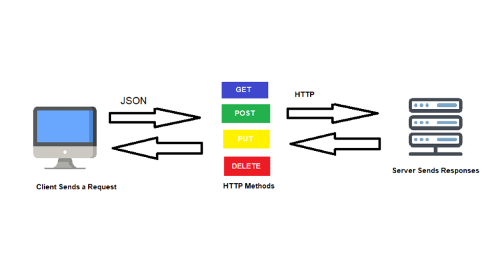

[⌂ Volver al inicio](index.md)

## Índice

1. [HTTP y APIs REST](#1-http-y-apis-rest)
    - [1.1 ResponseEntity](#11-responseentity)
2. [Controladores, JSON y DTOs](#2-controladores-json-y-dtos)
3. [Servicios y organización por capas](#3-servicios-y-organización-por-capas)
4. [Inyección de dependencias](#4-inyección-de-dependencias)
5. [Parámetros de ruta y de consulta](#5-parámetros-de-ruta-y-de-consulta)
6. [Operaciones CRUD](#6-operaciones-crud)
7. [Validación y manejo de excepciones](#7-validación-y-manejo-de-excepciones)
8. [Inicio de sesión con Firebase Authentication](#8-inicio-de-sesión-con-firebase-authentication)
9. [Actividades](#9-actividades)
    - [9.1 Actividad: catálogo de productos con ResponseEntity](#91-actividad-catálogo-de-productos-con-responseentity)


10. [Práctica 1: reservas de una sala](#10-práctica-1-reservas-de-una-sala)
11. [Práctica 2: estrategias de facturación](#11-práctica-2-estrategias-de-facturación)
12. [Práctica 3: telemetría de un rover](#12-práctica-3-telemetría-de-un-rover)
13. [Actividades de ampliación](#actividades-de-ampliación)



## 1. HTTP y APIs REST



Una aplicación web intercambia mensajes mediante el protocolo HTTP. El navegador u otro cliente envía una **petición** al servidor Spring Boot, y el servidor devuelve una **respuesta**. Cada operación se dirige a una URL y utiliza un método HTTP que expresa la intención: consultar, crear, reemplazar o borrar un recurso.

| Método | Intención | Ejemplo |
|---|---|---|
| `GET` | Consultar un recurso o una lista | `GET /reservas/12` |
| `POST` | Crear un recurso | `POST /reservas` |
| `PUT` | Reemplazar o actualizar un recurso | `PUT /reservas/12` |
| `DELETE` | Eliminar un recurso | `DELETE /reservas/12` |

Una respuesta HTTP tiene tres componentes:

1. **Código de estado:** informa del resultado general. Por ejemplo, `200 OK`, `404 Not Found` o `500 Internal Server Error`.
2. **Cabeceras:** metadatos de la respuesta, como `Content-Type: application/json`.
3. **Cuerpo:** los datos devueltos, normalmente JSON en una API REST, o HTML en una aplicación con vistas.

En Chrome se puede inspeccionar el tráfico desde las herramientas de desarrollador: abre **Network (Red)**, genera una petición y selecciona la fila correspondiente para consultar estado, cabeceras y cuerpo.

### Códigos de estado habituales

| Código | Significado | Uso habitual en una API |
|---|---|---|
| `200 OK` | Operación correcta | Consulta, actualización o resultado con cuerpo |
| `201 Created` | Recurso creado | Alta correcta mediante `POST` |
| `202 Accepted` | Petición aceptada | Trabajo que se procesará más adelante |
| `204 No Content` | Operación correcta sin cuerpo | Borrado correcto |
| `400 Bad Request` | Petición no válida | Datos mal formados o reglas de entrada incumplidas |
| `401 Unauthorized` | No hay autenticación válida | Falta un token o no se puede validar |
| `403 Forbidden` | Identidad reconocida, sin permiso | Acceso denegado |
| `404 Not Found` | Recurso inexistente | No se encuentra el identificador solicitado |
| `409 Conflict` | Conflicto con el estado actual | Horario ocupado o recurso duplicado |
| `410 Gone` | Recurso ya no disponible | Estado terminal, como un rover destruido |
| `500 Internal Server Error` | Error inesperado del servidor | Fallo no previsto durante el procesamiento |

El estado HTTP forma parte del contrato de la API. No conviene responder `200 OK` con un texto que diga que hubo un error: el cliente debe poder interpretar correctamente el resultado sin analizar mensajes.

### 1.1 ResponseEntity

`ResponseEntity` es la clase de Spring que representa **la respuesta HTTP completa**: código de estado, cabeceras y cuerpo. Es el elemento que permite al controlador decidir exactamente qué envía al cliente.

#### Por qué se necesita

Cuando un método de un controlador devuelve directamente un objeto, Spring lo convierte a JSON y responde siempre `200 OK`:

```java
@GetMapping("/ultima")
public ReservaDto ultima() {
    return reservaService.ultima();   // siempre 200 OK
}
```

Esto es suficiente en casos simples, pero no permite elegir otro código (`201`, `204`, `404`...) ni añadir cabeceras. Con `ResponseEntity` el método devuelve un objeto que describe la respuesta entera:

```java
@GetMapping("/ultima")
public ResponseEntity<ReservaDto> ultima() {
    ReservaDto reserva = reservaService.ultima();
    return ResponseEntity.ok(reserva);   // 200 OK + cuerpo JSON
}
```

#### El tipo genérico `ResponseEntity<T>`

`ResponseEntity` es una clase **genérica**: el tipo entre `< >` indica la clase del **cuerpo**.

| Declaración | Significado |
|---|---|
| `ResponseEntity<ReservaDto>` | El cuerpo es un `ReservaDto` |
| `ResponseEntity<List<ReservaDto>>` | El cuerpo es una lista de `ReservaDto` |
| `ResponseEntity<Void>` | No hay cuerpo (por ejemplo, un `204 No Content`) |
| `ResponseEntity<?>` | El tipo del cuerpo puede variar (ver más abajo) |

El tipo no cambia el código de estado; solo documenta y comprueba en compilación qué se puede poner en el cuerpo. Spring serializa ese cuerpo a JSON con Jackson, igual que si se devolviera directamente.

#### Cómo se construye una respuesta

`ResponseEntity` ofrece métodos estáticos que funcionan como *builders*: se encadenan para componer la respuesta y terminan con `body(...)` o `build()`.

```java
ResponseEntity.status(HttpStatus.CREATED)   // 1. el código de estado
        .body(reservaCreada);               // 2. el cuerpo, que cierra la construcción
```

Los atajos más habituales:

| Método | Código | Cierre | Uso típico |
|---|---|---|---|
| `ResponseEntity.ok(cuerpo)` | `200 OK` | — | Consulta o actualización correcta |
| `ResponseEntity.status(HttpStatus.CREATED).body(cuerpo)` | `201 Created` | `body` | Alta correcta mediante `POST` |
| `ResponseEntity.accepted().body(cuerpo)` | `202 Accepted` | `body` | Trabajo aceptado, procesado después |
| `ResponseEntity.noContent().build()` | `204 No Content` | `build` | Borrado correcto |
| `ResponseEntity.badRequest().body(error)` | `400 Bad Request` | `body` | Datos de entrada incorrectos |
| `ResponseEntity.notFound().build()` | `404 Not Found` | `build` | Recurso inexistente |
| `ResponseEntity.status(codigo).body(cuerpo)` | El indicado | `body` | Cualquier otro código (`409`, `410`...) |

La diferencia entre `build()` y `body(...)`: **`body(x)`** cierra la respuesta incluyendo un cuerpo; **`build()`** la cierra sin cuerpo. Por eso `notFound()` y `noContent()` solo admiten `build()` (no tienen cuerpo), mientras que `badRequest()` y `status(...)` permiten `body(...)`. `HttpStatus` es la enumeración con los códigos (`HttpStatus.CREATED`, `HttpStatus.CONFLICT`...).

#### `Optional<T>` y respuestas `200`/`404`

Una consulta puede no encontrar nada. Java representa «puede haber un valor o no» con `Optional<T>`: un contenedor que o bien guarda un valor, o bien está vacío (`Optional.empty()`). Evita devolver `null`, que fuerza a comprobaciones constantes y provoca `NullPointerException`.

Un servicio que devuelve la última reserva registrada puede no tener ninguna (si aún no se ha creado nada), así que declara su resultado como `Optional`:

```java
public Optional<ReservaDto> ultima() {
    if (reservas.isEmpty()) {
        return Optional.empty();
    }
    return Optional.of(reservas.get(reservas.size() - 1));
}
```

Los métodos básicos de `Optional` son:

| Método | Qué hace |
|---|---|
| `Optional.of(x)` | Crea un `Optional` con `x` (no puede ser `null`) |
| `Optional.ofNullable(x)` | Crea un `Optional` con `x`, o vacío si `x` es `null` |
| `Optional.empty()` | Crea un `Optional` vacío |
| `isPresent()` | Devuelve `true` si hay valor |
| `isEmpty()` | Devuelve `true` si está vacío |
| `orElse(alternativa)` | Devuelve el valor si lo hay; si está vacío, devuelve la `alternativa` indicada |
| `orElseThrow(() -> excepcion)` | Devuelve el valor si lo hay; si está vacío, lanza la excepción indicada |

`orElse` es la forma más sencilla de sacar el valor de un `Optional`: se le indica qué devolver cuando no hay nada. En un controlador, lo habitual es usar `null` como alternativa y comprobarlo después para decidir el código de estado:

```java
@GetMapping("/ultima")
public ResponseEntity<ReservaDto> ultima() {
    ReservaDto reserva = reservaService.ultima().orElse(null);

    if (reserva == null) {
        return ResponseEntity.notFound().build();   // 404 Not Found
    }
    return ResponseEntity.ok(reserva);              // 200 OK + la reserva
}
```

Se lee así: «obtén la última reserva o `null` si no hay ninguna; si es `null`, responde `404 Not Found`; si no, respóndela con `200 OK`». Aquí el `null` queda acotado a una sola línea del controlador: el servicio sigue sin devolver `null`.

`orElse` también sirve para dar un valor por defecto, por ejemplo `numero.orElse(0)`.

`orElseThrow` evita el `if`: si no hay valor, lanza una excepción. Con una excepción que lleve asociado el código `404` (apartado 7), el controlador ya no necesita comprobar nada:

```java
ReservaDto reserva = reservaService.ultima()
        .orElseThrow(() -> new RecursoNoEncontradoException("No hay reservas"));
```

`() -> new ...` es una expresión lambda sin parámetros: indica «cuando haga falta, crea esta excepción». Basta con copiar esta forma; no hace falta dominar las lambdas para usarla.

#### El comodín `?`: `ResponseEntity<?>`

Un método declarado como `ResponseEntity<ReservaDto>` solo puede devolver un `ReservaDto` en el cuerpo. Pero a veces la misma operación devuelve cuerpos de **clases distintas**: un DTO si todo va bien y un `ErrorDto` si falla.

```java
@PostMapping
public ResponseEntity<?> crear(@RequestBody ReservaCrearDto entrada) {
    if (entrada.duracionHoras() <= 0) {
        return ResponseEntity.badRequest()
                .body(new ErrorDto("La duración debe ser positiva"));  // cuerpo: ErrorDto
    }
    ReservaDto creada = reservaService.crear(entrada);
    return ResponseEntity.status(HttpStatus.CREATED).body(creada);     // cuerpo: ReservaDto
}
```

`?` es el **comodín** de los genéricos: significa «cualquier tipo». Así, `ResponseEntity<?>` admite un cuerpo de cualquier clase. Tiene un coste: se pierde la comprobación de tipos en compilación y la firma ya no documenta qué devuelve la API. Por eso:

- Úsalo solo cuando el cuerpo realmente pueda tener tipos distintos.
- Para errores es preferible lanzar una excepción (apartado 7) y mantener el tipo preciso `ResponseEntity<ReservaDto>`.

#### `ResponseEntity` o excepciones

Hay dos formas de producir una respuesta de error:

| Enfoque | Cómo | Cuándo |
|---|---|---|
| Devolver un `ResponseEntity` | `return ResponseEntity.notFound().build();` | El resultado «no encontrado» es normal y lo decide el controlador |
| Lanzar una excepción | `throw new RecursoNoEncontradoException(...)` | La regla de negocio se incumple en el servicio; el controlador queda sin condicionales |

Ambos se pueden combinar en la misma API. Lo importante es que cada situación devuelva siempre el código HTTP adecuado.

#### Ejemplo completo

Un buscador de palabras sobre un array fijo, sin clases propias: los cuerpos de las respuestas son simplemente textos (`String`) o listas de textos (`List<String>`). Reúne lo visto en este apartado: `Optional`, `orElse` y distintos códigos de estado (`200`, `201`, `400`, `404`, `409`). Las anotaciones de clase y de método se explican en los apartados siguientes; por ahora basta con leer qué responde cada método. El valor que aparece tras `?` en la URL (por ejemplo, `?texto=gat`) llega al método como parámetro, mediante `@RequestParam`, que se explica en el apartado 5.

```java
@RestController
@RequestMapping("/palabras")
public class PalabraController {

    private final List<String> palabras = new ArrayList<>(List.of("casa", "perro", "gato", "coche", "libro", "camino"));

    // 200 OK con todas las palabras
    @GetMapping
    public ResponseEntity<List<String>> listar() {
        return ResponseEntity.ok(palabras);
    }

    // 200 OK con la primera palabra que contiene el texto, o 404 Not Found con un mensaje
    @GetMapping("/buscar")
    public ResponseEntity<String> buscar(@RequestParam String texto) {
        Optional<String> resultado = Optional.empty();
        for (String palabra : palabras) {
            if (palabra.contains(texto)) {
                resultado = Optional.of(palabra);
                break;
            }
        }
        String encontrada = resultado.orElse(null);

        if (encontrada == null) {
            return ResponseEntity.status(HttpStatus.NOT_FOUND)
                    .body("Ninguna palabra contiene \"" + texto + "\"");
        }
        return ResponseEntity.ok(encontrada);
    }

    // 400 Bad Request si la palabra está en blanco, 409 Conflict si ya existe,
    // o 201 Created con la palabra añadida
    @PostMapping("/anadir")
    public ResponseEntity<String> anadir(@RequestParam String palabra) {
        if (palabra.isBlank()) {
            return ResponseEntity.badRequest().body("Indica una palabra");
        }

        for (String existente : palabras) {
            if (existente.equals(palabra)) {
                return ResponseEntity.status(HttpStatus.CONFLICT)
                        .body("La palabra \"" + palabra + "\" ya existe");
            }
        }

        palabras.add(palabra);
        return ResponseEntity.status(HttpStatus.CREATED).body(palabra);
    }
}
```

Qué responde cada petición:

| Petición | Situación | Estado | Cuerpo |
|---|---|---|---|
| `GET /palabras` | Siempre | `200 OK` | Lista con las 6 palabras |
| `GET /palabras/buscar?texto=at` | Hay una palabra que contiene «at» | `200 OK` | `gato` |
| `GET /palabras/buscar?texto=zz` | Ninguna la contiene | `404 Not Found` | Mensaje de texto |
| `POST /palabras/anadir?palabra=uva` | La palabra no existe | `201 Created` | `uva` |
| `POST /palabras/anadir?palabra=casa` | La palabra ya existe | `409 Conflict` | Mensaje de texto |
| `POST /palabras/anadir?palabra=` | Palabra vacía | `400 Bad Request` | Mensaje de texto |

Por ejemplo, `POST /palabras/anadir?palabra=uva` devuelve:

```http
HTTP/1.1 201 Created
Content-Type: text/plain;charset=UTF-8

uva
```

y `GET /palabras/buscar?texto=zz`:

```http
HTTP/1.1 404 Not Found
Content-Type: text/plain;charset=UTF-8

Ninguna palabra contiene "zz"
```

Observa tres detalles:

- `listar`, `buscar` y `anadir` declaran un tipo concreto (`List<String>` y `String`), porque siempre devuelven el mismo tipo de cuerpo, aunque `buscar` y `anadir` lo usen tanto para el éxito como para el error.
- En `buscar`, el `Optional<String>` expresa «puede haber una palabra o no». Se convierte en `404` o `200` con `orElse(null)`.
- `anadir` es un `POST`: modifica datos, por eso responde `201 Created` cuando la palabra se añade y `409 Conflict` cuando ya existía.

## 2. Controladores, JSON y DTOs

### Controladores

Un **controlador** recibe las peticiones HTTP y devuelve la respuesta. En Spring se declara con `@RestController`; `@RequestMapping` define la ruta base y las anotaciones `@GetMapping`, `@PostMapping`, `@PutMapping` y `@DeleteMapping` asocian cada método Java con un método HTTP.

```java
@RestController
@RequestMapping("/saludos")
public class SaludoController {

    @GetMapping
    public String saludar() {
        return "Hola";
    }
}
```

`GET /saludos` ejecuta el método y devuelve su resultado como cuerpo de la respuesta, con `200 OK`.

### DTOs: datos de entrada y salida

Un **DTO** (*Data Transfer Object*) representa los datos que cruzan el límite de la API. Separa el contrato HTTP de las clases internas de negocio y permite controlar qué información se expone.

Por ejemplo, un DTO de entrada para reservar una sala no necesita un identificador: ese valor lo asigna el servidor. El DTO de respuesta sí puede incluirlo.

```java
public record ReservaCrearDto(
        String nombre,
        int horaInicio,
        int duracionHoras) {
}

public record ReservaDto(
        long id,
        String nombre,
        int horaInicio,
        int duracionHoras) {
}

public record ErrorDto(String mensaje) {
}
```

### Conversión a JSON

Spring utiliza Jackson para convertir el JSON recibido en objetos Java mediante `@RequestBody` y para convertir los objetos devueltos en JSON. Una petición de ejemplo podría ser:

```http
POST /reservas
Content-Type: application/json

{
  "nombre": "Lucía Martín",
  "horaInicio": 10,
  "duracionHoras": 2
}
```

```java
@PostMapping
public ReservaDto crear(@RequestBody ReservaCrearDto entrada) {
    // ...
}
```

La respuesta de creación puede contener el identificador generado:

```http
HTTP/1.1 201 Created
Content-Type: application/json

{
  "id": 1,
  "nombre": "Lucía Martín",
  "horaInicio": 10,
  "duracionHoras": 2
}
```

## 3. Servicios y organización por capas

### 3.1. ¿Por qué organizar el código en capas?

Cuando una aplicación crece, lo más peligroso no es la cantidad de código, sino que **todo esté mezclado**. Imagina un único método que recibe la petición HTTP, valida los datos, aplica las reglas de la aplicación, consulta la base de datos y construye la respuesta. Funcionaría, pero:

- Sería difícil de leer: ¿dónde termina lo que es HTTP y empieza la lógica?
- Sería difícil de modificar: cambiar una regla obligaría a tocar código web.
- Sería difícil de probar: para comprobar una regla tendrías que simular una petición completa.
- No se podría reutilizar: si otra parte de la aplicación necesita esa regla, habría que copiarla.

La solución es **dividir la aplicación en capas**, de forma que cada una tenga una única responsabilidad. Este principio se conoce como **separación de responsabilidades**.

---

### 3.2. El flujo habitual en una API Spring

En una API Spring sencilla, una petición recorre las capas así:

```text
Petición HTTP -> Controller -> Service -> respuesta
```

Y la respuesta hace el camino de vuelta:

```text
Cliente  --(petición)-->  Controller  --(llama a)-->  Service
Cliente  <--(respuesta)-- Controller  <--(resultado)-- Service
```

Cada capa tiene su papel:

- **Controller (`@RestController`):** es la puerta de entrada. Recibe la petición, extrae los datos, llama al servicio y prepara la respuesta HTTP.
- **Service (`@Service`):** es el "cerebro". Ejecuta las operaciones y las reglas propias de la aplicación.

> En aplicaciones con base de datos suele añadirse una tercera capa, el **repositorio** (`@Repository`), encargada de leer y guardar datos. El flujo pasa a ser `Controller -> Service -> Repository -> base de datos`. Por ahora trabajamos solo con controlador y servicio.

#### Qué debe y qué no debe hacer cada capa

| Capa | Sí debe | No debe |
|---|---|---|
| **Controller** | Recibir la petición, leer el cuerpo, parámetros y rutas, llamar al servicio, devolver la respuesta y el código HTTP. | Contener reglas de negocio, cálculos o decisiones sobre los datos. |
| **Service** | Aplicar reglas, hacer comprobaciones y cálculos, coordinar operaciones. | Conocer detalles de HTTP (rutas, códigos de estado, cabeceras). |

Una buena pregunta para saber dónde va un fragmento de código es: *"¿esto cambiaría si en lugar de una API web tuviera una aplicación de consola?"*. Si la respuesta es **no**, probablemente pertenece al servicio.

---

### 3.3. Estructura de paquetes del proyecto

Por ahora, el código Java del proyecto puede organizarse así. `com.ejemplo.aplicacion` es un paquete de ejemplo: en tu proyecto tendrá el nombre que hayas configurado.

```text
src/
└── main/
    └── java/
        └── com/ejemplo/aplicacion/
            ├── Aplicacion.java
            ├── controller/
            │   └── InventarioController.java
            ├── model/
            │   └── Producto.java
            └── service/
                └── InventarioService.java
```

Qué contiene cada elemento:

- **`Aplicacion.java`**: la clase principal, anotada con `@SpringBootApplication`. Es el punto de arranque.
- **`controller`**: las clases que reciben las peticiones.
- **`service`**: las clases que realizan las operaciones y aplican las reglas.
- **`model`**: las clases que representan los elementos del dominio, como un producto o una reserva.

Los nombres de los paquetes pueden variar (`controllers`, `services`, `domain`, `entity`...), pero mantener cada responsabilidad en su lugar ayuda a encontrar y entender el código.

> **Importante:** `controller`, `service` y `model` deben quedar **dentro** del paquete de la clase principal. Spring escanea ese paquete y sus subpaquetes para encontrar las clases anotadas; si una clase queda fuera, no se registrará.

#### Ejemplo de clase del modelo

Una clase del modelo solo representa datos. Por ejemplo:

```java
public record Producto(Long id, String nombre, int unidades) {
}
```

No tiene lógica de la aplicación ni sabe nada de HTTP: simplemente describe qué es un producto.

---

### 3.4. ¿Qué es un servicio?

En este contexto, un **servicio** es una clase Java que reúne operaciones relacionadas con una tarea de la aplicación.

Ejemplos:

- Un servicio de **inventario** puede comprobar si hay unidades suficientes, calcular el stock restante o registrar una entrada de mercancía.
- Un servicio de **reservas** puede comprobar si una reserva cumple las reglas: fechas válidas, plazas disponibles, antelación mínima...

Algunas características importantes:

- **No es una URL.** Los clientes no llaman directamente al servicio.
- **No recibe la petición HTTP.** De eso se encarga el controlador.
- **Es una clase normal de Java.** Sus métodos pueden llamarse desde cualquier sitio, también desde otros servicios o desde tests.

El flujo de trabajo es: el controlador le pide al servicio que haga el trabajo y utiliza el resultado para decidir qué respuesta enviar.

---

### 3.5. ¿Por qué separar el servicio?

Separar el servicio del controlador aporta varias ventajas:

1. **Responsabilidades claras.** El controlador se ocupa de HTTP y el servicio de las reglas de negocio. Cada clase tiene un trabajo claro.
2. **Reutilización.** Si la misma regla se necesita desde varias operaciones (por ejemplo, desde un endpoint de consulta y desde otro de reserva), se escribe una vez en el servicio y se llama desde ambos.
3. **Facilidad para probar.** Un servicio se puede probar con un test normal de Java, sin levantar el servidor ni enviar peticiones web.
4. **Mantenimiento más sencillo.** Si cambia una regla, se modifica el servicio sin tocar el controlador. Si cambia la ruta o el formato de la respuesta, se modifica el controlador sin tocar las reglas.
5. **Código más legible.** Los controladores se quedan cortos y fáciles de leer.

#### Comparación: sin separar y separando

**Sin separar** (todo en el controlador):

```java
@PostMapping("/disponibilidad")
public boolean hayUnidades(@RequestBody ComprobarInventarioRequest entrada) {
    // regla de negocio mezclada con el controlador
    return entrada.solicitadas() > 0
            && entrada.disponibles() >= entrada.solicitadas();
}
```

**Separando** (el controlador delega):

```java
@PostMapping("/disponibilidad")
public boolean hayUnidades(@RequestBody ComprobarInventarioRequest entrada) {
    return inventarioService.hayUnidades(
            entrada.disponibles(), entrada.solicitadas());
}
```

En el segundo caso, el controlador no sabe *cómo* se decide si hay unidades; solo sabe a quién preguntar.

---

### 3.6. ¿Cómo se define y se usa un servicio?

#### Paso 1: crear el servicio

Se crea una clase y se anota con `@Service`. Sus métodos representan las operaciones que ofrece:

```java
@Service
public class InventarioService {

    public boolean hayUnidades(int disponibles, int solicitadas) {
        return solicitadas > 0 && disponibles >= solicitadas;
    }
}
```

Este método devuelve `true` solo si se piden unidades (más de 0) y hay suficientes disponibles. Esa es una **regla de negocio**, y por eso vive en el servicio.

#### Paso 2: recibir los datos de la petición

El cliente envía los datos en el cuerpo de una petición:

```http
POST /inventario/disponibilidad
Content-Type: application/json

{
  "disponibles": 8,
  "solicitadas": 3
}
```

Para representar esos datos en Java se crea una clase (aquí, un `record`) cuyos componentes coinciden con los campos del JSON:

```java
public record ComprobarInventarioRequest(int disponibles, int solicitadas) {
}
```

`@RequestBody` se encarga de convertir ese JSON en un objeto Java.

#### Paso 3: crear el controlador

El controlador pasa los valores al servicio y devuelve el resultado:

```java
@RestController
@RequestMapping("/inventario")
public class InventarioController {

    private final InventarioService inventarioService;

    public InventarioController(InventarioService inventarioService) {
        this.inventarioService = inventarioService;
    }

    @PostMapping("/disponibilidad")
    public boolean hayUnidades(@RequestBody ComprobarInventarioRequest entrada) {
        return inventarioService.hayUnidades(
                entrada.disponibles(), entrada.solicitadas());
    }
}
```

Elementos del controlador:

- **`@RestController`**: indica que la clase atiende peticiones HTTP y que lo que devuelven sus métodos se envía como cuerpo de la respuesta.
- **`@RequestMapping("/inventario")`**: prefijo común de todas las rutas de esta clase.
- **`@PostMapping("/disponibilidad")`**: este método atiende peticiones `POST` a `/inventario/disponibilidad`.
- **`@RequestBody`**: convierte el JSON recibido en un `ComprobarInventarioRequest`.
- **Constructor**: Spring lo usa para entregar el `InventarioService` al controlador (se explica en detalle en la sección de inyección de dependencias).

#### Paso 4: el resultado

En este ejemplo, `true` indica que se pueden atender las unidades solicitadas y `false` que no.

Con la petición anterior (`disponibles: 8`, `solicitadas: 3`), la respuesta sería:

```http
HTTP/1.1 200 OK
Content-Type: application/json

true
```

El controlador recibe la petición; la comprobación sigue estando en el servicio.

#### Recorrido completo de una petición

```text
1. El cliente envía POST /inventario/disponibilidad con el JSON.
2. Spring dirige la petición al método hayUnidades del controlador.
3. @RequestBody convierte el JSON en un ComprobarInventarioRequest.
4. El controlador llama a inventarioService.hayUnidades(8, 3).
5. El servicio aplica la regla y devuelve true.
6. El controlador devuelve ese valor y Spring lo envía como respuesta.
```

---

### 3.7. `@Service` y `@Component`

La anotación `@Service` permite que Spring detecte y gestione esa clase para poder proporcionársela al controlador. Al arrancar, Spring la registra como **bean** (un objeto que él crea y administra).

Hay otra anotación en Spring: `@Component`, que también registra una clase, pero es más general. `@Service` expresa que la clase contiene operaciones de negocio.

En realidad, `@Service`, `@Repository` y `@RestController` son **especializaciones** de `@Component`: Spring las trata igual a la hora de registrarlas, pero cada una comunica un propósito distinto.

| Anotación | Se usa en | Significado |
|---|---|---|
| `@Component` | Cualquier clase que no encaje en las demás | Componente genérico. |
| `@Service` | Clases de la capa de servicio | Contiene operaciones y reglas de negocio. |
| `@Repository` | Clases de acceso a datos | Lee y guarda información. |
| `@RestController` | Clases de la capa web | Atiende peticiones HTTP y devuelve datos. |

¿Por qué usar `@Service` si `@Component` también funcionaría? Porque **el código se lee mejor**: al ver `@Service`, cualquiera sabe en qué capa está la clase y qué se espera de ella. Además, algunas herramientas y funciones de Spring pueden tratar de forma especial ciertas anotaciones.

---

## 4. Inyección de dependencias

### 4.1. ¿Qué es una dependencia?

Casi ninguna clase trabaja sola. Lo normal es que, para hacer su trabajo, necesite apoyarse en otras clases. Esa clase que se necesita se llama **dependencia**.

En nuestro ejemplo:

- `InventarioController` recibe las peticiones HTTP y devuelve respuestas.
- `InventarioService` contiene la lógica para decidir si hay unidades suficientes.

El controlador **depende** del servicio: sin él no podría responder a la petición. Por tanto, `InventarioService` es una dependencia de `InventarioController`.

```
Cliente HTTP ──► InventarioController ──► InventarioService
                      (depende de)
```

---

### 4.2. El problema: crear las dependencias a mano

La forma más intuitiva de conseguir una dependencia es crearla con `new`:

```java
@RestController
@RequestMapping("/inventario")
public class InventarioController {

    private final InventarioService inventarioService = new InventarioService();

    @PostMapping("/disponibilidad")
    public boolean hayUnidades(@RequestBody ComprobarInventarioRequest entrada) {
        return inventarioService.hayUnidades(
                entrada.disponibles(), entrada.solicitadas());
    }
}
```

Funciona, pero tiene varios inconvenientes:

1. **Acoplamiento fuerte**: el controlador queda atado a una implementación concreta. Si mañana quieres usar otra versión del servicio, tienes que modificar el controlador.
2. **Responsabilidad extra**: el controlador debería ocuparse de las peticiones HTTP, no de construir y configurar otros objetos.
3. **Dependencias en cadena**: si `InventarioService` necesitara a su vez un `InventarioRepository`, y este un `DataSource`, el controlador tendría que construir toda la cadena.
4. **Difícil de probar**: en un test no puedes sustituir el servicio real por uno falso (un *mock*), porque el controlador lo crea él mismo.
5. **Objetos duplicados**: cada clase que haga `new InventarioService()` tendrá su propia instancia, sin control sobre ellas.

---

### 4.3. La solución: inversión de control

La idea clave es **invertir el control**: en lugar de que cada clase fabrique lo que necesita, **otra pieza se encarga de crear los objetos y entregárselos**.

En Spring, esa pieza es el **contenedor de Spring** (también llamado *contexto de aplicación* o `ApplicationContext`). Este contenedor:

1. Crea los objetos de tu aplicación.
2. Los configura.
3. Resuelve qué objeto necesita cada clase.
4. Se los entrega cuando los necesitan.

Esto se conoce como **inversión de control (IoC)**, y la técnica concreta para entregar los objetos es la **inyección de dependencias (DI)**.

> **Definición:** la inyección de dependencias consiste en que una clase **recibe** de fuera los objetos que necesita, en lugar de crearlos ella misma.

---

### 4.4. Beans: los objetos que gestiona Spring

Un **bean** es un objeto que Spring crea, configura y administra durante la ejecución de la aplicación. No es un tipo especial de objeto: es una clase normal de Java cuyo ciclo de vida controla Spring.

Para que Spring registre una clase como bean, se utilizan **anotaciones de estereotipo**:

| Anotación | Uso habitual |
|---|---|
| `@Component` | Componente genérico. |
| `@Service` | Clases con la lógica de negocio. |
| `@Repository` | Clases de acceso a datos. |
| `@RestController` | Controladores que exponen una API REST. |
| `@Configuration` | Clases que definen beans manualmente con `@Bean`. |

En nuestro ejemplo:

```java
@Service
public class InventarioService {

    public boolean hayUnidades(int disponibles, int solicitadas) {
        return disponibles >= solicitadas;
    }
}
```

```java
public record ComprobarInventarioRequest(int disponibles, int solicitadas) {}
```

Tanto `InventarioService` (por `@Service`) como `InventarioController` (por `@RestController`) se convierten en beans.

#### ¿Cómo los encuentra Spring?

Spring Boot realiza un **escaneo de componentes** (*component scan*). Al arrancar, recorre el paquete de la clase principal (la anotada con `@SpringBootApplication`) y todos sus subpaquetes, buscando clases con anotaciones de estereotipo.

```
com.ejemplo.tienda
├── TiendaApplication.java        ← clase principal (@SpringBootApplication)
├── controller
│   └── InventarioController.java ← se detecta
└── service
    └── InventarioService.java    ← se detecta
```

> **Importante:** si una clase con `@Service` está **fuera** del paquete de la clase principal, Spring no la encontrará y la aplicación fallará al arrancar.

---

### 4.5. Primer ejemplo: inyección por campo con `@Autowired`

La anotación `@Autowired` le indica a Spring: *"aquí necesito un bean de este tipo, búscalo y asígnalo"*.

```java
@RestController
@RequestMapping("/inventario")
public class InventarioController {

    @Autowired
    private InventarioService inventarioService;

    @PostMapping("/disponibilidad")
    public boolean hayUnidades(@RequestBody ComprobarInventarioRequest entrada) {
        return inventarioService.hayUnidades(
                entrada.disponibles(), entrada.solicitadas());
    }
}
```

Esta forma se llama **inyección por campo**, porque la anotación se coloca directamente sobre el atributo.

#### ¿Qué ocurre al arrancar la aplicación?

1. Spring escanea los paquetes y encuentra `InventarioService` (`@Service`) y `InventarioController` (`@RestController`).
2. Crea primero el `InventarioService`, porque el controlador lo necesita.
3. Crea el `InventarioController`.
4. Ve el `@Autowired` sobre el campo `inventarioService`, busca un bean de tipo `InventarioService` y lo **asigna** al campo.
5. Cuando llega una petición a `POST /inventario/disponibilidad`, el controlador ya tiene el servicio listo y puede llamar a `inventarioService.hayUnidades(...)`.

Fíjate en que en ningún momento escribimos `new InventarioService()`. Esa tarea la hace Spring.

#### Ventajas de la inyección por campo

- Es muy corta y fácil de leer.
- Se ve junto al atributo qué dependencia se necesita.

#### Inconvenientes

- El campo **no puede ser `final`**, así que el objeto no es inmutable.
- Para hacer tests unitarios sin Spring hay que usar reflexión o herramientas especiales para inyectar el mock.
- Las dependencias quedan **ocultas**: mirando el constructor (que no existe) no sabes qué necesita la clase.
- Es muy fácil acumular muchas dependencias sin darte cuenta de que la clase hace demasiadas cosas.

---

### 4.6. Otras formas de inyección

Spring permite tres formas de inyectar una dependencia.

#### a) Inyección por constructor (la recomendada)

```java
@RestController
@RequestMapping("/inventario")
public class InventarioController {

    private final InventarioService inventarioService;

    public InventarioController(InventarioService inventarioService) {
        this.inventarioService = inventarioService;
    }

    @PostMapping("/disponibilidad")
    public boolean hayUnidades(@RequestBody ComprobarInventarioRequest entrada) {
        return inventarioService.hayUnidades(
                entrada.disponibles(), entrada.solicitadas());
    }
}
```

Spring llama al constructor y le pasa el bean `InventarioService`.

- Desde Spring 4.3, si la clase tiene **un único constructor**, `@Autowired` es opcional (y suele omitirse).
- Si la clase tiene **varios constructores**, hay que marcar con `@Autowired` el que Spring debe usar.

**Ventajas:**

- Las dependencias son **obligatorias y visibles**: no se puede crear el objeto sin ellas.
- El campo puede ser `final`, lo que garantiza que no cambia.
- Es sencillo hacer tests: `new InventarioController(servicioFalso)`.
- Si una clase necesita demasiadas dependencias, el constructor se vuelve enorme y es una señal de que hay que dividirla.

#### b) Inyección por constructor con Lombok

Si el proyecto usa Lombok, `@RequiredArgsConstructor` genera el constructor para todos los campos `final`:

```java
@RestController
@RequestMapping("/inventario")
@RequiredArgsConstructor
public class InventarioController {

    private final InventarioService inventarioService;

    @PostMapping("/disponibilidad")
    public boolean hayUnidades(@RequestBody ComprobarInventarioRequest entrada) {
        return inventarioService.hayUnidades(
                entrada.disponibles(), entrada.solicitadas());
    }
}
```

Es la forma más limpia y muy habitual en proyectos reales.

#### c) Inyección por *setter*

```java
@RestController
@RequestMapping("/inventario")
public class InventarioController {

    private InventarioService inventarioService;

    @Autowired
    public void setInventarioService(InventarioService inventarioService) {
        this.inventarioService = inventarioService;
    }
    ...
}
```

Se usa para dependencias **opcionales** o que pueden cambiar después de crear el objeto. Es poco frecuente.

#### Comparativa

| Característica | Campo | Constructor | Setter |
|---|---|---|---|
| Código necesario | Mínimo | Medio (o mínimo con Lombok) | Medio |
| Permite `final` | No | **Sí** | No |
| Dependencias visibles | No | **Sí** | Parcialmente |
| Facilidad en tests unitarios | Baja | **Alta** | Media |
| Recomendada | Solo en ejemplos sencillos | **Sí, por defecto** | Para dependencias opcionales |

> En estos apuntes usamos inyección por campo porque es la forma más directa de ver `@Autowired` en acción. En proyectos reales, la inyección por constructor suele ser la preferida.

---

### 4.7. ¿Cómo decide Spring qué bean inyectar?

Spring busca primero por **tipo**. Si pides un `InventarioService`, buscará un bean de ese tipo.

Normalmente solo hay uno y no hay problema. Pero si el tipo es una **interfaz** con varias implementaciones, aparece la ambigüedad:

```java
public interface NotificadorService {
    void notificar(String mensaje);
}

@Service
public class EmailNotificador implements NotificadorService { ... }

@Service
public class SmsNotificador implements NotificadorService { ... }
```

Si inyectas `NotificadorService`, Spring no sabe cuál elegir y lanza una excepción. Hay dos soluciones:

**`@Primary`**: marca una implementación como la preferida por defecto.

```java
@Service
@Primary
public class EmailNotificador implements NotificadorService { ... }
```

**`@Qualifier`**: indica explícitamente cuál quieres en cada punto de inyección.

```java
@Autowired
@Qualifier("smsNotificador")
private NotificadorService notificador;
```

El nombre por defecto de un bean es el nombre de la clase con la primera letra en minúscula (`SmsNotificador` → `smsNotificador`).

---

### 4.8. Ciclo de vida y *scope* de los beans

Por defecto, Spring crea **una única instancia** de cada bean y la comparte en toda la aplicación. Esto se llama *scope* **singleton**.

Por eso, todas las clases que inyecten `InventarioService` reciben **el mismo objeto**. Es una de las razones por las que los servicios no deberían guardar datos mutables de una petición concreta en sus atributos: al compartirse entre todas las peticiones, podrían mezclarse datos de distintos usuarios.

Existen otros *scopes* (como `prototype`, que crea una instancia nueva cada vez, o `request`/`session` en aplicaciones web), pero el singleton es el que usarás casi siempre.

---

## 5. Parámetros de ruta y de consulta

### PathVariable

`@PathVariable` enlaza una parte variable de la ruta con un parámetro Java. Se utiliza para dirigirse a un recurso concreto:

```java
@GetMapping("/{id}")
public ReservaDto buscar(@PathVariable("id") long id) {
    return reservaService.buscar(id);
}
```

La ruta `GET /reservas/12` invoca el método con `id = 12`. El nombre del parámetro entre llaves (`{id}`) debe coincidir con el valor de `@PathVariable`, o puede omitirse el nombre si el compilador conserva los nombres de parámetros.

### RequestParam

`@RequestParam` enlaza un parámetro de consulta, es decir, lo que aparece tras el `?` en la URL. Se utiliza para filtrar, ordenar o configurar una operación:

```java
@GetMapping
public List<ReservaDto> listar(@RequestParam(required = false) String nombre) {
    return reservaService.listar(nombre);
}
```

`GET /reservas?nombre=Lucia` usa un parámetro de consulta, mientras que `GET /reservas/12` identifica el recurso en el propio camino de la URL. Como regla general: `@PathVariable` identifica *qué* recurso, `@RequestParam` modifica *cómo* se consulta.

## 6. Operaciones CRUD

A continuación se aplica `ResponseEntity` (explicado en el apartado 1) a cada operación del ciclo CRUD.

### Crear (POST) y consultar (GET)

`POST` crea un recurso a partir del cuerpo de la petición y responde `201 Created`; `GET` lo consulta.

```java
@PostMapping
public ResponseEntity<?> crear(@RequestBody ReservaCrearDto entrada) {
    int horaFin = entrada.horaInicio() + entrada.duracionHoras();
    if (entrada.horaInicio() < 9
            || entrada.horaInicio() >= 20
            || entrada.duracionHoras() <= 0
            || horaFin > 20) {
        return ResponseEntity.badRequest()
                .body(new ErrorDto("La reserva debe quedar dentro del horario 9-20"));
    }

    ReservaDto creada = reservaService.crear(entrada);
    return ResponseEntity.status(HttpStatus.CREATED).body(creada);
}
```

Para los errores esperados también se pueden lanzar excepciones que extienden `ResponseStatusException`, como se explica en el apartado 7; así el controlador queda libre de condicionales de error.

### Actualizar (PUT)

`PUT` actualiza o reemplaza un recurso identificado por su URL. Habitualmente, el cliente envía la representación completa que quiere guardar. Es **idempotente**: repetir la misma petición deja el recurso en el mismo estado final.

```java
@PutMapping("/{id}")
public ResponseEntity<ReservaDto> actualizar(
        @PathVariable long id,
        @RequestBody ReservaActualizarDto entrada) {
    ReservaDto actualizada = reservaService.actualizar(id, entrada).orElse(null);

    if (actualizada == null) {
        return ResponseEntity.notFound().build();
    }
    return ResponseEntity.ok(actualizada);
}
```

Si el diseño solo permite cambiar algunos campos, debe definirse claramente qué campos se actualizan; no se deben borrar accidentalmente los que el cliente no envíe.

### Eliminar (DELETE)

`DELETE` elimina el recurso identificado por la ruta. También es idempotente respecto al estado final del servidor: después de borrarlo, el recurso ya no existe. Una API puede contestar `404` al intentar borrarlo otra vez, aunque el estado no haya cambiado.

```java
@DeleteMapping("/{id}")
public ResponseEntity<Void> eliminar(@PathVariable long id) {
    boolean eliminado = reservaService.eliminar(id);
    return eliminado
            ? ResponseEntity.noContent().build()
            : ResponseEntity.notFound().build();
}
```

`204 No Content` es una respuesta adecuada cuando el borrado se completa y no hace falta devolver un cuerpo.

## 7. Validación y manejo de excepciones

### Validación de los datos de entrada

Para que los datos inválidos no lleguen a la lógica de negocio, se pueden añadir restricciones de Bean Validation a los DTOs (requiere la dependencia `spring-boot-starter-validation`), por ejemplo `@NotBlank`, `@Min` o `@Max`, y validar el cuerpo con `@Valid`:

```java
public record ReservaCrearDto(
        @NotBlank String nombre,
        @Min(9) @Max(19) int horaInicio,
        @Min(1) int duracionHoras) {
}
```

```java
@PostMapping
public ResponseEntity<ReservaDto> crear(@Valid @RequestBody ReservaCrearDto entrada) {
    return ResponseEntity.status(HttpStatus.CREATED)
            .body(reservaService.crear(entrada));
}
```

Si el cuerpo incumple alguna restricción, Spring responde automáticamente `400 Bad Request` sin ejecutar el método.

### Excepciones

Las excepciones representan situaciones que impiden completar una operación. En una API, el servidor debe convertirlas en respuestas HTTP con el código adecuado, sin exponer trazas, consultas internas ni detalles sensibles.

Spring ofrece `ResponseStatusException`, una excepción que lleva asociado un código de estado HTTP. Si se lanza desde un controlador o un servicio, Spring responde directamente con ese código, sin necesidad de escribir ningún manejador. Para no repetir el código y el mensaje en cada punto, se crean excepciones propias que **extienden** `ResponseStatusException`:

```java
public class RecursoNoEncontradoException extends ResponseStatusException {
    public RecursoNoEncontradoException(String mensaje) {
        super(HttpStatus.NOT_FOUND, mensaje);
    }
}
```

```java
public class ReservaSolapadaException extends ResponseStatusException {
    public ReservaSolapadaException() {
        super(HttpStatus.CONFLICT, "La sala ya está ocupada en ese horario");
    }
}
```

```java
public class DatosNoValidosException extends ResponseStatusException {
    public DatosNoValidosException(String mensaje) {
        super(HttpStatus.BAD_REQUEST, mensaje);
    }
}
```

El servicio lanza la excepción cuando se incumple una regla de negocio y el controlador no necesita ningún `if` ni `try/catch`:

```java
public ReservaDto buscar(long id) {
    ReservaDto reserva = reservas.get(id);
    if (reserva == null) {
        throw new RecursoNoEncontradoException("No existe la reserva " + id);
    }
    return reserva;
}
```

```java
@GetMapping("/{id}")
public ReservaDto buscar(@PathVariable long id) {
    return reservaService.buscar(id);
}
```

Si `GET /reservas/99` no encuentra el recurso, la respuesta será `404 Not Found`. El mensaje de la excepción queda disponible como motivo del error; según la configuración de Spring Boot (`server.error.include-message`) puede no incluirse en el cuerpo de la respuesta, lo cual es lo recomendable para no exponer información interna.

Asigna un código adecuado a cada error esperado (`400` para datos inválidos, `404` para recursos inexistentes, `409` para conflictos) y deja que los errores inesperados terminen como `500 Internal Server Error`.

## 8. Inicio de sesión con Firebase Authentication

Firebase Authentication permite que el cliente inicie sesión mediante los proveedores configurados (correo, Google u otros). El flujo recomendado para una API Spring es:

1. El cliente autentica al usuario mediante el SDK de Firebase.
2. Firebase devuelve un **ID token** firmado y de duración limitada.
3. El cliente envía el token a Spring por HTTPS, normalmente en la cabecera `Authorization: Bearer <idToken>`.
4. El backend verifica la firma, el emisor, el proyecto destinatario y la caducidad mediante **Firebase Admin SDK**.
5. Solo después de validar el token se utiliza el UID o las reclamaciones verificadas para identificar al usuario y autorizar la operación.

El backend **no** debe recibir ni almacenar la contraseña de Firebase. Un UID enviado en el cuerpo de la petición tampoco demuestra la identidad del usuario: la identidad se obtiene de las reclamaciones del token verificado.

### DTO y servicio de verificación

Para una demostración didáctica se puede enviar el ID token en el cuerpo. En una API protegida de producción es preferible validarlo en un filtro de seguridad desde la cabecera `Authorization`.

```java
public record LoginFirebaseDto(String idToken) {
}

public record UsuarioAutenticadoDto(String uid, String email) {
}
```

El servicio encapsula la llamada al SDK:

```java
@Service
public class FirebaseAuthService {
    private final FirebaseAuth firebaseAuth;

    @Autowired
    public FirebaseAuthService(FirebaseAuth firebaseAuth) {
        this.firebaseAuth = firebaseAuth;
    }

    public UsuarioAutenticadoDto verificar(String idToken) {
        try {
            FirebaseToken token = firebaseAuth.verifyIdToken(idToken);
            return new UsuarioAutenticadoDto(token.getUid(), token.getEmail());
        } catch (FirebaseAuthException e) {
            throw new TokenInvalidoException();
        }
    }
}
```

El bean `FirebaseAuth` debe inicializarse una sola vez al arrancar Spring y configurarse con credenciales de servidor. En local se pueden usar las credenciales de aplicación predeterminadas; en despliegues, utiliza la identidad de servicio del entorno. No incluyas archivos JSON de cuentas de servicio, claves privadas ni tokens en el repositorio.

### Endpoint de ejemplo

```java
@RestController
@RequestMapping("/auth")
public class AuthController {
    private final FirebaseAuthService firebaseAuthService;

    @Autowired
    public AuthController(FirebaseAuthService firebaseAuthService) {
        this.firebaseAuthService = firebaseAuthService;
    }

    @PostMapping("/login")
    public ResponseEntity<UsuarioAutenticadoDto> login(
            @RequestBody LoginFirebaseDto entrada) {
        return ResponseEntity.ok(
                firebaseAuthService.verificar(entrada.idToken()));
    }
}
```

El servicio convierte los errores de verificación en una excepción propia que extiende `ResponseStatusException` con `401 Unauthorized`, sin exponer detalles internos del SDK:

```java
public class TokenInvalidoException extends ResponseStatusException {
    public TokenInvalidoException() {
        super(HttpStatus.UNAUTHORIZED, "El token de Firebase no es válido");
    }
}
```

El cliente obtiene el token con Firebase y lo envía a `POST /auth/login`. Si no se puede verificar, la aplicación responde con `401 Unauthorized`, no con un usuario vacío ni con `200 OK`. En una aplicación real también se protegen las rutas con Spring Security.

La verificación del token autentica al usuario, pero no concede automáticamente todos los permisos. La autorización (por ejemplo, roles o acceso a un recurso propio) se decide en el backend utilizando reclamaciones verificadas y reglas de negocio. Usa siempre HTTPS y no registres tokens completos.

## 9. Actividades

### 9.1 Actividad 1: catálogo de productos con ResponseEntity

Crea un controlador Spring Boot sencillo para consultar y modificar un catálogo de productos, elegir el código de estado adecuado en cada caso y devolver cuerpos con o sin contenido según proceda. Los datos se mantienen en memoria, en una lista dentro del propio controlador. La actividad utiliza tres operaciones `GET` y un `POST`, y ninguna recibe datos en el cuerpo de la petición.


#### Clases del enunciado

- **`Producto`:** representa un producto del catálogo, con `id` (número), `nombre` (texto) y `precio` (decimal).
- **`Respuesta`:** clase propia que se usa como cuerpo cuando hay que devolver un mensaje al cliente.

#### Endpoints solicitados

| Operación | Respuesta esperada |
|---|---|
| `GET /productos` | `200 OK` con la lista de `Producto`; si la lista está vacía, `404 Not Found` con una `Respuesta` («No hay productos») |
| `GET /productos/buscar?id=2` | `200 OK` con el `Producto` cuyo `id` se pasa como parámetro de consulta, o `404 Not Found` con una `Respuesta` si no existe ningún producto con ese `id` |
| `GET /productos/resumen` | `200 OK` con una `Respuesta` como «Hay 3 productos», o `204 No Content` sin cuerpo si no hay ninguno |
| `POST /productos/nuevo` | `201 Created` con el `Producto` creado (nombre «Producto N», precio fijo, `id` siguiente al último); si ya hay 5 productos, `409 Conflict` con una `Respuesta` («El catálogo está lleno») |

#### Ten en cuenta

1. `GET /productos`, `GET /productos/buscar` y `POST /productos/nuevo` pueden devolver cuerpos de clases distintas (`Producto`, `List<Producto>` o `Respuesta`).
2. `GET /productos/buscar` recibe el `id` como parámetro de consulta. El método que busca el producto devuelve un `Optional<Producto>`, y el controlador lo convierte en respuesta con `orElse`, tal como se explica en 1.1.
3. Las respuestas sin cuerpo se construyen con `build()` y las que llevan cuerpo, con `body(...)`.
4. Cada endpoint devuelve siempre el código de estado indicado en la tabla.

#### Comprobación

La lista empieza con tres productos. Prueba los `GET` en el navegador y el `POST` con Postman, y comprueba la tabla con el estado que devuelve tu API. Ejecútalos en este orden, sin reiniciar la aplicación:

| Orden | Petición | Situación | Estado esperado | Estado obtenido |
|---|---|---|---|---|
| 1 | `GET /productos` | Con 3 productos | `200` | |
| 2 | `GET /productos/buscar?id=2` | El producto 2 existe | `200` | |
| 3 | `GET /productos/buscar?id=99` | No existe ese producto | `404` | |
| 4 | `GET /productos/resumen` | Con 3 productos | `200` | |
| 5 | `POST /productos/nuevo` | Hay 3, pasa a 4 | `201` | |
| 6 | `POST /productos/nuevo` | Hay 4, pasa a 5 | `201` | |
| 7 | `POST /productos/nuevo` | Hay 5, catálogo lleno | `409` | |



## 10. Práctica 1: reservas de una sala

### Objetivo

Construye una API REST para administrar las reservas de una única sala durante el día actual. Los datos permanecen en memoria; no hace falta conectar una base de datos.

### Modelo y reglas

Cada reserva incluye un identificador generado por el sistema, el nombre de quien reserva, una hora de inicio expresada como hora entera (por ejemplo, `9`, `14` o `18`) y una duración en horas.

- La sala está disponible entre las 09:00 y las 20:00.
- No se acepta una reserva que empiece antes de las 9 ni una cuyo final supere las 20.
- No se permiten intervalos que se solapen con otra reserva.
- Si una reserva empieza exactamente cuando termina otra, no hay solapamiento.

Para intervalos semiabiertos `[inicio, fin)`, dos reservas se solapan cuando:

```text
nuevoInicio < reservaExistenteFin
y
nuevoFin > reservaExistenteInicio
```

### API solicitada

| Operación | Resultado esperado |
|---|---|
| `POST /reservas` | Crea una reserva; devuelve `201 Created` y el DTO creado |
| `GET /reservas` | Devuelve la lista; `200 OK` |
| `GET /reservas/{id}` | Devuelve el recurso o `404 Not Found` |
| `DELETE /reservas/{id}` | Elimina; `204 No Content` si existe o `404 Not Found` |
| `GET /reservas/ocupacion` | Informa de horas ocupadas y libres dentro del horario de apertura |

Al crear una reserva, responde `400 Bad Request` si se sale del horario y `409 Conflict` si el intervalo se solapa. Los errores deben explicar el motivo mediante un DTO, por ejemplo `{"mensaje":"La sala ya está ocupada en ese horario"}`.

Las horas disponibles se calculan sobre el intervalo de apertura (11 horas). Si se registran reservas de 9 a 11 y de 14 a 16, hay 4 horas ocupadas y 7 libres.

**Ampliación:** añade `PUT /reservas/{id}` para modificar una reserva y vuelve a comprobar las reglas de horario y solapamiento sin considerar la reserva que se está editando como conflicto consigo misma.

## 11. Práctica 2: estrategias de facturación

### Objetivo

Crea `POST /compra` para recibir un carrito JSON, calcular su factura y devolverla como JSON. No se guarda el carrito. El periodo promocional selecciona una política de cálculo.

Diseña al menos un `CarritoDto`, un DTO de línea de producto y un `FacturaDto`. La factura debe incluir los importes necesarios para justificar el total, como subtotal, descuentos, coste de envío y total final. Define una interfaz de estrategia, por ejemplo `PromocionStrategy`, con un código de periodo y una operación que calcule la factura a partir del carrito.

### Periodos y reglas

- **STANDARD:** sin descuento por categoría. Cuando el subtotal supera los 1.000 €, se aplica un 5 % al total de productos. El envío cuesta 10 €, o 20 € si el peso total supera los 20 kg.
- **SUMMER:** 20 % de descuento en ropa y 15 % en juguetes. Si hay al menos dos unidades de comida, la unidad de menor valor se ofrece gratis. El envío cuesta 5 €.
- **BLACK_FRIDAY:** por cada pareja de unidades de un mismo producto, una se cobra a precio completo y la otra tiene un 50 % de descuento; en grupos impares, la unidad sobrante se cobra completa. Si hay más de cinco productos distintos, aplica un 10 % adicional al total de productos. El envío es gratuito.

Define y documenta claramente cómo se combinan los descuentos, el envío y el redondeo monetario; utiliza `BigDecimal` para representar importes en vez de `float` o `double`.

### Selección de la estrategia

El controlador no debe contener un `if/else` o `switch` para escoger las reglas. Cada estrategia se registra como bean Spring y el servicio recibe todas las implementaciones por inyección. El servicio localiza la que corresponde al periodo y ejecuta su cálculo.

Una opción es asociar cada estrategia a un código (`STANDARD`, `SUMMER`, `BLACK_FRIDAY`) y construir un mapa al inicializar el servicio. Si el código no existe, la API debe devolver `400 Bad Request` con un error claro.

```java
public interface PromocionStrategy {
    String codigo();
    FacturaDto calcular(CarritoDto carrito);
}
```

El endpoint puede recibir el periodo como parámetro de consulta:

```text
POST /compra?periodo=SUMMER
POST /compra?periodo=BLACK_FRIDAY
```

El cuerpo JSON representa el carrito. El controlador delega el cálculo en un servicio, que selecciona e invoca la estrategia. Así, añadir un nuevo periodo no requiere añadir ramas condicionales al controlador.

## 12. Práctica 3: telemetría de un rover

### Objetivo y configuración

Implementa una API para desplegar un rover, recibir órdenes de movimiento y consultar su estado. En esta práctica no se usa una base de datos externa: cada operador mantiene el estado temporal en su sesión HTTP.

Al iniciar la aplicación, carga `config.json` desde `src/main/resources`. La configuración incluye:

- `tamanoMapa`: lado del terreno cuadrado, con coordenadas válidas entre 0 y 50.
- `zonasRestringidas`: posiciones de cráteres en las que no puede entrar el rover.
- `tokenSeguridad`: valor que debe presentar una orden de movimiento.
- Batería inicial y coste de cada movimiento, según los campos que se definan para la práctica.

### Operaciones y comprobaciones

**Despliegue:** reinicia la sesión del operador, coloca el rover en `(0, 0)` y asigna la batería inicial. Devuelve `200 OK` y el estado inicial.

**Movimiento:** comprueba las condiciones en este orden:

1. Si no existe un despliegue en la sesión, devuelve `401 Unauthorized`.
2. Si el token de seguridad recibido no coincide con la configuración, devuelve `403 Forbidden`.
3. Si el rover ya está destruido, devuelve `410 Gone`.
4. Si el destino sale de los límites del mapa, devuelve `400 Bad Request`.
5. Si el destino es un cráter, marca el rover como destruido, fija la batería a cero y devuelve `409 Conflict`.
6. Si la batería no cubre el coste del movimiento, no cambia la posición y devuelve `406 Not Acceptable`.
7. En otro caso, descuenta la batería, actualiza la posición y devuelve `200 OK` con el estado actualizado.

**Consulta:** devuelve `200 OK` con la telemetría actual o `404 Not Found` si todavía no hay rover desplegado en esa sesión.

El DTO de telemetría puede incluir posición, batería y estado de destrucción. El servicio debe aplicar las reglas de movimiento; el controlador se limita a traducir la petición en una llamada y a elegir la respuesta HTTP correspondiente.

## Actividades de ampliación

1. Usa Postman o el cliente HTTP del IDE para probar cada endpoint. Registra el método, URL, cuerpo, estado HTTP y respuesta.
2. Añade validación de entrada a los DTOs y respuestas consistentes para los errores.
3. Crea excepciones propias que extiendan `ResponseStatusException` para los errores de las prácticas.
4. Protege una ruta con Firebase Authentication y comprueba que las peticiones con token inválido reciben `401`.
5. Escribe pruebas unitarias para servicios y estrategias, y pruebas de integración para los estados HTTP.

