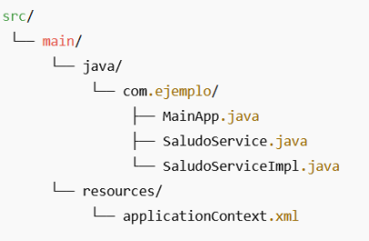
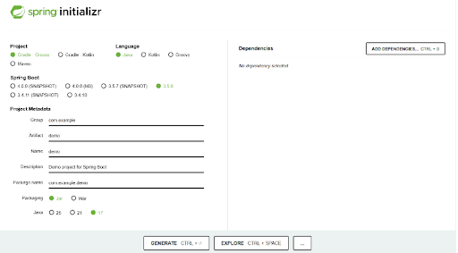
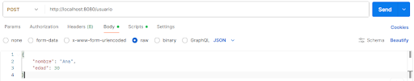

## Arquitecturas y tecnologías en la programación Web

1. [Entorno de trabajo](#1-entorno-de-trabajo)
   - [1.1. Java - JDK](#11-java---jdk)
   - [1.2. IntelliJ IDEA](#12-intellij-idea)
   - [1.3. Postman](#13-postman)
2. [Spring Boot](#2-spring)
   - [2.1. ¿Qué es?](#21-qué-es-spring-boot)
   - [2.2. Ventajas](#ventajas-de-usar-spring-boot)
    - [2.3. Primer proyecto](#23-primer-proyecto)
3. [Anatomía de una Aplicación Spring Boot](#3-anatomía-de-una-aplicación-spring-boot)
   - [3.1. Ficheros Importantes en un Proyecto Spring Boot](#31-ficheros-importantes)
   - [3.2. Clase principal](#32-clase-principal)
   - [3.3. Archivo application.properties](#33-archivo-applicationproperties)
4. [Web estática vs web dinámica](#4-web-estática-vs-web-dinámica)
   - [4.1. Página web estática](#41-página-web-estática)
   - [4.2. Página web dinámica](#42-página-web-dinámica)
5. [Creación de páginas web con Spring Boot](#5-creación-de-páginas-web-con-spring-boot)
   - [5.1. Anotaciones más comunes](#51-anotaciones-más-comunes)
   - [5.2. Estructura típica por capas](#52-estructura-típica-por-capas)
   - [5.3. Carpeta resources](#53-carpeta-resources)
6. [Creación de Páginas Web Estáticas en Spring Boot](#6-creación-de-páginas-web-estáticas-en-spring-boot)
7. [Creación de Páginas Web Dinámicas en Spring Boot](#7-creación-de-páginas-web-dinámicas-en-spring-boot)
   - [7.1. Introducción a controladores](#71-introducción-a-controladores)
8. [Métodos HTTP en Spring Boot](#8-métodos-http-en-spring-boot)
   - [8.1. Método GET](#81-método-get)
   - [8.2. Método POST](#82-método-post)
9. [JSON](#9-json)

## 1. Entorno de trabajo

### Instalaciones necesarias

- **Java JDK:** Descarga e instala la última versión (nosotros utilizaremos Java 21).
- Verifica con: `java -version`
- **IntelliJ IDEA:** Ultimate tiene mejor soporte para Spring, pero con Community también se puede.
- **Postman:** Para probar tus endpoints REST.
- **Base de datos:** MySQL, PostgreSQL o la que prefieras. También puedes empezar con H2 (en memoria).

### 1.1. Java - JDK

<https://www.oracle.com/java/technologies/downloads/>

```text
C:\Users\2DAM>java -version
java version "21.0.8" 2025-07-15 LTS
Java(TM) SE Runtime Environment (build 21.0.8+12-LTS-250)
Java HotSpot(TM) 64-Bit Server VM (build 21.0.8+12-LTS-250, mixed mode, sharing)
```

### 1.2. IntelliJ IDEA

<https://www.jetbrains.com/idea/download/?section=windows>

### 1.3. Postman

Se puede descargar o usar la versión online.

<https://www.postman.com/downloads/>

## 2. Spring



Spring es un framework de Java muy popular que facilita el desarrollo de aplicaciones empresariales. Permite construir aplicaciones más modulares, fáciles de probar y mantener.

### Características

- Spring se encarga de crear y gestionar los objetos (beans) en lugar de que tú los instancies manualmente.
- Programación orientada a aspectos, separar preocupaciones transversales.
- Spring MVC.
- Integración.

### 2.1. ¿Qué es Spring Boot?


Spring Boot es un framework basado en Spring que simplifica la creación de aplicaciones Java al proporcionar configuraciones automáticas y convenciones preestablecidas.

Permite desarrollar aplicaciones independientes y listas para producción con **mínima configuración**.

#### Ventajas de Usar Spring Boot

- **Configuración Automática (Auto-Configuration):** Spring Boot configura automáticamente los componentes según las dependencias presentes en el proyecto.
- **Servidor Embebido:** Incluye servidores como Tomcat, Jetty o Undertow, lo que permite ejecutar la aplicación sin necesidad de desplegarla en un servidor externo.
- **Inicio Rápido de Proyectos:** Con herramientas como Spring Initializr, se pueden generar proyectos base en cuestión de minutos.
- **Actuadores (Actuators):** Proporciona endpoints para monitoreo y gestión de la aplicación.
- **Mínima Configuración XML:** Se enfoca en convenciones y anotaciones, reduciendo la necesidad de archivos XML de configuración.

### 2.3. Primer proyecto

#### Spring initializr



- Genera un esqueleto de proyecto para importar.
- Accede a: <https://start.spring.io/>
- Elige gradle o maven. Depende de las dependencias y el archivo de configuración. Nosotros vamos a trabajar con maven.
  - gradle → `build.gradle`
  - maven → `pom.xml`
- Lenguaje de programación: Java.
- Versión de Spring Boot → Trabajar con la última disponible (viene por defecto, no SNAPSHOT ni M, ya que están en desarrollo).

Configuramos los metadatos:

- **Group:** dominio de la empresa o ejercicio (al revés `com.dominio`).
- **Artifact:** nombre con el que se va a identificar por ejemplo para importar (sin espacios).
- **Nombre del proyecto.**
- **Descripción.**
- **Nombre del paquete:** dónde se guardará la estructura de carpetas del proyecto.
- **Packaging:**
  - **jar** (java archive): contiene servidor y aplicación sin necesidad de servidor externo.
  - **war** (web application archive): para crear una aplicación web, se tienen que desplegar en un servidor web externo como Tomcat. Nosotros usaremos esta opción.
- **Java**, la versión LTS que tengamos instalada → 21 en nuestro caso.

**Dependencias:** componentes o bibliotecas que la aplicación necesita para funcionar.

- **Spring Web:** para usar apis RESTFUL y genera servidor tomcat → Añadir siempre.
- **Spring Data JPA:** Para interactuar con bases de datos utilizando JPA.
- **Spring Security:** Para añadir seguridad a la aplicación.
- **Thymeleaf:** Para generar vistas HTML desde el backend.
- **H2 Database:** Base de datos en memoria para pruebas rápidas.

**Generar** → se genera un archivo comprimido con el nombre que hemos puesto en Artifact listo para importar en nuestro IDE.

#### Práctica

Crea un proyecto de ejemplo siguiendo las indicaciones dadas en los apartados anteriores, puedes ayudarte del vídeo adjunto.

De momento no tienes que realizar ninguna entrega solo crear el proyecto con Spring Initializr.

#### Trabajar con el proyecto

- Descomprimir el proyecto generado.
- Abrir IntelliJ y seleccionar Open para abrirlo. Cuidado, no abrir ninguna carpeta dentro del proyecto sino la carpeta principal, la que tiene el nombre que pusimos en los metadatos en Artifact.
- Esperamos a que cargue las dependencias. Aceptar los mensajes que salgan en la esquina inferior derecha.
- **pom.xml** → Archivo de configuración con información, dependencias etc…
- **src:** alberga toda la lógica del proyecto. Si da error al importarlo, ha sido algún error en cargar las dependencias, volver a generar en Spring Initializr.
- Se levanta en el puerto **8080**, aunque se puede modificar en resources, `application.properties` (nosotros no lo vamos a hacer de momento).
- Al **ejecutar**, se levanta el servidor pero nuestra aplicación aún no tiene lógica por lo que al entrar en <http://localhost:8080> ¿qué pasará?.

#### Ejecutando la Aplicación

- Para ejecutar la aplicación, puedes:
  - Desde el IDE: Ejecutar la clase `DemoApplication.java`.
  - Desde la línea de comandos.
  - Desde un entorno de desarrollo simplemente ejecutando con el botón correspondiente.
- **Verificación.**
- Abre un navegador web y accede a <http://localhost:8080>. Deberías ver un error 404, lo cual es normal ya que no hemos definido ningún controlador aún.

## 3. Anatomía de una Aplicación Spring Boot

### Estructura

```text
demo/
├── src/
│   ├── main/
│   │   ├── java/
│   │   │   └── com/
│   │   │       └── ejemplo/
│   │   │           └── demo/
│   │   │               └── DemoApplication.java
│   │   └── resources/
│   │       ├── application.properties
│   │       ├── static/
│   │       └── templates/
│   └── test/
│       └── java/
│           └── com/
│               └── ejemplo/
│                   └── demo/
│                       └── DemoApplicationTests.java
└── pom.xml
```

### 3.1. Ficheros importantes

- **pom.xml (o build.gradle):** Este archivo gestiona las dependencias y el ciclo de vida del proyecto. En el caso de Maven, `pom.xml` define las dependencias, como Spring Web, así como plugins para construir y ejecutar la aplicación.
- **application.properties (o application.yml):** Este archivo contiene la configuración de la aplicación, como el puerto del servidor, detalles de la base de datos, y ajustes de logs.
- **src/main/java:** Aquí reside el código fuente de la aplicación, incluyendo controladores, servicios y repositorios. La clase principal con la anotación `@SpringBootApplication` también se encuentra aquí.
- **src/main/resources:** Contiene recursos como plantillas Thymeleaf, archivos estáticos (CSS, JS), y `application.properties`.
- **src/test/java:** Esta carpeta alberga las pruebas unitarias y de integración, permitiendo verificar el correcto funcionamiento de la aplicación.

### 3.2. Clase principal

En una aplicación Spring Boot, la clase principal es aquella que arranca la aplicación, normalmente se coloca en la raíz del proyecto y lleva la anotación `@SpringBootApplication`.

Un ejemplo básico sería:

```java
@SpringBootApplication
public class DemoApplication {

    public static void main(String[] args) {
        SpringApplication.run(DemoApplication.class, args);
    }
}
```

### 3.3. Archivo application.properties

Este archivo se utiliza para configurar propiedades de la aplicación.

```properties
# Configuracion para el acceso a la Base de Datos
spring.jpa.hibernate.ddl-auto=update
spring.jpa.properties.hibernate.globally_quoted_identifiers=true

# Puerto donde escucha el servidor una vez se inicie
server.port=8081

# Datos de conexion con la base de datos MySQL
spring.datasource.url=jdbc:mysql://localhost:3306/myshoponline
spring.datasource.username=myshopuser
spring.datasource.password=mypassword
spring.datasource.driverClassName=com.mysql.jdbc.Driver
```

## 4. Web estática vs web dinámica


### 4.1. Página web estática

El contenido es siempre el mismo para todos los usuarios: se sirve tal cual está guardado en el servidor, sin procesamiento adicional (HTML, CSS, JS, imágenes).

### 4.2. Página web dinámica

El contenido se genera o modifica en función de datos, parámetros o interacciones del usuario (por ejemplo, consultando una base de datos o procesando el resultado de un formulario) antes de enviarse al cliente.

## 5. Creación de páginas web con Spring Boot

### 5.1. Anotaciones más comunes

Las **anotaciones** (`@Anotacion`) son metadatos que se añaden a clases, métodos o atributos para indicarle a Spring qué papel cumple ese elemento dentro de la aplicación, sin necesidad de escribir configuración adicional. Spring lee estas anotaciones en tiempo de ejecución y, en función de ellas, crea y gestiona automáticamente los objetos (beans), asocia rutas HTTP a métodos, inyecta dependencias o valida datos.

- **`@RestController`:** Define una clase como controlador REST.
- **`@RequestMapping`:** Asocia solicitudes HTTP a métodos del controlador.
- **`@GetMapping`:** Maneja solicitudes HTTP GET.
- **`@PostMapping`:** Maneja solicitudes HTTP POST.
- **`@PutMapping`:** Maneja solicitudes HTTP PUT.
- **`@DeleteMapping`:** Maneja solicitudes HTTP DELETE.
- **`@PatchMapping`:** Maneja solicitudes HTTP PATCH.
- **`@PathVariable`:** Extrae valores de variables en la URL.
- **`@RequestParam`:** Obtiene parámetros de la consulta o formulario.
- **`@RequestBody`:** Vincula el cuerpo de la solicitud a un parámetro.
- **`@ResponseBody`:** Devuelve datos directamente en la respuesta HTTP.
- **`@Autowired`:** Inyecta dependencias automáticamente.
- **`@Service`:** Declara una clase como un servicio de negocio.
- **`@Component`:** Declara una clase como un componente genérico de Spring.
- **`@Repository`:** Declara una clase como componente de acceso a datos.
- **`@Configuration`:** Declara una clase como fuente de configuración.
- **`@Bean`:** Declara un bean gestionado por Spring.
- **`@Value`:** Inyecta valores desde el archivo de propiedades.
- **`@Qualifier`:** Especifica cuál bean inyectar cuando hay múltiples candidatos.
- **`@Primary`:** Define un bean como principal cuando hay varios del mismo tipo.
- **`@RequestHeader`:** Extrae valores de encabezados HTTP.
- **`@CrossOrigin`:** Habilita CORS para peticiones desde otros dominios.
- **`@ExceptionHandler`:** Maneja excepciones específicas dentro de un controlador.
- **`@ControllerAdvice`:** Define manejo global de errores para controladores.
- **`@Valid`:** Activa validación sobre los objetos del modelo.
- **`@NotNull`:** Indica que un valor no puede ser nulo (usado con validación).
- **`@Min` / `@Max`:** Define valores mínimo o máximo permitidos en validaciones.
- **`@EnableAutoConfiguration`:** Habilita configuración automática en Spring Boot.
- **`@SpringBootApplication`:** Agrupa `@Configuration`, `@EnableAutoConfiguration` y `@ComponentScan`.

### 5.2. Estructura típica por capas

En un proyecto Spring Boot real, el código de `src/main/java` se organiza en paquetes según su responsabilidad, separando cada capa de la arquitectura:

- **`controller`:** clases anotadas con `@RestController` o `@Controller` que reciben las peticiones HTTP y devuelven la respuesta. No deben contener lógica de negocio.
- **`service`:** clases anotadas con `@Service` que contienen la lógica de negocio de la aplicación. Los controladores llaman a los servicios.
- **`repository`:** interfaces o clases anotadas con `@Repository` encargadas del acceso a datos (bases de datos, ficheros, APIs externas).
- **`model` (o `entity`):** clases que representan las entidades/tablas de la base de datos.
- **`dto`:** *Data Transfer Object*, clases que definen qué datos viajan entre el cliente y el servidor (petición/respuesta), evitando exponer directamente las entidades.
- **`config`:** clases anotadas con `@Configuration` para configuraciones específicas (seguridad, CORS, beans manuales, etc.).

```text
com.ejemplo.demo/
├── DemoApplication.java
├── controller/
│   └── UsuarioController.java
├── service/
│   └── UsuarioService.java
├── repository/
│   └── UsuarioRepository.java
├── model/
│   └── Usuario.java
├── dto/
│   ├── UsuarioRequestDTO.java
│   └── UsuarioResponseDTO.java
└── config/
    └── SecurityConfig.java
```

Con esta separación, una petición HTTP fluye así: **Controller** (recibe la petición y el DTO) → **Service** (aplica la lógica de negocio) → **Repository** (accede a los datos) → **Model** (entidad persistida), devolviendo la respuesta de nuevo como DTO hasta el cliente.

### 5.3. Carpeta resources

Carpeta `src/main/resources`. Contiene archivos incluidos en el classpath de la aplicación. Se usa para:

- **Configuración:** `application.properties` o `application.yml`.
- **Archivos estáticos:** en carpetas `static/`, `public/`, `resources/`, `META-INF/resources/`.
- **Plantillas HTML:** en `templates/` (usado con Thymeleaf, FreeMarker, etc.).
- **Otros recursos:** archivos `.json`, `.xml`, `.sql`, propiedades, etc.

Todo se empaqueta en el `.jar` y Spring lo carga automáticamente.


## 6. Creación de Páginas Web Estáticas en Spring Boot

Spring Boot permite servir páginas web estáticas fácilmente, sin necesidad de controladores, solo colocando archivos en el lugar correcto.

Simplemente habría que seguir estos pasos:

1. Crear un proyecto Spring Boot (puede ser con Spring Initializr).
2. Colocar archivos HTML en `/static` o `/public`. Ruta: `src/main/resources/static/` → Ejemplo: `src/main/resources/static/index.html`.
3. Ejecutar la aplicación.
4. Spring Boot detecta automáticamente los archivos estáticos.

**Acceso desde el navegador:**

- <http://localhost:8080/> → carga `index.html` automáticamente.
- <http://localhost:8080/about.html> → carga `about.html`.

> **IMPORTANTE:** No se necesita controlador para servir archivos en `static/` o `public/`.

#### Actividad: crear una página web estática

Crea un proyecto Spring Boot con Spring Initializr (dependencia Spring Web).

- Añade en `src/main/resources/static/index.html` una página de bienvenida con tu nombre y una breve presentación.
- Añade una segunda página `contacto.html` en la misma carpeta con algún dato de contacto ficticio.
- Ejecuta la aplicación y comprueba que:
  - <http://localhost:8080/> carga `index.html` sin necesidad de ningún controlador.
  - <http://localhost:8080/contacto.html> carga `contacto.html`.
- Añade también una hoja de estilos `static/css/estilos.css` y enlázala desde ambas páginas para comprobar que Spring Boot también sirve los recursos estáticos que no son HTML.

## 7. Creación de Páginas Web Dinámicas en Spring Boot

Spring Boot permite generar páginas web dinámicas (contenido personalizado según datos) usando motores de plantillas como Thymeleaf, FreeMarker, etc. o cargando nuestros propios archivos `.html`.

1. **Crear proyecto Spring Boot:** con dependencia Spring Web + Thymeleaf (o FreeMarker).
2. **Crear controlador (Controller):** devuelve vistas con datos dinámicos.
3. **Crear plantillas HTML:** en carpeta `src/main/resources/templates/`.

> **IMPORTANTE:** Para servir una página web dinámica se necesita obligatoriamente un controlador.

### 7.1. Introducción a controladores

Un controlador en Spring Boot es una clase que maneja las solicitudes HTTP entrantes, procesa la lógica necesaria y devuelve respuestas, ya sean vistas HTML o datos (JSON, XML).

**Funciones:**

- Recibir peticiones del cliente (GET, POST, etc.).
- Ejecutar lógica o llamar a servicios.
- Devolver una respuesta adecuada (página web, JSON, redirección, etc.).

#### Diferencia entre `@Controller` y `@RestController`

`@Controller` se utiliza habitualmente en aplicaciones Spring MVC que devuelven vistas. En ese caso, el método suele devolver el nombre de una plantilla, como una vista de Thymeleaf, y Spring la procesa para generar la página HTML. Si se quiere que un método de una clase `@Controller` devuelva directamente un dato en el cuerpo de la respuesta, se puede anotar ese método con `@ResponseBody`.

`@RestController` está pensado para endpoints que devuelven directamente el contenido de la respuesta, como texto, JSON o XML, en lugar de resolver el valor devuelto como el nombre de una vista. Técnicamente, combina `@Controller` y `@ResponseBody`, por lo que aplica ese comportamiento a todos los métodos de la clase. Es una opción habitual al crear APIs REST.

## 8. Métodos HTTP en Spring Boot

### 8.1. Método GET

```text
Cliente / navegador                         Servidor Spring
  |                                          |
  | GET /hola?name=Ana                       |
  |----------------------------------------->|
  |                                          |
  | 200 OK + "Hola Ana"                      |
  |<-----------------------------------------|
```

Esquema basado en la documentación de [MDN sobre GET](https://developer.mozilla.org/en-US/docs/Web/HTTP/Reference/Methods/GET).

El método GET se usa para solicitar datos al servidor sin modificar nada. En Spring Boot, se mapea a métodos del controlador para manejar esas solicitudes.

**Cómo se usa:**

- Se anota el método del controlador con `@GetMapping` (o `@RequestMapping` con método GET).
- Se define la ruta que responderá a la solicitud GET.
- El método retorna datos o una vista.
- Se puede acceder a los datos enviados usando `@RequestBody`, `@RequestParam`.

Al acceder a <http://localhost:8080/hola> el servidor responde con: "¡Hola desde GET!"

```java
@RestController
public class HolaControlador {

    @GetMapping("/hola")
    public String decirHola() {
        return "¡Hola desde GET!";
    }
}
```

#### Recogida de parámetros con `@RequestParam`

Una petición HTTP puede incluir datos en la URL. Por ejemplo, en:

<http://localhost:8080/hola?name=Ana>

`/hola` es la ruta solicitada y `?name=Ana` es la cadena de consulta (*query string*). En ella, `name` es el nombre del parámetro y `Ana` es su valor. Si se envían varios parámetros, se separan con `&`, por ejemplo: `/hola?name=Ana&saludo=Buenos%20días`.

En Spring, la anotación `@RequestParam` enlaza un parámetro de la cadena de consulta con un argumento del método del controlador. El nombre indicado en la anotación debe coincidir con el de la URL:

```java
@RestController
public class SaludoController {

  @GetMapping("/hola")
  public String saludar(
      @RequestParam(name = "name", defaultValue = "Desconocido") String name) {
    return "Hola " + name;
  }
}
```

Cuando se visita `/hola?name=Ana`, Spring asigna `Ana` al argumento `name` y el método responde con `Hola Ana`. Si se visita `/hola` sin indicar el parámetro, se utiliza `Desconocido`. `defaultValue` también hace que el parámetro sea opcional; sin un valor predeterminado, `@RequestParam` es obligatorio por defecto y Spring responde con un error si no se envía.

### 8.2. Método POST

```text
Cliente / Postman                           Servidor Spring
  |                                          |
  | POST /usuario                            |
  | Content-Type: application/json           |
  | Cuerpo: {"nombre":"Ana","edad":30}       |
  |----------------------------------------->|
  |                                          |
  | 200 OK + "Usuario creado: Ana, edad: 30" |
  |<-----------------------------------------|
```

Esquema basado en la documentación de [MDN sobre POST](https://developer.mozilla.org/en-US/docs/Web/HTTP/Reference/Methods/POST).

El método POST se usa para enviar datos al servidor, generalmente para crear o modificar recursos. A diferencia de GET, POST envía información en el cuerpo de la solicitud (no en la URL) y puede cambiar el estado del servidor.

**Cómo se usa:**

- El cliente envía datos (por ejemplo, un formulario, JSON) al servidor mediante POST.
- El servidor recibe esos datos, los procesa (ejemplo: guarda en base de datos).
- El servidor devuelve una respuesta indicando éxito, error, etc.
- Se usa la anotación `@PostMapping` para manejar solicitudes POST.

El cliente envía un POST a `/usuario` con el nombre en el cuerpo y el servidor responde confirmando la creación con el nombre recibido:

Este primer ejemplo recibe el cuerpo como texto. Cuando se envía un objeto JSON con varias propiedades, conviene representarlo con una clase Java cuyos atributos correspondan a las propiedades del JSON.

```java
@RestController
public class UsuarioControlador {

    @PostMapping("/usuario")
    public String crearUsuario(@RequestBody String nombre) {
        return "Usuario creado: " + nombre;
    }
}
```

**Ejemplo recibiendo un objeto completo en JSON**

Si el cuerpo JSON contiene `nombre` y `edad`, la clase debe tener propiedades equivalentes y tipos compatibles. Por ejemplo, una cadena JSON se representa con `String` y un número entero con `int`:

| Propiedad JSON | Atributo Java |
| --- | --- |
| `nombre` | `String nombre` |
| `edad` | `int edad` |

Los nombres deben corresponder para que Jackson, la biblioteca que Spring Boot utiliza habitualmente, pueda asociar cada valor con su propiedad. En una clase Java convencional se incluyen un constructor sin argumentos y getters y setters para que Jackson pueda crear y rellenar el objeto.

Definimos la clase `Usuario`:

```java
public class Usuario {
    private String nombre;
    private int edad;

    // Constructor vacío (necesario para deserialización)
    public Usuario() {}

    // Getters y setters
    public String getNombre() { return nombre; }
    public void setNombre(String nombre) { this.nombre = nombre; }

    public int getEdad() { return edad; }
    public void setEdad(int edad) { this.edad = edad; }
}
```

A continuación, el controlador declara el parámetro como `Usuario` y lo anota con `@RequestBody`. Spring lee el JSON del cuerpo y lo convierte en una instancia de esa clase antes de ejecutar el método:

```java
@RestController
public class UsuarioControlador {

    @PostMapping("/usuario")
    public String crearUsuario(@RequestBody Usuario usuario) {
        return "Usuario creado: " + usuario.getNombre() + ", edad: " + usuario.getEdad();
    }
}
```

**¿Cómo funciona?**

- El cliente envía un POST a `/usuario` con el JSON en el cuerpo.
- Spring automáticamente convierte ese JSON en el objeto `Usuario`.
- El método accede a los datos usando los getters.
- Responde con un mensaje que incluye los datos recibidos.

El formato del JSON enviado para que esto funcione será:

```json
{
    "nombre": "Ana",
    "edad": 30
}
```

**¿Cómo enviar JSON en el cuerpo de una petición POST usando Postman?**



- Selecciona método POST.
- Ingresa la URL, por ejemplo: `http://localhost:8080/usuario`.
- Ve a la pestaña Body.
- Elige la opción `raw` y luego en el desplegable selecciona `JSON`.
- Escribe el JSON.

## 9. JSON

JSON (JavaScript Object Notation) es un formato de texto ligero para el intercambio de datos.

Está compuesto por pares clave-valor. Utiliza dos estructuras principales:

- **Objeto:** conjunto de pares clave-valor, delimitado por `{}`.
- **Arreglo (Array):** lista ordenada de valores, delimitada por `[]`.

```json
{
  "clave1": "valor1",
  "clave2": "valor2",
  "clave3": {
    "subclave": "subvalor"
  }
}
```

```json
[
  "valor1",
  "valor2",
  "valor3"
]
```

**Tipos de valores**

- **Cadenas de texto (string):** `"Hola Mundo"`
- **Números:** `123`, `45.67`
- **Booleanos:** `true`, `false`
- **Null:** `null`
- **Objetos:** `{ "clave": "valor" }`
- **Arrays:** `[1, 2, 3]`

```json
{
  "nombre": "Ana",
  "edad": 30,
  "esEstudiante": false,
  "hobbies": ["leer", "futbol", "cine"],
  "direccion": {
    "calle": "Av. Siempre Viva",
    "numero": 742
  }
}
```

### Para practicar

1. **Perfil de usuario.** Crea un objeto JSON con el nombre y la ciudad de una persona, su edad, si tiene cuenta activa y sus tres aficiones favoritas en una lista.
2. **Libro.** Crea un objeto JSON para un libro con título, autor, número de páginas y disponibilidad. Añade una lista de géneros y un objeto `editorial` con su nombre y país.
3. **Pedido sencillo.** Representa un pedido con un número identificador, el nombre del cliente y una lista de dos productos. Para cada producto, incluye nombre, cantidad y precio.
4. **Reserva de viaje.** Crea un objeto JSON para una reserva con un código y un objeto `cliente` que incluya nombre y correo. Añade una lista `pasajeros` con dos objetos, cada uno con nombre, edad y una lista de necesidades especiales. Incluye también un objeto `vuelo` con origen, destino y fecha, y una propiedad booleana que indique si está confirmado.
5. **Factura completa.** Representa una factura con número y fecha, un objeto `cliente` con nombre y dirección (calle, ciudad y código postal), una lista `lineas` con al menos dos objetos de producto (descripción, cantidad, precio unitario y etiquetas), y un objeto `pago` con método, importe abonado y estado. Añade el total de la factura y una propiedad `observaciones` cuyo valor sea `null` si no hay ninguna.

