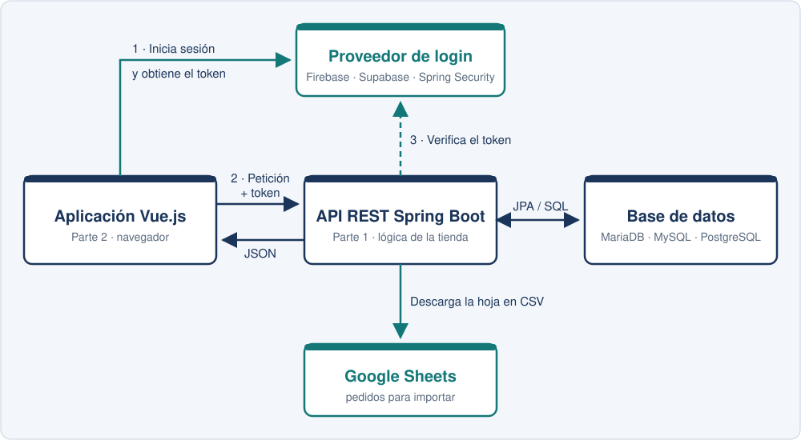
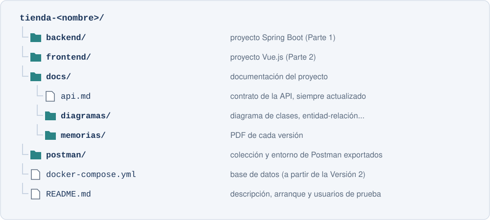

[⌂ Volver al inicio](../index.md)

A lo largo del curso desarrollaréis en parejas una tienda online completa. Podéis elegir libremente la temática: videojuegos, libros, ropa, música, material deportivo, plantas, productos artesanales, informática, juegos de mesa o cualquier otra propuesta que os interese.

El proyecto será evolutivo. No tendréis que construirlo todo desde el primer día: cada versión añadirá funcionalidades nuevas sobre la anterior. Al final, la tienda tendrá:

- Una API REST con Spring Boot organizada por capas, con catálogo, carrito, pedidos, usuarios y roles.
- Un sistema de inicio de sesión del que dependerá el acceso a todos los *endpoints*.
- La importación de pedidos desde una hoja de cálculo de Google Sheets a partir de su enlace.
- Una base de datos relacional gestionada con Spring Data JPA.
- Una interfaz gráfica con Vue.js para clientes y administradores que consumirá toda la API, con estadísticas de ventas e informes en Excel.

En clase se explicarán la mayor parte de las tecnologías necesarias y se proporcionará código de apoyo. Ese código deberá adaptarse a la temática y a las decisiones de cada proyecto. Algunas partes no se verán en clase y aparecen marcadas como Investigación: son obligatorias y deberéis documentar en la memoria qué habéis aprendido, cómo lo habéis aplicado y qué fuentes habéis consultado.

> Importante: las funcionalidades se incorporarán de forma gradual. En cada versión solo será necesario implementar los objetivos indicados para ese momento; las funcionalidades más avanzadas se añadirán en las versiones posteriores.

---

## Trabajo en parejas y control de versiones

| Pareja | Integrante 1 | Integrante 2 |
|---|---|---|
| Pareja 1 | Alexandra | Sara |
| Pareja 2 | Nuria | Nuria |
| Pareja 3 | Jose Miguel | Shin |
| Pareja 4 | Gonzálo | Gonzálo |
| Pareja 5 | Martín | Jose Ángel |
| Pareja 6 | | |
| Pareja 7 | | |
| Pareja 8 | | |
| Pareja 9 | | |

El proyecto se realiza en parejas, pero cada persona trabajará en su propia rama de Git y el código se integrará mediante *Pull Requests* revisadas por la otra persona de la pareja. La forma de organizar las ramas, proteger la rama principal, revisar el código y resolver conflictos es Investigación y se plantea en la [Versión 1](versiones/version_1.md).

Cada versión incluye un apartado Reparto en la pareja con una propuesta orientativa de qué hace cada persona. Podéis cambiar el reparto, pero:

- Las dos personas deben programar en todas las versiones.
- El historial de *commits* y de *Pull Requests* debe reflejar el trabajo de cada una.
- En cada entrega, cualquiera de las dos personas debe poder explicar cualquier parte del proyecto, no solo la suya.

La nota de cada versión se calculará sobre el trabajo de la pareja y se ajustará de forma individual según la contribución que muestre el repositorio y las explicaciones de cada persona en las defensas.

---

## ¿Qué aplicación hay que construir?

El proyecto tendrá dos partes que se desarrollarán una después de la otra:

1. **Parte 1. Backend con Spring Boot (noviembre - diciembre):** la API REST que contiene toda la lógica de la tienda. Primero trabajará con datos en memoria (Versión 1) y después con una base de datos (Versión 2).
2. **Parte 2. Frontend con Vue.js (enero - febrero):** la aplicación web que utilizarán los clientes (Versión 3) y los administradores (Versión 4). No tendrá datos propios: todo lo obtendrá de la API de la Parte 1.

### 1. Backend: API REST con Spring Boot

#### Datos de la tienda

Cada pareja elegirá los nombres y las características que mejor encajen con su propuesta. Si vuestra tienda vende videojuegos, la clase `Producto` puede llamarse `Videojuego`; si vende libros, `Libro`, etc. Como mínimo, la tienda gestionará:

- Categorías, que agrupan los productos.
- Productos, con un código de referencia único (SKU), nombre, descripción, precio, stock, imagen, categoría, estado activo/retirado, si es destacado y al menos dos atributos propios de la temática (plataforma, autor, talla, edad recomendada, etc.).
- Usuarios, con al menos dos roles: cliente y administrador.
- Carritos, uno por cliente, formados por líneas de producto y cantidad.
- Pedidos, que se generan a partir del carrito, con un ciclo de vida de estados y líneas que guardan el precio de cada producto en el momento de la compra.

#### Reglas de negocio

La tienda no es solo un conjunto de CRUD: la lógica se implementará en los servicios.

- No se puede añadir al carrito ni comprar una cantidad mayor que el stock disponible.
- Al confirmar un pedido se descuenta el stock y se vacía el carrito. Al cancelarlo, el stock se repone.
- Los pedidos siguen el ciclo `PENDIENTE → PAGADO → ENVIADO → ENTREGADO`, o pasan a `CANCELADO`. No se permiten transiciones no válidas.
- Los importes (subtotales, gastos de envío y total) los calcula siempre el servidor.
- Un cliente solo puede ver y modificar su carrito y sus pedidos.
- Solo el administrador puede gestionar el catálogo y cambiar el estado de los pedidos.

#### Seguridad

Todos los *endpoints* de la API solo podrán utilizarse después de iniciar sesión. Las únicas excepciones serán las rutas estrictamente necesarias para registrarse o iniciar sesión, si las hay, y la documentación de la API. La autenticación se implementará con Firebase Authentication, Supabase Auth o Spring Security (Investigación, [Versión 1](versiones/version_1.md)).

### 2. Frontend: aplicación web con Vue.js

En la segunda parte se construirá la interfaz gráfica de la tienda con Vue.js, consumiendo la API de la Parte 1: inicio de sesión, catálogo con filtros, detalle de producto, carrito, importación de pedidos desde Google Sheets, proceso de compra, área del cliente y panel de administración con estadísticas e informes en Excel.

---

## Investigaciones del proyecto

| Versión | Investigación |
|---|---|
| [Versión 1](versiones/version_1.md) | Trabajo con ramas en Git: una rama por persona, *Pull Requests*, revisión de código, protección de ramas y etiquetas |
| [Versión 1](versiones/version_1.md) | Autenticación con Firebase, Supabase o Spring Security y autorización por roles |
| [Versión 2](versiones/version_2.md) | Importación de pedidos desde Google Sheets: cliente HTTP, CSV y seguridad (SSRF) |
| [Versión 2](versiones/version_2.md) | Documentación de la API con OpenAPI/Swagger y pruebas automatizadas en Postman |
| [Versión 3](versiones/version_3.md) | Generación de informes Excel con Apache POI y su descarga desde Vue |
| [Versión 4](versiones/version_4.md) | Despliegue de la aplicación completa |

---

## Cronología de Versiones y Plan de Entregas

Cada versión añade una pieza al proyecto. No se trata de hacer cuatro aplicaciones distintas: se conserva el mismo proyecto y se amplía en cada versión. Cuando una versión reutiliza el trabajo anterior, se espera que siga funcionando.

Dentro de cada versión se propone una planificación semanal orientativa para que el trabajo no se acumule al final.

### Parte 1: Backend con Spring Boot

* [**Versión 1 (API REST completa sin base de datos)**](versiones/version_1.md): Diseño, repositorio con una rama por persona, catálogo, filtros, excepciones, autenticación, carrito y pedidos, con los datos en memoria. Investigación → <strong>FECHA ENTREGA:</strong> 29/11/2026
* [**Versión 2 (Persistencia con Spring Data JPA y Lombok)**](versiones/version_2.md): Validación de los datos de entrada, entidades, relaciones, repositorios JPA, consultas, transacciones, estadísticas de ventas, importación desde Google Sheets y documentación de la API. Investigación → <strong>FECHA ENTREGA:</strong> 13/12/2026

### Parte 2: Frontend con Vue.js

* [**Versión 3 (Interfaz de cliente con Vue.js)**](versiones/version_3.md): Prototipo, proyecto Vue, inicio de sesión, rutas protegidas, catálogo, detalle de producto, carrito, importación desde Google Sheets e informes Excel. Investigación → <strong>FECHA ENTREGA:</strong> 12/02/2027
* [**Versión 4 (Compra, administración, informes y despliegue)**](versiones/version_4.md): Tramitación de pedidos, área de cliente, panel de administración con estadísticas y descargas Excel, y despliegue. Investigación → <strong>FECHA ENTREGA:</strong> 26/02/2027
* [**Defensa final del proyecto**](#defensa-final-del-proyecto): presentación del proyecto completo por la pareja y preguntas individuales, tras la entrega de la Versión 4. → <strong>FECHA:</strong> se publicará en Moodle

---

## Estructura del repositorio

Cada pareja utilizará un único repositorio con esta organización:

---

## Contenido de cada entrega

En cada versión se subirá a Moodle (una entrega por pareja, indicando los dos nombres):

1. URL del repositorio y nombre de la etiqueta de la versión (`v1`, `v2`, `v3`, `v4`) creada sobre `main`.
2. Memoria en PDF (también en `docs/memorias/`) con:
   - Portada con el nombre de la tienda y de las dos personas.
   - Cambios realizados, capturas de las pruebas y las evidencias que se piden en el apartado Entrega de la versión.
   - Por cada investigación: un apartado propio con qué se ha elegido y por qué, cómo funciona, cómo se ha aplicado en el proyecto, problemas encontrados y fuentes consultadas.
   - Tabla de reparto del trabajo: qué ha hecho cada persona, con enlaces a sus *Pull Requests*.
3. En las versiones de la Parte 1, la colección de Postman actualizada en la carpeta `postman/`.

Tras cada entrega, el docente podrá realizar, si lo considera oportuno, una defensa a las parejas o a las personas que estime conveniente. En ella se podrá pedir que se explique o modifique cualquier parte del código.

---

## Defensa final del proyecto

Tras la entrega de la Versión 4, cada pareja realizará una defensa final del proyecto completo en la fecha que se publicará en Moodle. La defensa es obligatoria para las dos personas de la pareja y en ella:

1. La pareja presentará la tienda (unos 15 minutos), interviniendo las dos personas: temática, arquitectura, decisiones técnicas y un recorrido por la aplicación como cliente y como administrador, desde el inicio de sesión hasta la gestión de los pedidos.
2. Cada persona explicará al menos una de las investigaciones realizadas.
3. El profesor hará preguntas a cada persona por separado sobre cualquier parte del proyecto, del backend o del frontend, y podrá pedir que se realice en ese momento un pequeño cambio en el código.

La aplicación se mostrará funcionando a partir del código de la etiqueta `v4` del repositorio.

---

## Normativa de Evaluación de las Entregas

### Contenidos evaluados en cada versión

| Versión | Contenidos que se evalúan |
|---|---|
| **Versión 1** | API REST, `ResponseEntity` y códigos HTTP, organización por capas, DTOs y modelos, inyección de dependencias, `@PathVariable` y `@RequestParam`, CRUD y excepciones. Investigaciones: Git con ramas y autenticación. |
| **Versión 2** | Validación de los datos de entrada con Bean Validation, Spring Data JPA, entidades y relaciones, Lombok, repositorios y consultas, transacciones y consultas de agregación. Investigaciones: importación desde Google Sheets y OpenAPI. |
| **Versión 3** | Proyecto Vue, componentes, *props* y eventos, Vue Router, consumo de la API, gestión de la sesión y del estado con Pinia. Investigación: informes Excel. |
| **Versión 4** | Formularios y validación en el cliente, rutas por rol, tratamiento de errores, integración completa. Investigación: despliegue. |

### Normas

1. **Control de Versiones (Git):** Es obligatorio el uso de Git y la entrega mediante un repositorio remoto (GitHub, GitLab, etc.) al que tendrá acceso el profesor. Cada persona trabajará en su propia rama y se evaluará el desarrollo incremental a través del histórico de *commits*, *Pull Requests* y etiquetas. No se aceptarán proyectos con uno o muy pocos *commits* subidos al final.
2. **Trabajo individual dentro de la pareja:** si el repositorio muestra que una persona no ha contribuido en una versión, o no es capaz de explicar el código cuando se le pide, su nota de esa versión podrá ser distinta a la de su pareja, llegando a 0.0.
3. **Documentación PDF:** cada versión incluye la memoria descrita arriba. Las investigaciones que no estén documentadas no se considerarán realizadas.
4. **Defensas:** la defensa final es obligatoria para las dos personas de la pareja. Las defensas de cada entrega se realizarán a criterio del docente, cuando lo considere oportuno y a quien considere oportuno.
   > Si el código subido al repositorio no coincide con la funcionalidad mostrada en una defensa, la versión correspondiente será evaluada automáticamente con una nota de 0.0.
5. **Secretos fuera del repositorio:** las claves privadas, contraseñas y credenciales (por ejemplo, el JSON de la cuenta de servicio de Firebase o la clave de firma de los JWT) no se subirán al repositorio. Se incluirá un archivo de ejemplo (`application-example.properties`, `.env.example`) y se explicará en el `README.md` cómo configurarlas.
6. **El proyecto debe arrancar:** siguiendo el `README.md`, el profesor debe poder arrancar el proyecto en su equipo. Si no arranca, la versión se evaluará únicamente con lo que pueda comprobarse en la memoria y, en su caso, en la defensa.
7. **Plazos:** no se permiten entregas fuera de plazo.
