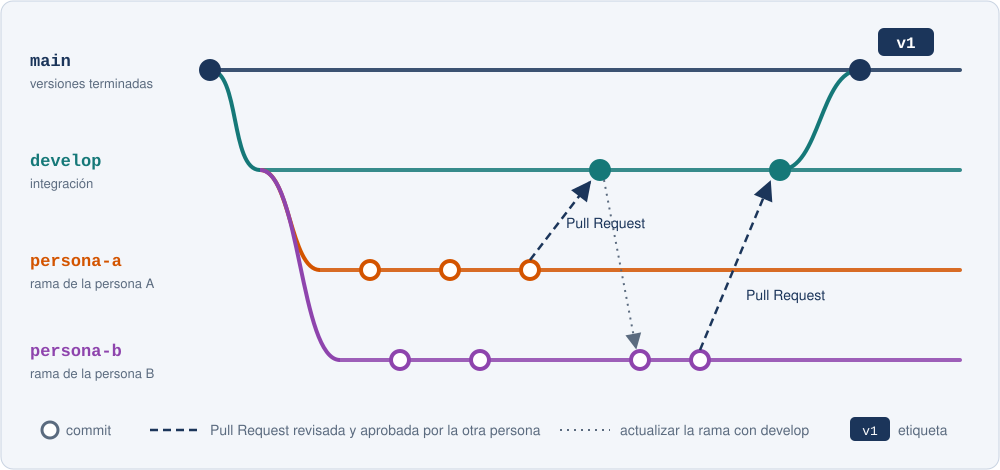
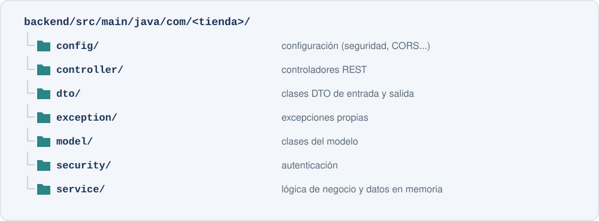

[⌂ Volver al enunciado del proyecto](../enunciado_proyecto.md)

# **FECHA DE ENTREGA:** 29/11/2026

# Versión 1 — API REST completa sin base de datos

## Objetivo

Construir la estructura completa del backend de la tienda con Spring Boot: diseño, repositorio con una rama por persona, catálogo, búsqueda, validación, autenticación, carrito y pedidos.

En esta versión no hay base de datos: los datos se guardan en memoria y se pierden al reiniciar la aplicación. La persistencia llegará en la Versión 2.

## Planificación orientativa

| Semana | Trabajo |
|---|---|
| 09/11 - 15/11 | Apartados 1 a 4: diseño, repositorio y ramas, proyecto base y catálogo |
| 16/11 - 22/11 | Apartados 5 a 7: búsqueda y filtros, validación y errores, autenticación |
| 23/11 - 29/11 | Apartado 8: carrito y pedidos, y revisión final con la colección de Postman |

---

## Enunciado

### 1. Diseño de la tienda

Elegid la temática y el nombre de la tienda y describidlos en el `README.md`, junto con los nombres de la pareja, la rama de cada persona y cómo se llamarán en vuestro proyecto las clases genéricas (`Producto` → `Videojuego`, `Categoria` → `Genero`...).

Diseñad el diagrama de clases (draw.io, PlantUML, Mermaid...) y guardadlo en `docs/diagramas/`. Como mínimo:

| Clase | Atributos mínimos |
|---|---|
| `Categoria` | `id`, `nombre`, `descripcion` |
| `Producto` | `id`, `sku` (código único), `nombre`, `descripcion`, `precio`, `stock`, `imagenUrl`, `activo`, `destacado`, `fechaAlta`, `categoria`, **dos atributos propios de la temática** |
| `Usuario` | `id`, `uid` (identificador del proveedor de autenticación), `email`, `nombre`, `direccionEnvio`, `rol`, `fechaAlta` |
| `Carrito` y `LineaCarrito` | `usuario`, `lineas` / `producto`, `cantidad` |
| `Pedido` | `id`, `codigo` (legible, por ejemplo `PED-2026-0001`), `usuario`, `fecha`, `estado`, `direccionEnvio`, `subtotal`, `gastosEnvio`, `total`, `lineas` |
| `LineaPedido` | `producto`, `nombreProducto`, `precioUnitario`, `cantidad`, `subtotal` |
| `Rol` y `EstadoPedido` | enumerados: `CLIENTE`, `ADMIN` / `PENDIENTE`, `PAGADO`, `ENVIADO`, `ENTREGADO`, `CANCELADO` |

- Los importes se representan con `BigDecimal`, nunca con `double`.
- `LineaPedido` guarda una copia del nombre y del precio del producto: si mañana cambia el precio, los pedidos antiguos no cambian.
- Un producto no se borra: se marca como `activo = false` para no romper los pedidos que lo contienen.

Cread también `docs/api.md` con la tabla de todos los *endpoints* (método, ruta, rol, DTO de entrada, DTO de salida y códigos de respuesta) y mantenedlo actualizado.

### 2. Investigación: repositorio y trabajo con ramas
{: .investigacion}

> Este apartado no se explica en clase. Es trabajo de investigación y debe documentarse en la memoria.
{: .investigacion}

Cada persona de la pareja trabajará en su propia rama y nunca directamente en la rama principal:



1. Una persona crea el repositorio e invita a la otra y al profesor.
2. Se crean `develop` y una rama con el nombre de cada persona. Cada persona hace *commits* solo en su rama.
3. Al terminar una tarea, se abre una *Pull Request* hacia `develop`, que la otra persona revisa y aprueba antes de fusionarla.
4. Cada persona actualiza su rama con los cambios de `develop` antes de seguir trabajando (`merge` o `rebase`, justificando la elección).
5. Al terminar la versión, se fusiona `develop` en `main` y se crea la etiqueta `v1`.

Investigad y aplicad también: reglas de protección de ramas (no se permite `push` directo a `main` ni a `develop` y las *Pull Requests* necesitan una aprobación), la resolución de un conflicto provocado a propósito, un `.gitignore` adecuado y una convención de mensajes de *commit* (por ejemplo, *Conventional Commits*).

### 3. Proyecto base y organización por capas

Cread el proyecto en `backend/` con [Spring Initializr](https://start.spring.io/): Maven, Java 21 o superior, y las dependencias Spring Web, Validation, Lombok y DevTools. Organizad los paquetes así:



- Los controladores solo reciben la petición, llaman al servicio y devuelven un `ResponseEntity` con el código adecuado.
- Los servicios contienen la lógica de negocio, trabajan con DTOs y no conocen `ResponseEntity`.
- Inyección de dependencias por constructor (`@RequiredArgsConstructor`).
- Las rutas de administración empiezan por `/api/admin`, lo que facilitará protegerlas.

Material de referencia: [apartados 1 a 4 de Aplicaciones Spring Boot](../../aplicaciones.md#1-http-y-apis-rest).

### 4. Catálogo

Los modelos y los DTOs son clases Java con Lombok. DTOs mínimos: `CategoriaDto`, `CategoriaCrearDto`, `ProductoResumenDto` (para listados), `ProductoDetalleDto`, `ProductoCrearDto` y `StockDto`. El cliente nunca envía `id`, `activo` ni `fechaAlta`: los asigna el servidor. Las conversiones van en clases del paquete `mapper`.

```java
@Getter
@Setter
@NoArgsConstructor
@AllArgsConstructor
public class ProductoCrearDto {

    @NotBlank(message = "El SKU es obligatorio")
    @Pattern(regexp = "[A-Za-z0-9-]{3,20}", message = "El SKU solo admite letras, números y guiones (3 a 20)")
    private String sku;

    @NotBlank(message = "El nombre es obligatorio")
    @Size(max = 100, message = "El nombre no puede superar los 100 caracteres")
    private String nombre;

    @NotNull(message = "El precio es obligatorio")
    @Positive(message = "El precio debe ser mayor que 0")
    private BigDecimal precio;

    @NotNull(message = "El stock es obligatorio")
    @PositiveOrZero(message = "El stock no puede ser negativo")
    private Integer stock;

    @NotNull(message = "La categoría es obligatoria")
    private Long categoriaId;

    // descripcion, imagenUrl, destacado y atributos propios de la temática...
}
```

El constructor sin argumentos y los *setters* son necesarios para que Jackson pueda construir el objeto a partir del JSON de la petición.

Repositorios en memoria con los mismos nombres de métodos que tendrá Spring Data JPA, para que en la Versión 2 el cambio sea mínimo:

```java
@Repository
public class ProductoRepository {

    private final Map<Long, Producto> productos = new ConcurrentHashMap<>();
    private final AtomicLong secuencia = new AtomicLong();

    public List<Producto> findAll() {
        return new ArrayList<>(productos.values());
    }

    public Optional<Producto> findById(Long id) {
        return Optional.ofNullable(productos.get(id));
    }

    public Producto save(Producto producto) {
        if (producto.getId() == null) {
            producto.setId(secuencia.incrementAndGet());
        }
        productos.put(producto.getId(), producto);
        return producto;
    }

    public void deleteById(Long id) {
        productos.remove(id);
    }
}
```

Datos de ejemplo: una clase de `config` que implemente `CommandLineRunner` carga al arrancar al menos 3 categorías y 12 productos con imágenes reales, incluyendo alguno sin stock, alguno retirado y alguno destacado.

Reglas: SKU único (se guarda en mayúsculas); no se puede usar una categoría inexistente; no puede haber dos categorías con el mismo nombre; no se puede eliminar una categoría con productos; eliminar un producto lo marca como retirado; el stock nunca queda en negativo; los listados públicos solo muestran productos activos.

| Método y ruta | Descripción | Respuestas |
|---|---|---|
| `GET /api/categorias` · `GET /api/categorias/{id}` | Consultar categorías | `200`, `404` |
| `GET /api/productos/{id}` | Detalle de un producto activo | `200`, `404` |
| `GET /api/productos/destacados` | Productos activos destacados | `200` |
| `GET`, `POST /api/admin/categorias` · `PUT`, `DELETE /api/admin/categorias/{id}` | Gestión de categorías | `200`, `201`, `204`, `404`, `409` |
| `GET`, `POST /api/admin/productos` · `PUT`, `DELETE /api/admin/productos/{id}` | Gestión de productos (el listado incluye los retirados) | `200`, `201`, `204`, `400`, `404`, `409` |
| `PATCH /api/admin/productos/{id}/stock` | Sumar o restar stock | `200`, `404`, `409` |

Las respuestas `201 Created` incluyen la cabecera `Location` (investigad `ServletUriComponentsBuilder`).

### 5. Búsqueda, filtros y ordenación

`GET /api/productos` admite estos parámetros, opcionales y combinables:

| Parámetro | Ejemplo | Efecto |
|---|---|---|
| `categoriaId` | `?categoriaId=2` | Productos de esa categoría |
| `q` | `?q=zelda` | Texto en el nombre o la descripción, sin distinguir mayúsculas ni tildes |
| `precioMin`, `precioMax` | `?precioMin=10&precioMax=60` | Rango de precio (`400` si el mínimo supera al máximo) |
| `soloDisponibles` | `?soloDisponibles=true` | Solo productos con stock |
| `orden`, `direccion` | `?orden=PRECIO&direccion=DESC` | Enumerados `NOMBRE`, `PRECIO`, `NOVEDAD` y `ASC`, `DESC` |
| Uno propio | `?plataforma=SWITCH` | Filtro por un atributo de vuestra temática |

Además: `GET /api/categorias/{id}/productos`, `GET /api/productos/sku/{sku}` (con el formato restringido por una expresión regular en la ruta) y `GET /api/admin/productos/stock-bajo?umbral=5`.

- Agrupad los filtros en una clase `ProductoFiltroDto` y aplicadlos en el servicio con *streams* y `Comparator`.
- Comprobad que `/api/productos/destacados` no se confunde con `/api/productos/{id}` (podéis restringir `{id:\\d+}`).

Material de referencia: [apartado 5 de los apuntes](../../aplicaciones.md#5-parámetros-de-ruta-y-de-consulta).

### 6. Validación y excepciones

- Todos los DTOs de entrada tienen restricciones de Bean Validation (`@NotBlank`, `@Size`, `@Positive`, `@PositiveOrZero`, `@Pattern`...) con mensajes en castellano y se validan con `@Valid`.
- Cread excepciones propias que extiendan `ResponseStatusException`: `RecursoNoEncontradoException` (`404`), `ConflictoException` (`409`), `DatosNoValidosException` (`400`) y `StockInsuficienteException` (`409`). Los servicios las lanzan y los controladores no tienen `try/catch`.
- Las respuestas de error no muestran trazas ni información interna.

Material de referencia: [apartado 7 de los apuntes](../../aplicaciones.md#7-validación-y-manejo-de-excepciones).

### 7. Investigación: autenticación y roles
{: .investigacion}

> Este apartado no se explica en clase. Es trabajo de investigación y debe documentarse en la memoria.
{: .investigacion}

Elegid una opción y justificadla:

- **Firebase Authentication:** el cliente envía el ID token en `Authorization: Bearer <token>` y el backend lo verifica con Firebase Admin SDK. Punto de partida: [apartado 8 de los apuntes](../../aplicaciones.md#8-inicio-de-sesión-con-firebase-authentication), llevando la verificación a un filtro que proteja todas las rutas.
- **Supabase Auth:** el backend verifica la firma, la caducidad y el emisor del *access token* (JWT) de Supabase.
- **Spring Security:** usuarios propios con contraseña cifrada (`BCryptPasswordEncoder`), `POST /api/auth/registro` y `POST /api/auth/login` (únicas rutas públicas) que devuelven un JWT, y un filtro que lo valida.

Requisitos:

- Sin token, o con un token no válido o caducado: `401`. Un cliente en cualquier ruta `/api/admin/`: `403`.
- La primera vez que un usuario accede se crea su `Usuario` con rol `CLIENTE`. Los administradores se definen en `application.properties` (`tienda.admins=admin@tienda.com`).
- La identidad se obtiene siempre del token verificado, encapsulada en un `UsuarioActualService` que usará el resto del código.
- *Endpoints*: `GET` y `PUT /api/usuarios/me`, `GET /api/admin/usuarios` y `PATCH /api/admin/usuarios/{id}/rol`.
- Dos usuarios de prueba (cliente y administrador) indicados en el `README.md`; la colección de Postman obtiene el token con una petición de *login* y lo guarda en una variable `{{token}}`.
- Las credenciales privadas no se suben al repositorio; se incluye un `application-example.properties`.

### 8. Carrito y pedidos

Carrito (siempre el del usuario autenticado; las rutas no llevan id de usuario):

| Método y ruta | Descripción |
|---|---|
| `GET /api/carrito` | Ver el carrito con importes calculados por el servidor y `avisos` |
| `POST /api/carrito/lineas` | `{ "productoId": 7, "cantidad": 2 }`; si ya existe, suma la cantidad |
| `PUT` y `DELETE /api/carrito/lineas/{productoId}` | Cambiar la cantidad o quitar la línea |
| `DELETE /api/carrito` | Vaciar el carrito |

- No se pueden añadir productos retirados ni más unidades que el stock (`409`) ni superar `tienda.carrito.max-unidades-por-producto`.
- Si un producto del carrito se retira o baja su stock, el carrito lo indica en `avisos` y no se puede confirmar el pedido.
- Gastos de envío configurables con `@ConfigurationProperties` (`tienda.envio.coste` y `tienda.envio.gratis-desde`).

Pedidos:

| Método y ruta | Descripción |
|---|---|
| `POST /api/pedidos` | Confirmar el carrito (dirección del cuerpo o del perfil) |
| `GET /api/pedidos?estado=` · `GET /api/pedidos/{id}` | Mis pedidos y su detalle (`404` si es de otro usuario) |
| `PATCH /api/pedidos/{id}/cancelar` | Cancelar uno de mis pedidos |
| `GET /api/admin/pedidos?estado=&desde=&hasta=` · `GET /api/admin/pedidos/{id}` | Todos los pedidos |
| `PATCH /api/admin/pedidos/{id}/estado` | Cambiar el estado |

Al confirmar: se comprueba que el carrito no esté vacío y que todas las líneas tienen stock (si alguna falla, no se modifica nada), se crea el pedido `PENDIENTE` con la copia de nombres y precios, se descuenta el stock y se vacía el carrito. Al cancelar, se repone el stock. Las transiciones de estado se definen en el propio enumerado:

```java
public enum EstadoPedido {
    PENDIENTE, PAGADO, ENVIADO, ENTREGADO, CANCELADO;

    public boolean puedeCambiarA(EstadoPedido nuevo) {
        return switch (this) {
            case PENDIENTE -> nuevo == PAGADO || nuevo == CANCELADO;
            case PAGADO -> nuevo == ENVIADO || nuevo == CANCELADO;
            case ENVIADO -> nuevo == ENTREGADO;
            case ENTREGADO, CANCELADO -> false;
        };
    }
}
```

El cliente solo puede cancelar; el resto de cambios los hace el administrador. Una transición no válida responde `409`.

---

## Requisitos

- Repositorio con la estructura indicada, ramas protegidas, una rama por persona y *Pull Requests* revisadas, con un conflicto resuelto.
- Organización por capas, DTOs en la API e inyección por constructor.
- Todos los *endpoints* indicados con los códigos HTTP correctos y las reglas de negocio implementadas.
- Validación de todos los DTOs de entrada y excepciones propias.
- Ninguna ruta responde sin token válido (salvo las públicas indicadas) y las de administración devuelven `403` a los clientes.
- Colección de Postman con todas las peticiones, incluidas las que deben fallar.
- Ningún secreto en el repositorio. Etiqueta `v1` en `main`.

## Reparto en la pareja

| Persona A | Persona B |
|---|---|
| Repositorio, ramas, protección y proyecto base | Diagrama de clases y contrato de la API |
| Categorías y búsqueda/filtros | Productos, ordenación y datos de ejemplo |
| Autenticación: filtro, `401`/`403` y secretos | Usuarios, roles, `UsuarioActualService` y `/api/usuarios/me` |
| Carrito y gastos de envío | Pedidos y ciclo de vida |

## Criterios de finalización

- El proyecto arranca siguiendo el `README.md` y se puede probar desde Postman.
- Flujo completo demostrable: iniciar sesión → consultar el catálogo con filtros → añadir al carrito → confirmar el pedido → el stock baja → el administrador lo marca como `PAGADO` → el cliente lo cancela → el stock se repone.
- Los datos no válidos, las operaciones prohibidas y los accesos sin permiso se rechazan con el código adecuado.
- El historial de Git muestra el trabajo de las dos personas.

## Entrega

Incluid en la memoria:

- Temática, diagrama de clases y tabla de *endpoints*.
- Capturas de las pruebas más relevantes: flujo de compra, filtros, errores de validación, `401`, `403`, `404` y `409`.
- Investigación sobre Git: flujo de ramas, reglas de protección, una *Pull Request* revisada y el conflicto resuelto.
- Investigación sobre autenticación: opción elegida, flujo de una petición autenticada, qué es un JWT y cómo se obtiene el token para las pruebas.

Consultad los requisitos comunes de entrega en el [enunciado general](../enunciado_proyecto.md#contenido-de-cada-entrega).

---

[Versión 2 →](version_2.md)
