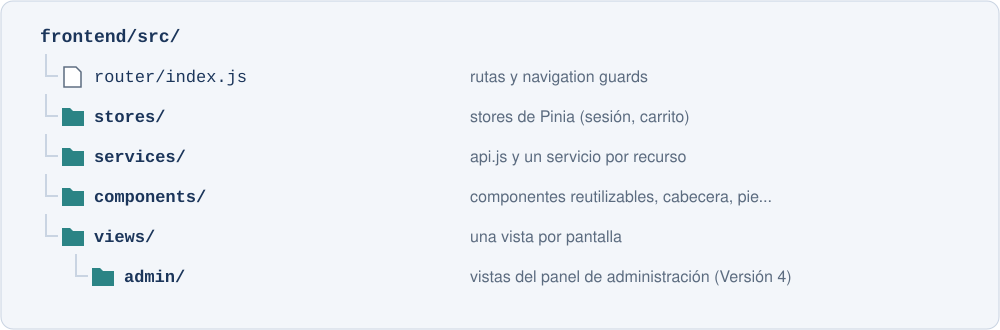

[⌂ Volver al enunciado del proyecto](../enunciado_proyecto.md)

# **FECHA DE ENTREGA:** 12/02/2027

# Versión 3 — Interfaz de cliente con Vue.js

## Objetivo

Comenzar la Parte 2: diseñar la interfaz, crear el proyecto Vue 3 en la carpeta `frontend/` e implementar todo lo que necesita un cliente antes de comprar: inicio de sesión, catálogo, detalle de producto, carrito e importación desde Google Sheets, consumiendo la API de la Parte 1. Además, se generarán informes Excel en la API con Apache POI (investigación).

## Planificación orientativa

| Semana | Trabajo |
|---|---|
| 11/01 - 17/01 | Apartados 1 y 2: prototipo, proyecto Vue y diseño base |
| 18/01 - 24/01 | Apartado 3: inicio de sesión y rutas protegidas |
| 25/01 - 31/01 | Apartado 4: catálogo y detalle de producto |
| 01/02 - 07/02 | Apartado 5: carrito e importación |
| 08/02 - 12/02 | Apartado 6: informes Excel |

---

## Enunciado

### 1. Prototipo

Diseñad con Figma, Penpot o Balsamiq el prototipo de todas las pantallas de la tienda (cliente y administración), en escritorio y móvil, con un mapa de navegación que indique qué pantallas son solo para administradores y qué *endpoints* usa cada una. Guardadlo en `docs/`.

### 2. Proyecto Vue y diseño base

Cread el proyecto con `npm create vue@latest`, activando Vue Router y Pinia. Usad `axios` o `fetch` y, si queréis, una librería de estilos o componentes (Bootstrap, Tailwind CSS, Vuetify, PrimeVue...).

- La URL de la API se lee de `VITE_API_URL` (`.env.development`, con un `.env.example` en el repositorio).
- Configurad CORS en el backend para el origen de Vite (`http://localhost:5173`), leyendo los orígenes permitidos de `application.properties`. El navegador envía antes una petición `OPTIONS` (*preflight*) sin token: comprobad que vuestro filtro de autenticación la deja pasar.
- Definid todas las rutas (con vistas provisionales para las de la Versión 4) y una vista 404.
- Diseño base adaptable a móvil: cabecera con logotipo, navegación y menú plegable, pie y zona de contenido.
- Portada con los productos destacados (`/api/productos/destacados`) y las novedades (`/api/productos` ordenado por fecha de alta).

### 3. Inicio de sesión y rutas protegidas

- Vistas de inicio de sesión, registro y, si el proveedor lo permite, recuperación de contraseña, integradas con la opción elegida en la Versión 1 (SDK web de Firebase, `@supabase/supabase-js` o los *endpoints* de Spring Security), con mensajes de error comprensibles.
- *Store* de Pinia `sesion` con el token, el usuario de `GET /api/usuarios/me` y los *getters* `estaAutenticado` y `esAdmin`. La sesión sobrevive a una recarga de la página.
- El token se añade a todas las peticiones desde un único punto (interceptor de `axios` o envoltorio de `fetch` en `services/api.js`).
- Si la API responde `401`, se cierra la sesión y se redirige al inicio de sesión; si responde `403`, se muestra un aviso.
- Rutas con `meta.requiereSesion` y `meta.requiereAdmin` y un *navigation guard* (`router.beforeEach`). Tras iniciar sesión se vuelve a la ruta solicitada.
- La cabecera muestra el usuario, *Mi perfil*, *Mis pedidos*, *Cerrar sesión* y el acceso a la administración solo para administradores.

### 4. Catálogo y detalle de producto

Componentes reutilizables mínimos, comunicados con *props* y eventos: `TarjetaProducto`, `ListaProductos`, `FiltrosCatalogo`, `Paginacion`, `IndicadorCarga` y `MensajeError`.

Catálogo (`/catalogo`):

- Cuadrícula de tarjetas con filtros por categoría, texto, precio, disponibilidad y vuestro filtro propio, ordenación y paginación, usando los parámetros de la API (no se filtra en el navegador).
- El estado del catálogo se refleja en la URL (`/catalogo?categoriaId=2&q=mario&page=1`): al recargar o compartir el enlace se ve el mismo resultado.
- La búsqueda por texto usa *debounce* para no lanzar una petición por cada tecla.
- Estados de carga, error (con reintentar) y sin resultados.

Detalle (`/productos/:id`): todos los datos, imagen, stock disponible, selector de cantidad, botón para añadir al carrito, productos de la misma categoría y mensaje si el producto no existe (`404`).

Toda la comunicación con la API está en `services/`; los componentes no construyen URLs.

### 5. Carrito e importación desde Google Sheets

- *Store* de Pinia `carrito` que guarda el carrito devuelto por la API y se actualiza tras cada operación. La cabecera muestra siempre el número de artículos.
- Vista del carrito: líneas con imagen, cantidad modificable, subtotal y botón para quitar; resumen con subtotal, envío (indicando cuánto falta para el envío gratuito) y total; avisos junto a las líneas afectadas; vaciar con confirmación; mensaje si está vacío.
- Importación: explicación del formato con un enlace a una hoja de plantilla, campo para el enlace, botón Previsualizar (líneas que se importarán y tabla de filas con errores), elección del modo (`SUMAR`/`REEMPLAZAR`) y de *estricto*, y botón Confirmar importación. Mensajes claros para los errores `400`, `422` y `502`.

### 6. Investigación: informes Excel con Apache POI
{: .investigacion}

> Este apartado no se explica en clase. Es trabajo de investigación y debe documentarse en la memoria.
{: .investigacion}

Investigad la librería Apache POI (`poi-ooxml`) y añadid al backend tres *endpoints* que generan archivos `.xlsx`:

| Método | Ruta | Contenido |
|---|---|---|
| `GET` | `/api/admin/pedidos/exportar?desde=&hasta=&estado=` | Libro con dos hojas: `Pedidos` (código, fecha, cliente, estado, subtotal, envío, total) y `Líneas` (código del pedido, SKU, producto, precio, cantidad, subtotal) |
| `GET` | `/api/pedidos/{id}/exportar` | Uno de los pedidos del cliente con las columnas `sku`, `cantidad` y `comentario`, el mismo formato que la importación desde Google Sheets |
| `GET` | `/api/carrito/exportar` | El carrito actual, con el mismo formato que la importación |

- En todos los informes: cabecera en negrita con color de fondo, filas inmovilizadas y columnas ajustadas al contenido.
- En el informe de administración, además: filtros automáticos, importes con formato de moneda, fechas con formato de fecha y una fila de totales con una fórmula `SUM`.
- Respuesta con `ResponseEntity<byte[]>`, tipo `application/vnd.openxmlformats-officedocument.spreadsheetml.sheet` y cabecera `Content-Disposition: attachment; filename="..."`.

Y en Vue:

- Botón Descargar Excel en la vista del carrito. Cread una función de descarga reutilizable: en la Versión 4 se usará en *Mis pedidos* y en el panel de administración.
- Investigad cómo descargar un archivo protegido con token: petición con `responseType: 'blob'`, `URL.createObjectURL` y un enlace temporal, leyendo el nombre del archivo de la cabecera `Content-Disposition` (recordad exponerla en la configuración CORS).

Comprobad el ciclo completo: exportar el carrito o un pedido → abrirlo con Google Sheets → compartirlo → importarlo en el carrito.

---

## Requisitos

- Prototipo completo y mapa de navegación en `docs/`.
- Proyecto que arranca con `npm install` y `npm run dev`, con la URL de la API en variables de entorno y CORS configurado.
- Inicio de sesión, registro y cierre de sesión; sesión persistente; token en todas las peticiones; rutas protegidas por sesión y por rol.
- Catálogo con los filtros, la ordenación y la paginación de la API, estado en la URL y *debounce*.
- Componentes reutilizables con *props* y eventos.
- Carrito centralizado en Pinia con avisos e importación con previsualización.
- Los tres *endpoints* de exportación generan `.xlsx` con los formatos indicados y el carrito se descarga desde Vue con token.
- Diseño adaptable a móvil y escritorio.
- Etiqueta `v3` en `main`.

## Reparto en la pareja

| Persona A | Persona B |
|---|---|
| Prototipo de las pantallas de cliente | Prototipo de administración y mapa de navegación |
| Proyecto Vue, `api.js`, diseño base y portada | CORS, *router* y vista 404 |
| Vistas de acceso e integración con el proveedor | *Store* de sesión, interceptor y *guards* |
| Detalle de producto y componentes de tarjeta y lista | Catálogo con filtros, URL, *debounce* y paginación |
| *Store* y vista del carrito | Importación desde Google Sheets |
| Excel de administración con Apache POI | Excel del pedido y del carrito, y descarga desde Vue |

## Criterios de finalización

- Sin sesión no se ve ninguna página salvo las de acceso, y un cliente no puede entrar en `/admin` ni escribiendo la URL.
- Al recargar la página la sesión sigue activa.
- Copiar la URL del catálogo en otra pestaña muestra el mismo resultado.
- Se puede añadir desde el catálogo, modificar y vaciar el carrito, y la cabecera muestra siempre el número correcto.
- Una hoja con errores muestra qué filas fallan antes de importar.
- Los Excel se abren sin avisos en Excel, LibreOffice y Google Sheets, y un carrito exportado puede volver a importarse.

## Entrega

Incluid en la memoria:

- Prototipo, mapa de navegación y tabla de rutas (ruta, vista, *endpoints*, si requiere administrador).
- Árbol de componentes con sus *props* y eventos.
- Explicación del *store* de sesión, del interceptor y de los *guards*, y de dónde se guarda el token.
- Capturas en escritorio y móvil de la portada, el catálogo filtrado, el detalle, el carrito con avisos y la importación con errores.
- Investigación sobre Apache POI: estructura de un libro (*workbook*, *sheet*, *row*, *cell*, *style*), formatos y fórmula aplicados, descarga desde Vue con token y capturas de los Excel y del ciclo exportar → Google Sheets → importar.

Consultad los requisitos comunes de entrega en el [enunciado general](../enunciado_proyecto.md#contenido-de-cada-entrega).

---

[← Versión 2](version_2.md) · [Versión 4 →](version_4.md)
