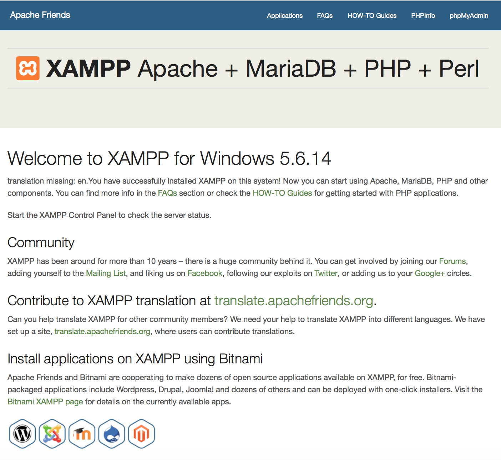
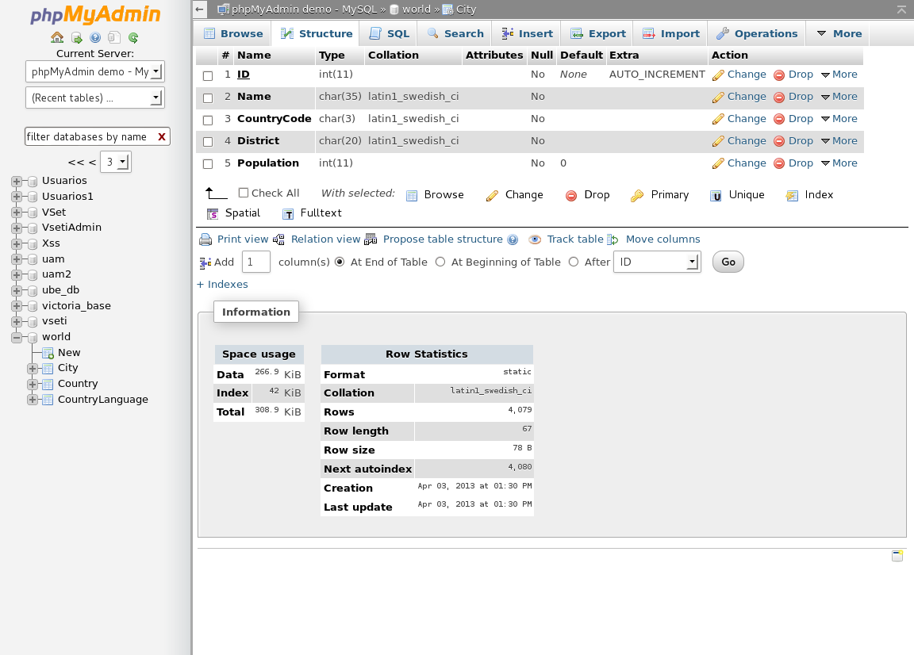

[⌂ Volver al inicio](index.md)

## Índice

1. [Introducción](#1-introducción)
2. [Configuración del proyecto](#2-configuración-del-proyecto)
3. [Primer ejemplo completo](#3-primer-ejemplo-completo)
4. [Entidades](#4-entidades)
5. [Validación de datos](#5-validación-de-datos)
6. [Ciclo de vida de una entidad](#6-ciclo-de-vida-de-una-entidad)
7. [Lombok](#7-lombok)
8. [Repositorios y operaciones CRUD](#8-repositorios-y-operaciones-crud)
9. [Consultas personalizadas](#9-consultas-personalizadas)
10. [Relaciones entre entidades](#10-relaciones-entre-entidades)
11. [Actividades](#11-actividades)
    - [Actividad 1: catálogo de una biblioteca](#actividad-1-catálogo-de-una-biblioteca)
    - [Actividad 2: del modelo E/R a entidades](#actividad-2-del-modelo-er-a-entidades)
    - [Actividad 3: calificaciones con clave compuesta](#actividad-3-calificaciones-con-clave-compuesta)
    - [Actividad 4: contratos con Lombok](#actividad-4-contratos-con-lombok)
    - [Actividad 5: entidades completas de la tienda](#actividad-5-entidades-completas-de-la-tienda)
    - [Actividad 6: repositorios, servicios y controladores CRUD](#actividad-6-repositorios-servicios-y-controladores-crud)
    - [Actividad 7: nombres de Query Methods](#actividad-7-nombres-de-query-methods)
    - [Actividad 8: consultas personalizadas de la tienda](#actividad-8-consultas-personalizadas-de-la-tienda)
    - [Actividad 9: relaciones entre entidades](#actividad-9-relaciones-entre-entidades)
    - [Actividad 10: relaciones de la tienda](#actividad-10-relaciones-de-la-tienda)

## 1. Introducción

Spring Data JPA es un módulo de Spring que simplifica el acceso y la gestión de datos en aplicaciones Java. Proporciona una capa de abstracción sobre JPA (*Java Persistence API*) que permite trabajar con bases de datos relacionales sin escribir código repetitivo.

Hasta ahora, en las APIs de las unidades anteriores, los datos se guardaban en memoria (en una `List` o un `Map` dentro del servicio) y se perdían al reiniciar la aplicación. Con Spring Data JPA los datos se guardan en una base de datos real.

### 1.1. ¿Qué es JPA?

JPA es una especificación de Java que define cómo manejar datos relacionales utilizando objetos. Permite mapear clases Java a tablas de bases de datos y facilita las operaciones de persistencia (guardar, leer, actualizar y borrar).

Conviene distinguir tres piezas que suelen confundirse:

| Pieza | Qué es | Papel |
|---|---|---|
| JPA | Especificación (un conjunto de interfaces y anotaciones) | Define *qué* se puede hacer: `@Entity`, `@Id`, `@Column`... |
| Hibernate | Implementación de JPA (el motor) | Hace el trabajo real: genera el SQL, lo ejecuta y convierte filas en objetos |
| Spring Data JPA | Módulo de Spring sobre JPA | Genera automáticamente los repositorios y las consultas |

Spring Boot usa Hibernate como implementación por defecto, por eso en la consola verás mensajes que empiezan por `Hibernate:`.

### 1.2. ORM: del modelo relacional al orientado a objetos

JPA es un ORM (*Object-Relational Mapping*, mapeo objeto-relacional). Resuelve un problema conocido como *impedance mismatch* (desajuste de impedancia):

- Las bases de datos trabajan con tablas, filas y claves foráneas.
- Java trabaja con clases, objetos y referencias.

Una entidad es el puente entre ambos mundos: cada objeto de la clase representa una fila de la tabla.

| Modelo relacional | Modelo orientado a objetos |
|---|---|
| Tabla `estudiantes` | Clase `Estudiante` |
| Fila | Objeto (`new Estudiante()`) |
| Columna `nombre` | Atributo `nombre` |
| Clave foránea `id_tutor` | Referencia `Tutor tutor` |
| Tabla intermedia `estudiantes_clases` | Colección `List<Clase> clases` |

Por ejemplo, un estudiante tiene un tutor (relación 1) y cursa muchas clases (relación N). En el modelo E/R esto son dos relaciones entre tablas; en Java, un atributo `Tutor tutor` y una colección `List<Clase> clases`.

### 1.3. Ventajas de Spring Data JPA

- **Simplicidad:** reduce la cantidad de código necesario para las operaciones comunes.
- **Productividad:** proporciona métodos predefinidos para las operaciones CRUD.
- **Extensibilidad:** permite crear consultas personalizadas fácilmente.
- **Integración:** se integra con el resto de módulos de Spring.

---

## 2. Configuración del proyecto

### 2.1. Dependencias

Al crear el proyecto con [Spring Initializr](https://start.spring.io/) añade estas dependencias:

| Dependencia | Para qué sirve |
|---|---|
| Spring Web | Crear controladores REST |
| Spring Data JPA | Persistencia con JPA y Hibernate |
| MariaDB Driver | Conectar con la base de datos MariaDB de XAMPP (también hay drivers para MySQL, PostgreSQL, Oracle, SQL Server, H2...) |
| Validation | Validar los datos de los objetos (Bean Validation) |
| Lombok | Opcional, pero recomendado para no escribir getters, setters y constructores |

Si el proyecto ya existe, se pueden añadir a mano en el `pom.xml`:

```xml
<dependencies>
    <!-- Spring Data JPA -->
    <dependency>
        <groupId>org.springframework.boot</groupId>
        <artifactId>spring-boot-starter-data-jpa</artifactId>
    </dependency>

    <!-- Driver de MariaDB -->
    <dependency>
        <groupId>org.mariadb.jdbc</groupId>
        <artifactId>mariadb-java-client</artifactId>
        <scope>runtime</scope>
    </dependency>

    <!-- Validaciones -->
    <dependency>
        <groupId>org.springframework.boot</groupId>
        <artifactId>spring-boot-starter-validation</artifactId>
    </dependency>
</dependencies>
```

> **Nota:** no hace falta indicar la versión del driver, porque la gestiona Spring Boot. Si en lugar de MariaDB se usa MySQL, se elige MySQL Driver en Initializr (dependencia `com.mysql:mysql-connector-j`).

### 2.2. Crear la base de datos

Trabajaremos con XAMPP, que incluye MariaDB (compatible con MySQL) y phpMyAdmin. Se descarga desde la web oficial de Apache Friends: [https://www.apachefriends.org/download.html](https://www.apachefriends.org/download.html). Para Windows basta con el instalador de la versión más reciente; durante la instalación se pueden dejar marcados los componentes por defecto (al menos Apache, MySQL y phpMyAdmin).

Al terminar la instalación, si abres `http://localhost` con Apache arrancado aparece la página de bienvenida de XAMPP, que confirma que todo funciona:



*Página de inicio de XAMPP. Fuente: [documentación oficial de Apache Friends](https://www.apachefriends.org/faq_windows.html).*

Para crear la base de datos:

1. Abre el XAMPP Control Panel y pulsa Start en los módulos Apache (necesario para phpMyAdmin) y MySQL. MySQL debe quedar en verde escuchando en el puerto 3306.
2. Abre `http://localhost/phpmyadmin`.
3. En la pestaña Bases de datos, escribe `tienda_db`, elige el cotejamiento `utf8mb4_general_ci` y pulsa Crear.

También se puede crear desde la pestaña SQL de phpMyAdmin:

```sql
CREATE DATABASE tienda_db CHARACTER SET utf8mb4 COLLATE utf8mb4_general_ci;
```

En phpMyAdmin, el panel izquierdo muestra las bases de datos y sus tablas. Al seleccionar una tabla, la pestaña Estructura enseña sus columnas, tipos, claves e índices. Es la vista que usaremos para comprobar qué tablas ha creado Hibernate a partir de las entidades:



*Vista de la estructura de una tabla en phpMyAdmin. Fuente: [web oficial de phpMyAdmin](https://www.phpmyadmin.net/try/).*

### 2.3. Archivo application.properties

El archivo `src/main/resources/application.properties` define cómo se conecta Spring a la base de datos. Con la instalación por defecto de XAMPP queda así:

```properties
spring.application.name=tienda

# --- Conexión con MariaDB de XAMPP ---
spring.datasource.url=jdbc:mariadb://localhost:3306/tienda_db?createDatabaseIfNotExist=true&connectionTimeZone=Europe/Madrid
spring.datasource.username=root
spring.datasource.password=
spring.datasource.driver-class-name=org.mariadb.jdbc.Driver

# --- Configuración de JPA / Hibernate ---
# Muestra en la consola el SQL que se ejecuta (útil para aprender)
spring.jpa.show-sql=true
# Muestra el SQL con saltos de línea, más fácil de leer
spring.jpa.properties.hibernate.format_sql=true
# Actualiza la estructura de las tablas automáticamente
spring.jpa.hibernate.ddl-auto=update

# Errores en formato estándar Problem Details (RFC 7807)
spring.mvc.problemdetails.enabled=true
```

- La URL empieza por `jdbc:mariadb://` porque usamos el driver de MariaDB. Con el driver de MySQL sería `jdbc:mysql://` y la clase `com.mysql.cj.jdbc.Driver`.
- `createDatabaseIfNotExist=true` crea la base de datos si no existe, así que crearla en phpMyAdmin es opcional.
- `connectionTimeZone=Europe/Madrid` evita desfases de hora al guardar fechas. En el driver de MySQL esta opción se llama `serverTimezone`.
- En XAMPP el usuario es `root` y no tiene contraseña por defecto, por eso `spring.datasource.password` se deja vacío. Si se la has puesto, escríbela ahí.
- Si cambiaste el puerto de MySQL en XAMPP (por ejemplo, a 3307 porque el 3306 estaba ocupado), cámbialo también en la URL.

#### Errores habituales con XAMPP

| Error al arrancar | Causa | Solución |
|---|---|---|
| `Socket fail to connect to localhost` / `Connection refused` | MySQL no está arrancado en XAMPP | Pulsa Start en el módulo MySQL |
| `Access denied for user 'root'@'localhost'` | Contraseña incorrecta | Revisa `spring.datasource.password` |
| `Unknown database 'tienda_db'` | La base de datos no existe | Créala en phpMyAdmin o añade `createDatabaseIfNotExist=true` |
| MySQL no arranca en XAMPP (puerto 3306 en uso) | Hay otro MySQL instalado en el equipo | Detén el otro servicio o cambia el puerto en XAMPP y en la URL |

La propiedad `spring.jpa.hibernate.ddl-auto` decide qué hace Hibernate con las tablas al arrancar:

| Valor | Comportamiento | Cuándo usarlo |
|---|---|---|
| `none` | No toca las tablas | Producción |
| `validate` | Comprueba que las tablas coinciden con las entidades; si no, falla | Producción |
| `update` | Crea las tablas y columnas que falten, sin borrar datos | Desarrollo |
| `create` | Borra y vuelve a crear las tablas en cada arranque | Pruebas |
| `create-drop` | Como `create`, y además las borra al parar la aplicación | Tests |

---

## 3. Primer ejemplo completo

Vamos a crear una API mínima que guarde y liste usuarios. Trabajaremos con la arquitectura en tres capas vista en [Aplicaciones Spring Boot](aplicaciones.md), ahora completa con el repositorio:

```text
Cliente ──► Controlador ──► Servicio ──► Repositorio ──► Base de datos
            (@RestController) (@Service)  (@Repository)
```

| Capa | Responsabilidad |
|---|---|
| Controlador | Recibe las peticiones HTTP, llama al servicio y devuelve la respuesta |
| Servicio | Contiene la lógica de negocio y usa el repositorio para acceder a los datos |
| Repositorio | Lee y guarda las entidades en la base de datos |

Cada capa solo habla con la siguiente: el controlador nunca usa el repositorio directamente. Spring crea un objeto de cada capa y lo inyecta en la capa anterior con `@Autowired`.

Además de las tres capas necesitamos la entidad, que representa los datos que viajan entre ellas.

### 3.1. La entidad

Las entidades representan tablas de la base de datos. Se definen como clases Java anotadas con `@Entity`. Crea el paquete `model` y la clase `Usuario`:

```java
package com.example.tienda.model;

import jakarta.persistence.*;

@Entity
@Table(name = "usuarios")
public class Usuario {

    @Id
    @GeneratedValue(strategy = GenerationType.IDENTITY)
    private Long id;

    @Column(nullable = false, length = 50)
    private String nombre;

    @Column(unique = true)
    private String email;

    public Usuario() {
    }

    public Usuario(String nombre, String email) {
        this.nombre = nombre;
        this.email = email;
    }

    public Long getId() { return id; }
    public void setId(Long id) { this.id = id; }
    public String getNombre() { return nombre; }
    public void setNombre(String nombre) { this.nombre = nombre; }
    public String getEmail() { return email; }
    public void setEmail(String email) { this.email = email; }
}
```

### 3.2. El repositorio

Los repositorios son interfaces que permiten realizar operaciones sobre las entidades. Crea el paquete `repository` y la interfaz `UsuarioRepository`:

```java
package com.example.tienda.repository;

import com.example.tienda.model.Usuario;
import org.springframework.data.jpa.repository.JpaRepository;
import org.springframework.stereotype.Repository;

@Repository
public interface UsuarioRepository extends JpaRepository<Usuario, Long> {
    // Ya tienes heredados métodos como save(), findAll(), findById(), deleteById()...
}
```

`JpaRepository<Usuario, Long>` recibe dos tipos: la entidad que gestiona y el tipo de su clave primaria. No hay que implementar la interfaz: Spring crea la implementación al arrancar.

### 3.3. El servicio

El servicio recibe el repositorio con `@Autowired` y ofrece las operaciones que necesita la aplicación. Crea el paquete `service` y la clase `UsuarioService`:

```java
package com.example.tienda.service;

import com.example.tienda.model.Usuario;
import com.example.tienda.repository.UsuarioRepository;
import org.springframework.beans.factory.annotation.Autowired;
import org.springframework.stereotype.Service;

import java.util.List;

@Service
public class UsuarioService {

    @Autowired
    private UsuarioRepository usuarioRepository;

    public List<Usuario> listarTodos() {
        return usuarioRepository.findAll();
    }

    public Usuario guardar(Usuario usuario) {
        return usuarioRepository.save(usuario);
    }
}
```

De momento el servicio solo pasa las llamadas al repositorio. Más adelante es donde se añaden las comprobaciones y reglas de negocio (por ejemplo, no permitir dos usuarios con el mismo email), sin tocar el controlador.

### 3.4. El controlador

El controlador recibe el servicio con `@Autowired`. Crea el paquete `controller` y la clase `UsuarioController`:

```java
package com.example.tienda.controller;

import com.example.tienda.model.Usuario;
import com.example.tienda.service.UsuarioService;
import org.springframework.beans.factory.annotation.Autowired;
import org.springframework.web.bind.annotation.*;

import java.util.List;

@RestController
@RequestMapping("/api/usuarios")
public class UsuarioController {

    @Autowired
    private UsuarioService usuarioService;

    @GetMapping
    public List<Usuario> obtenerTodos() {
        return usuarioService.listarTodos();
    }

    @PostMapping
    public Usuario guardarUsuario(@RequestBody Usuario usuario) {
        return usuarioService.guardar(usuario);
    }
}
```

La estructura de paquetes queda así:

```text
com.example.tienda
├── TiendaApplication.java
├── model
│   └── Usuario.java
├── repository
│   └── UsuarioRepository.java
├── service
│   └── UsuarioService.java
└── controller
    └── UsuarioController.java
```

### 3.5. Prueba

1. **Ejecuta la aplicación.** Como la tabla no existe, Hibernate la crea y lo muestra en la consola:

    ```text
    Hibernate: create table usuarios (id bigint not null auto_increment, email varchar(255),
    nombre varchar(50) not null, primary key (id)) engine=InnoDB
    ```

    Fíjate en cómo se traducen las anotaciones: `nullable = false` → `not null`, `length = 50` → `varchar(50)`, `IDENTITY` → `auto_increment`. En phpMyAdmin aparecerá la tabla `usuarios` dentro de `tienda_db`.

2. **Inserta datos con Postman:**

    ```http
    POST http://localhost:8080/api/usuarios
    Content-Type: application/json

    {
      "nombre": "Carlos Gómez",
      "email": "carlos@ejemplo.com"
    }
    ```

    ```http
    HTTP/1.1 200 OK
    Content-Type: application/json

    {
      "id": 1,
      "nombre": "Carlos Gómez",
      "email": "carlos@ejemplo.com"
    }
    ```

3. **Comprueba los datos en el navegador:** abre `http://localhost:8080/api/usuarios`.

4. **Comprueba la base de datos** en phpMyAdmin con `SELECT * FROM usuarios;`. El registro debe aparecer. Si reinicias la aplicación, los datos siguen ahí.

---

## 4. Entidades

### 4.1. Anotaciones básicas

#### @Entity

- Marca la clase como una entidad gestionada por el contexto de persistencia.
- Su atributo `name` es el nombre de la entidad; por defecto, el nombre de la clase.
- La clase debe tener un constructor vacío (`public` o `protected`) para que Hibernate pueda instanciarla mediante reflexión.

#### @Table

Especifica la tabla exacta de la base de datos:

- `name`: nombre real en la BD (por ejemplo, `tbl_usuarios`). Importante si la BD sigue normas de nombrado distintas a Java (*snake_case* frente a *camelCase*).
- `schema`: para bases de datos que usan esquemas, como PostgreSQL u Oracle.
- `indexes`: permite definir índices desde el código (aunque muchos equipos prefieren hacerlo en scripts SQL).

Si no se pone `@Table`, la tabla se llama como la clase.

#### @Column

No solo mapea una columna: define sus atributos para controlar el DDL (*Data Definition Language*) y el comportamiento en ejecución.

| Atributo | Significado | Por defecto |
|---|---|---|
| `name` | Nombre de la columna en la BD | El del atributo (en *snake_case*) |
| `nullable` | Permite o no valores `NULL` | `true` |
| `length` | Longitud máxima de un `VARCHAR` | `255` |
| `unique` | Crea una restricción de unicidad | `false` |
| `precision` / `scale` | Dígitos totales y decimales de un `DECIMAL` | Depende de la BD |
| `insertable` / `updatable` | Si la columna se incluye en `INSERT` / `UPDATE` | `true` |
| `columnDefinition` | Fragmento SQL para definir la columna a mano | — |

```java
@Entity
@Table(name = "usuarios")
public class Usuario {

    @Id
    @GeneratedValue(strategy = GenerationType.IDENTITY)
    private Long id;

    @Column(name = "nombre", nullable = false, length = 150)
    private String nombre;

    private String email;   // sin @Column: columna "email", VARCHAR(255), admite NULL

    // Getters y setters
}
```

#### Otras anotaciones útiles

- `@Transient`: el atributo no se guarda en la base de datos (por ejemplo, un dato calculado o temporal).
- `@Enumerated(EnumType.STRING)`: guarda un `enum` como texto (`"ACTIVO"`). Sin ella se guarda su posición (`0`, `1`...), y añadir o reordenar valores del `enum` corrompería los datos existentes.
- `@Lob`: para textos o binarios muy largos (`TEXT`, `BLOB`).

### 4.2. Estrategias de generación de IDs

La clave primaria se marca con `@Id` y, si la genera el sistema, se complementa con `@GeneratedValue(strategy = ...)`. La estrategia elegida afecta mucho al rendimiento de las inserciones masivas (*batch inserts*).

#### GenerationType.IDENTITY

- Delega en la base de datos (`AUTO_INCREMENT` en MySQL, `SERIAL` / `IDENTITY` en PostgreSQL).
- Hibernate hace el `INSERT`, la BD genera el ID y Hibernate lo recupera.
- Hibernate no puede agrupar inserciones, porque necesita el ID inmediatamente después de cada una.
- Es la opción habitual en proyectos pequeños y medianos con MySQL/MariaDB.

#### GenerationType.SEQUENCE

- Usa un objeto *secuencia* de la base de datos (Oracle, PostgreSQL, H2; MariaDB desde la 10.3).
- Hibernate pide IDs por bloques: con `allocationSize = 50` (valor por defecto) pide un número a la BD y genera los 49 siguientes en memoria sin volver a consultar.
- Es la opción más rápida.

```java
@Id
@GeneratedValue(strategy = GenerationType.SEQUENCE, generator = "user_seq")
@SequenceGenerator(name = "user_seq", sequenceName = "db_user_sequence", allocationSize = 50)
private Long id;
```

#### GenerationType.TABLE

- Usa una tabla normal para llevar la cuenta de los IDs.
- **Evitar:** es lenta porque necesita bloqueos (*locks*) sobre la fila del contador, lo que crea cuellos de botella.

#### GenerationType.AUTO

- Deja que Hibernate decida según el dialecto de la base de datos.
- La elección puede cambiar entre versiones de Hibernate y causar problemas en migraciones. Mejor ser explícito.

#### GenerationType.UUID

- Genera un identificador aleatorio de 128 bits, como `3f2b8c1e-9a4d-4e7b-b5c2-1d0e6f7a8b9c`.
- Útil cuando el ID no debe ser predecible o se generan registros en varios sistemas.

```java
@Id
@GeneratedValue(strategy = GenerationType.UUID)
private UUID id;
```

### 4.3. Ejemplo de entidad con buenas prácticas

```java
@Entity
@Table(name = "empleados", indexes = {
    @Index(name = "idx_email", columnList = "email")
})
public class Empleado {

    @Id
    @GeneratedValue(strategy = GenerationType.SEQUENCE, generator = "emp_seq")
    @SequenceGenerator(name = "emp_seq", sequenceName = "empleados_sequence", allocationSize = 10)
    private Long id;

    @Column(nullable = false, length = 100)
    private String nombre;

    @Column(nullable = false, unique = true)
    private String email;

    @Enumerated(EnumType.STRING)
    @Column(name = "estado_empleado", length = 20)
    private EstadoEmpleado estado;

    @Column(name = "fecha_creacion", updatable = false)
    private LocalDateTime fechaCreacion;

    @Transient
    private String codigoTemporal;

    // Constructor vacío, getters y setters
}
```

```java
public enum EstadoEmpleado {
    ACTIVO, BAJA, VACACIONES
}
```

### 4.4. Claves primarias compuestas

Una clave primaria compuesta está formada por varias columnas. No basta con poner `@Id` dos veces: hay que crear una clase auxiliar que represente la combinación. Esta clase debe:

- Estar anotada con `@Embeddable`.
- Implementar `Serializable`.
- Tener un constructor vacío.
- Implementar `equals()` y `hashCode()`. Es vital: Hibernate los usa para localizar el objeto en su caché.

```java
@Embeddable
public class ArticuloFechaId implements Serializable {

    private String nArticulo;
    private LocalDate fecha;

    public ArticuloFechaId() {
    }

    public ArticuloFechaId(String nArticulo, LocalDate fecha) {
        this.nArticulo = nArticulo;
        this.fecha = fecha;
    }

    @Override
    public boolean equals(Object o) {
        if (this == o) return true;
        if (o == null || getClass() != o.getClass()) return false;
        ArticuloFechaId that = (ArticuloFechaId) o;
        return Objects.equals(nArticulo, that.nArticulo) &&
               Objects.equals(fecha, that.fecha);
    }

    @Override
    public int hashCode() {
        return Objects.hash(nArticulo, fecha);
    }

    // Getters y setters
}
```

En la entidad se usa `@EmbeddedId` en lugar de `@Id`:

```java
@Entity
public class PrecioHistorico {

    // Inyectamos la clave compuesta
    @EmbeddedId
    private ArticuloFechaId id;

    private BigDecimal precio;
}
```

El repositorio usa la clase de la clave como tipo del ID: `JpaRepository<PrecioHistorico, ArticuloFechaId>`.

---

## 5. Validación de datos

Hay dos niveles de validación que se complementan:

| Nivel | Dónde actúa | Herramienta | Ejemplo |
|---|---|---|---|
| Físico | En la estructura de la base de datos | `@Column`, `@Check` | `NOT NULL`, `VARCHAR(50)`, `UNIQUE` |
| Lógico | En Java, antes de llegar a la base de datos | Bean Validation (`@NotBlank`, `@Email`...) | «El email debe tener un formato válido» |

### 5.1. Restricciones físicas con @Column

#### nullable

- Indica si la columna admite `NULL`. Por defecto, `true`.
- Con `nullable = false`, Hibernate añade `NOT NULL` al crear la tabla.
- Si intentas guardar un objeto con ese campo nulo, la operación falla con una excepción.

#### length

- Longitud máxima de las cadenas. Por defecto, `255`. Solo afecta a `String`, no a `Integer` ni a fechas.
- Motivos para ajustarla:
    - **Rendimiento:** los índices más pequeños son más rápidos.
    - **Límites de la BD:** en MySQL/MariaDB con `utf8mb4` no se pueden indexar columnas `VARCHAR` demasiado grandes (por encima de 768 bytes en algunas configuraciones).
    - **Integridad:** un código postal nunca debería tener 255 caracteres.

#### unique

- Obliga a que todos los valores de la columna sean distintos. Por defecto, `false`.
- Hibernate crea una restricción o índice único.
- Uso típico: emails, DNI, nombres de usuario, códigos de producto (SKU).
- Si se inserta un duplicado, la base de datos lanza un error que Spring traduce a `DataIntegrityViolationException`.

#### precision y scale

Para importes se usa `BigDecimal` (nunca `double`, que acumula errores de redondeo):

```java
@Column(precision = 10, scale = 2)   // DECIMAL(10,2): hasta 99.999.999,99
private BigDecimal precio;
```

#### insertable y updatable

1. **`updatable = false`**
    - La columna se incluye en el `INSERT`, pero nunca en los `UPDATE`.
    - Uso: fecha de creación, usuario creador... datos que no deben cambiar una vez creado el registro.
2. **`insertable = false`**
    - La columna no se incluye en el `INSERT`. Se espera que la rellene la base de datos con un valor por defecto o un *trigger*.
    - Uso: columnas calculadas por la BD, o columnas que comparten nombre con una relación `@ManyToOne`.

### 5.2. Restricciones CHECK con @Check

No es JPA estándar: es una extensión de Hibernate que añade una restricción `CHECK` de SQL.

```java
@Entity
@Table(name = "productos")
@Check(constraints = "precio > 0 AND stock >= 0")
public class Producto {

    private Double precio;
    private Integer stock;
}
```

Genera en el DDL algo como `CHECK (precio > 0 AND stock >= 0)`. Si se intenta insertar un precio negativo, la base de datos rechaza la inserción.

### 5.3. Validación lógica con Bean Validation

Con la dependencia Validation se pueden anotar los atributos con reglas que se comprueban en Java:

| Anotación | Regla |
|---|---|
| `@NotNull` | El valor no es `null` |
| `@NotEmpty` | No es `null` y su tamaño es mayor que 0 |
| `@NotBlank` | No es `null` y tiene al menos un carácter que no sea espacio |
| `@Min(18)` / `@Max(99)` | Valor mínimo / máximo para enteros |
| `@DecimalMin("0.0")` / `@DecimalMax("10.0")` | Valor mínimo / máximo para decimales |
| `@Positive` / `@PositiveOrZero` | Número positivo / positivo o cero (precios, stock) |
| `@Past` / `@PastOrPresent` | Fecha pasada / pasada o actual (fecha de nacimiento) |
| `@Future` | Fecha futura (fecha de caducidad) |
| `@Digits(integer = 5, fraction = 2)` | Formato numérico exacto; útil para dinero |
| `@Email` | Formato básico de correo electrónico |
| `@Pattern(regexp = "...")` | Expresión regular (DNI, teléfonos, códigos postales) |
| `@Size(min = 5, max = 200)` | Longitud de una cadena o tamaño de una colección |

Todas aceptan un `message` personalizado:

```java
@Column(nullable = false, length = 50)
@NotBlank(message = "El nombre es obligatorio")
@Size(min = 2, max = 50, message = "El nombre debe tener entre 2 y 50 caracteres")
private String nombre;

@Column(nullable = false, unique = true)
@NotBlank(message = "El email no puede estar vacío")
@Email(message = "Formato de correo inválido")
private String email;

@Column(nullable = false)
@Pattern(regexp = "^(?=.*[0-9])(?=.*[a-z])(?=.*[A-Z]).{8,}$",
         message = "La contraseña debe tener mayúscula, minúscula, número y al menos 8 caracteres")
private String password;
```

Para que el controlador valide el cuerpo de la petición se añade `@Valid`. Si alguna regla falla, Spring responde `400 Bad Request` automáticamente y la petición no llega al servicio:

```java
@PostMapping
public ResponseEntity<Usuario> crear(@Valid @RequestBody Usuario usuario) {
    return ResponseEntity.status(HttpStatus.CREATED).body(usuarioService.guardar(usuario));
}
```

> Hibernate también ejecuta estas validaciones justo antes de guardar una entidad, así que una entidad inválida nunca llega a la base de datos.

---

## 6. Ciclo de vida de una entidad

El ciclo de vida define la relación entre un objeto Java y una fila de la base de datos. Una entidad pasa por cuatro estados:

```text
                 persist / save                    flush / commit
  new ──► TRANSIENT ──────────────► MANAGED ─────────────────────────► Base de datos
                                    ▲  │  │  ◄── find / query ──────
                                    │  │  │
                          persist   │  │  └── clear / close ──► DETACHED
                                    │  ▼
                                   REMOVED ── commit ──► DELETE en la BD
```

#### Transient (nuevo)

Es un objeto Java normal recién creado.

- **En memoria:** existe.
- **En la base de datos:** no existe.
- **Para JPA:** Hibernate lo ignora por completo.
- **ID:** `null`.
- **Código:** `Usuario u = new Usuario();`

#### Managed (gestionado)

El objeto está sincronizado con una fila de la base de datos.

- **En la base de datos:** existe (o se insertará al confirmar la transacción).
- **Para JPA:** Hibernate lo tiene registrado en su caché de primer nivel (el *contexto de persistencia*).
- **Comportamiento:** si modificas un atributo (`setNombre(...)`) dentro de una transacción, Hibernate detecta el cambio y, al terminar la transacción, ejecuta automáticamente el `UPDATE`. No hace falta volver a llamar a `save()`. Esto se conoce como *dirty checking*.
- **Código:** `usuarioRepository.save(u);` o `usuarioRepository.findById(1L);`

Las transacciones se gestionan en la capa de servicio, anotando el método con `@Transactional`:

```java
// Método de UsuarioService
@Transactional
public void renombrar(Long id, String nuevoNombre) {
    Usuario u = usuarioRepository.findById(id).orElseThrow();
    u.setNombre(nuevoNombre);   // al acabar el método se ejecuta el UPDATE
}
```

#### Detached (desconectado)

El objeto representa datos que existen en la base de datos, pero Hibernate ya no lo vigila.

- **Comportamiento:** los cambios (`setNombre(...)`) se quedan solo en memoria; no se genera ningún `UPDATE`.
- **Cuándo ocurre:** al cerrarse la transacción o la sesión. Típicamente, al salir del método del servicio.
- Para volver a guardar los cambios hay que llamar a `save()`, que hace un *merge*.

#### Removed (eliminado)

El objeto está marcado para borrarse.

- **En memoria:** sigue existiendo y se pueden consultar sus getters hasta que el recolector de basura lo elimine.
- **En la base de datos:** la fila se borra al confirmar la transacción (`DELETE`).
- **Código:** `usuarioRepository.delete(u);`

---

## 7. Lombok

Lombok es una librería que elimina el código repetitivo. Con JPA es especialmente útil, porque las entidades necesitan muchos métodos estándar (getters, setters, constructores) que ocupan espacio y ocultan lo importante.

- **Simplifica el código:** menos líneas y más legibilidad.
- **Mejora la productividad:** menos código que mantener.
- **Integración sencilla:** compatible con Spring Boot y JPA.

#### ¿Cómo funciona?

Lombok actúa en tiempo de compilación: a partir de sus anotaciones genera los métodos directamente en los archivos `.class`. El código fuente queda limpio, pero el compilado contiene todo lo que Java y JPA necesitan.

#### Dependencia

Se añade desde Spring Initializr (Lombok, en *Developer Tools*) o en el `pom.xml`:

```xml
<dependency>
    <groupId>org.projectlombok</groupId>
    <artifactId>lombok</artifactId>
    <optional>true</optional>
</dependency>
```

> En IntelliJ IDEA, activa *Settings → Build → Compiler → Annotation Processors → Enable annotation processing* si el IDE no reconoce los métodos generados.

#### Principales anotaciones

| Anotación | Qué genera |
|---|---|
| `@Getter` / `@Setter` | Getters y setters de todos los atributos |
| `@ToString` | Método `toString()` con el nombre de la clase y cada campo |
| `@EqualsAndHashCode` | Métodos `equals()` y `hashCode()` |
| `@NoArgsConstructor` | Constructor sin parámetros (el que necesita JPA) |
| `@AllArgsConstructor` | Constructor con todos los atributos |
| `@RequiredArgsConstructor` | Constructor con los atributos `final` |
| `@Data` | `@Getter` + `@Setter` + `@ToString` + `@EqualsAndHashCode` + `@RequiredArgsConstructor` |
| `@Builder` | Patrón *builder* para construir objetos paso a paso |

#### Cuidado con @Data en entidades

Muchos desarrolladores desaconsejan `@Data` en entidades JPA: el `toString()`, `equals()` y `hashCode()` que genera recorren todos los atributos, y con relaciones bidireccionales (`@OneToMany` / `@ManyToOne`) provocan bucles infinitos (`StackOverflowError`) o cargas innecesarias de datos. Es más seguro usar las anotaciones individuales.

#### @Builder

Implementa el patrón *builder*: permite crear objetos de forma legible y evita constructores con muchos parámetros en los que es fácil confundir el orden.

```java
Cliente c = Cliente.builder()
        .nombre("Juan")
        .email("juan@ejemplo.com")
        .build();
```

#### Comparativa: sin Lombok y con Lombok

Sin Lombok:

```java
@Entity
@Table(name = "categorias")
public class Categoria {

    @Id
    @GeneratedValue(strategy = GenerationType.IDENTITY)
    private Long id;

    @Column(nullable = false, unique = true)
    @NotBlank
    private String nombre;

    public Categoria() {
    }

    public Categoria(Long id, String nombre) {
        this.id = id;
        this.nombre = nombre;
    }

    public Long getId() { return id; }
    public void setId(Long id) { this.id = id; }
    public String getNombre() { return nombre; }
    public void setNombre(String nombre) { this.nombre = nombre; }

    @Override
    public boolean equals(Object o) {
        if (this == o) return true;
        if (o == null || getClass() != o.getClass()) return false;
        Categoria categoria = (Categoria) o;
        return Objects.equals(id, categoria.id);
    }

    @Override
    public int hashCode() {
        return Objects.hash(id);
    }
}
```

Con Lombok:

```java
@Entity
@Table(name = "categorias")
@Getter
@Setter
@NoArgsConstructor
@AllArgsConstructor
@EqualsAndHashCode(onlyExplicitlyIncluded = true)
public class Categoria {

    @Id
    @GeneratedValue(strategy = GenerationType.IDENTITY)
    @EqualsAndHashCode.Include
    private Long id;

    @Column(nullable = false, unique = true)
    @NotBlank
    private String nombre;
}
```

Lombok no sustituye a JPA ni a la validación: limpia el ruido. De un vistazo se ven las restricciones de la base de datos y las reglas de validación, sin hacer *scroll* entre decenas de métodos generados.

---

## 8. Repositorios y operaciones CRUD

### 8.1. Operaciones CRUD

CRUD son las cuatro operaciones básicas sobre los datos. Cada una se corresponde con un método HTTP y con un método del repositorio:

| Sigla | Operación | Método HTTP | Método en JPA |
|---|---|---|---|
| **C**reate | Crear | `POST` | `save(entity)` |
| **R**ead | Leer | `GET` | `findById(id)` / `findAll()` |
| **U**pdate | Actualizar | `PUT` | `save(entity)` con un ID existente |
| **D**elete | Borrar | `DELETE` | `deleteById(id)` |

`save()` sirve para crear y para actualizar: si la entidad no tiene ID (o el ID no existe en la BD) hace un `INSERT`; si ya existe, un `UPDATE`.

### 8.2. El repositorio

El repositorio es una interfaz que actúa de intermediario entre el dominio (el código Java) y la base de datos. No hay que implementar las consultas: Spring las genera al heredar de `JpaRepository`.

```java
@Repository
public interface ProductoRepository extends JpaRepository<Producto, Long> {
    // CRUD completo sin escribir una sola línea de SQL
}
```

En la arquitectura en tres capas, el repositorio solo se usa desde el servicio.

#### Ventajas de los repositorios

- **Abstracción:** separa la lógica de negocio del acceso físico a los datos.
- **Productividad:** elimina el código repetitivo al heredar los métodos CRUD.
- **Query Methods:** genera consultas a partir del nombre de los métodos.
- **Seguridad:** evita la inyección SQL al usar parámetros tipados.
- **Testabilidad:** se puede simular (*mock*) la capa de persistencia en pruebas unitarias.
- **Mantenibilidad:** centraliza el acceso a cada entidad en un solo lugar.

Otros métodos heredados útiles: `existsById(id)`, `count()`, `saveAll(lista)`, `delete(entity)` y `findAll(Sort.by("precio"))`.

### 8.3. El servicio

El servicio es la única clase que usa el repositorio. Lo recibe con `@Autowired` y ofrece una operación por cada caso de uso:

```java
@Service
public class ProductoService {

    @Autowired
    private ProductoRepository productoRepository;

    // Crear
    public Producto crear(Producto producto) {
        return productoRepository.save(producto);
    }

    // Obtener todos
    public List<Producto> listarTodos() {
        return productoRepository.findAll();
    }

    // Obtener uno: Optional vacío si no existe
    public Optional<Producto> buscarPorId(Long id) {
        return productoRepository.findById(id);
    }

    // Actualizar: Optional vacío si no existe
    public Optional<Producto> actualizar(Long id, Producto detalles) {
        return productoRepository.findById(id)
                .map(producto -> {
                    producto.setNombre(detalles.getNombre());
                    producto.setPrecio(detalles.getPrecio());
                    return productoRepository.save(producto);
                });
    }

    // Borrar: devuelve false si no existía
    public boolean eliminar(Long id) {
        if (!productoRepository.existsById(id)) {
            return false;
        }
        productoRepository.deleteById(id);
        return true;
    }
}
```

Fíjate en `actualizar`: primero se busca la entidad existente y se copian los campos que se pueden modificar. Así el cliente no puede cambiar el ID ni campos que no le corresponden. Esta decisión es lógica de negocio, por eso está en el servicio y no en el controlador.

### 8.4. Controlador CRUD completo

El controlador recibe el servicio con `@Autowired` y se limita a traducir el resultado a una respuesta HTTP con `ResponseEntity`, como en [Aplicaciones Spring Boot](aplicaciones.md):

```java
@RestController
@RequestMapping("/api/productos")
public class ProductoController {

    @Autowired
    private ProductoService productoService;

    @PostMapping
    public ResponseEntity<Producto> crear(@Valid @RequestBody Producto producto) {
        return ResponseEntity.status(HttpStatus.CREATED).body(productoService.crear(producto));
    }

    @GetMapping
    public List<Producto> listar() {
        return productoService.listarTodos();
    }

    @GetMapping("/{id}")
    public ResponseEntity<Producto> obtener(@PathVariable Long id) {
        return productoService.buscarPorId(id)
                .map(ResponseEntity::ok)
                .orElse(ResponseEntity.notFound().build());
    }

    @PutMapping("/{id}")
    public ResponseEntity<Producto> actualizar(@PathVariable Long id,
                                               @Valid @RequestBody Producto detalles) {
        return productoService.actualizar(id, detalles)
                .map(ResponseEntity::ok)
                .orElse(ResponseEntity.notFound().build());
    }

    @DeleteMapping("/{id}")
    public ResponseEntity<Void> eliminar(@PathVariable Long id) {
        if (!productoService.eliminar(id)) {
            return ResponseEntity.notFound().build();
        }
        return ResponseEntity.noContent().build();
    }
}
```

El controlador no conoce el repositorio: si mañana cambia la forma de guardar los productos, solo hay que tocar el servicio.

---

## 9. Consultas personalizadas

Spring Data JPA funciona como un traductor: tú le pides cosas en Java y él las traduce a SQL. Cuando los métodos básicos (`save`, `findAll`...) no bastan, hay tres formas de darle instrucciones, de más sencilla a más potente:

| Forma | Cómo se escribe | Cuándo usarla |
|---|---|---|
| Query Methods | Nombre del método | Consultas sencillas |
| @Query con JPQL | Consulta orientada a objetos | Consultas largas o con lógica que no cabe en un nombre |
| Consulta nativa | SQL puro | Funciones propias de la BD u optimizaciones |

### 9.1. Query Methods

Spring genera la consulta analizando el nombre del método. No se escribe nada de SQL; solo hay que seguir una nomenclatura:

```java
// Spring entiende: SELECT * FROM productos WHERE nombre = ?
List<Producto> findByNombre(String nombre);
```

#### Verbos iniciales

| Verbo | Qué hace | Devuelve |
|---|---|---|
| `find...By` / `get...By` / `read...By` / `query...By` | Consulta `SELECT` | Una entidad, un `Optional` o una `List` |
| `count...By` | Cuenta los registros que cumplen la condición | `long` |
| `exists...By` | Comprueba si hay al menos uno | `boolean` |
| `delete...By` / `remove...By` | Borra los registros que cumplen la condición | `void` o el número de borrados |

> Los métodos `delete...By` deben ejecutarse dentro de una transacción: anota el método del servicio con `@Transactional`.

#### Operadores de comparación

Después de `By` va el nombre del atributo de la clase (no de la columna) seguido de un operador. Si no se pone operador, se asume igualdad (`=`).

| Operador | Significado | Ejemplo |
|---|---|---|
| *(ninguno)* / `Is` / `Equals` | Igual a (`=`) | `findByNombre(String n)` |
| `Not` | Distinto de (`<>`) | `findByEstadoNot(Estado e)` |
| `GreaterThan` / `GreaterThanEqual` | Mayor que (`>`) / mayor o igual (`>=`) | `findByPrecioGreaterThan(Double p)` |
| `LessThan` / `LessThanEqual` | Menor que (`<`) / menor o igual (`<=`) | `findByPrecioLessThan(Double p)` |
| `Between` | Entre dos valores | `findByPrecioBetween(Double min, Double max)` |
| `Before` / `After` | Antes / después (fechas) | `findByFechaAfter(LocalDate fecha)` |

#### Comparación de texto

| Operador | Significado | Ejemplo |
|---|---|---|
| `Containing` | Contiene (`LIKE %x%`) | `findByNombreContaining(String n)` |
| `StartingWith` | Empieza por (`LIKE x%`) | `findByNombreStartingWith(String n)` |
| `EndingWith` | Termina en (`LIKE %x`) | `findByNombreEndingWith(String n)` |
| `IgnoreCase` | Ignora mayúsculas y minúsculas | `findByNombreIgnoreCase(String n)` |

#### Operadores lógicos y de colección

| Operador | Significado | Ejemplo |
|---|---|---|
| `And` / `Or` | Une condiciones | `findByNombreAndActivo(String n, boolean a)` |
| `IsNull` / `IsNotNull` | Es nulo / no es nulo | `findByDescripcionIsNull()` |
| `In` / `NotIn` | Dentro / fuera de una lista | `findByCategoriaIn(List<String> cats)` |
| `True` / `False` | Booleano verdadero / falso | `findByActivoTrue()` |

#### Ordenamiento y limitación

Se puede controlar el resultado sin añadir parámetros:

- **`OrderBy`:** `findByCategoriaOrderByPrecioDesc(String cat)`
- **`First` / `Top`:**
    - `findFirstByOrderByFechaDesc()`: el registro más reciente.
    - `findTop3ByOrderByPrecioAsc()`: los 3 productos más baratos.

#### Ejemplos

Con una entidad `Producto` con los atributos `nombre`, `precio`, `stock` y `categoria`:

```java
public interface ProductoRepository extends JpaRepository<Producto, Long> {

    // ¿Hay stock de un producto?
    boolean existsByNombreAndStockGreaterThan(String nombre, Integer cantidad);

    // ¿Cuántos productos de una categoría superan un precio?
    long countByCategoriaAndPrecioGreaterThan(String cat, Double precio);

    // Los 5 más baratos de una categoría
    List<Producto> findTop5ByCategoriaOrderByPrecioAsc(String cat);

    // Productos cuyo nombre contiene un texto, sin distinguir mayúsculas
    List<Producto> findByNombreContainingIgnoreCase(String nombre);

    // Un único resultado que puede no existir
    Optional<Producto> findByNombre(String nombre);
}
```

> Si el nombre del método no coincide con un atributo real, la aplicación no arranca y el error indica qué propiedad no se encontró. Es una ventaja: el fallo aparece al iniciar, no en producción.

#### Uso de las consultas desde las capas

Las consultas se declaran en el repositorio, pero se usan desde el servicio, y el controlador las expone a través de un endpoint:

```java
// ProductoService
public List<Producto> buscarPorNombre(String texto) {
    return productoRepository.findByNombreContainingIgnoreCase(texto);
}
```

```java
// ProductoController
@GetMapping("/buscar")
public List<Producto> buscar(@RequestParam String texto) {
    return productoService.buscarPorNombre(texto);
}
```

Con esto, `GET /api/productos/buscar?texto=raton` devuelve los productos cuyo nombre contiene «raton».

### 9.2. @Query con JPQL

Cuando la consulta es demasiado larga para un nombre de método, se escribe con `@Query`. Se usa JPQL (*Java Persistence Query Language*), un lenguaje parecido a SQL pero orientado a objetos:

- No se consulta la tabla `productos`, sino la clase `Producto`.
- No se usa la columna `nom_prod`, sino el atributo `nombre`.

```java
@Query("SELECT p FROM Producto p WHERE p.precio > :minimo")
List<Producto> buscarPorPrecioMayor(@Param("minimo") Double minimo);

@Query("SELECT p FROM Producto p WHERE p.categoria = :cat AND p.stock > 0 ORDER BY p.precio")
List<Producto> disponiblesPorCategoria(@Param("cat") String categoria);

@Query("SELECT AVG(p.precio) FROM Producto p WHERE p.categoria = :cat")
Double precioMedio(@Param("cat") String categoria);
```

Los parámetros se indican con `:nombre` y se enlazan con `@Param`. Para consultas que modifican datos (`UPDATE`, `DELETE`) se añade `@Modifying` y se ejecutan en una transacción:

```java
@Modifying
@Transactional
@Query("UPDATE Producto p SET p.precio = p.precio * :factor WHERE p.categoria = :cat")
int subirPrecios(@Param("cat") String categoria, @Param("factor") Double factor);
```

### 9.3. Consultas nativas (SQL)

Es el último recurso: se escribe SQL puro, igual que en la consola de la base de datos. La consulta habla directamente con el motor de la BD y salta la abstracción de JPA.

Se usan cuando necesitas funciones que solo existen en tu base de datos o para optimizar una consulta muy compleja.

```java
@Query(value = "SELECT * FROM productos WHERE fecha_registro > NOW() - INTERVAL 7 DAY",
       nativeQuery = true)
List<Producto> buscarRecientesNativo();
```

Aquí sí se usan nombres de tablas y columnas. El inconveniente es que la consulta queda atada a un motor concreto: si se cambia de MySQL a PostgreSQL, puede dejar de funcionar.

---

## 10. Relaciones entre entidades

Las relaciones se definen con anotaciones que indican la cardinalidad: cuántos registros de una entidad se relacionan con cuántos de la otra. Recordemos los tipos del modelo E/R:

| Tipo | Relación | Cómo se representa en tablas | Ejemplo |
|---|---|---|---|
| 1:1 | Uno a uno: la cardinalidad máxima es 1 en ambos sentidos | Clave foránea con restricción `UNIQUE` en una de las tablas | Usuario y DNI |
| 1:N | Uno a muchos: 1 en un sentido y N en el otro | La tabla del lado «muchos» guarda la clave foránea del «uno» | Hospital y médicos |
| N:M | Muchos a muchos: N en ambos sentidos | Tabla intermedia con los pares de claves | Autores y libros |

Dos conceptos aparecen en todas las relaciones:

- **Lado propietario:** la entidad cuya tabla contiene la clave foránea. Se configura con `@JoinColumn` (o `@JoinTable`).
- **Lado inverso:** la entidad que «mira» la relación desde el otro lado. Se configura con `mappedBy`, cuyo valor es el nombre del atributo en la clase propietaria.

Una relación es unidireccional si solo una entidad conoce a la otra, y bidireccional si ambas tienen un atributo que apunta a la otra.

### 10.1. @OneToOne (uno a uno)

Un registro de la entidad A pertenece exclusivamente a un registro de la entidad B. Se usa para fragmentar tablas muy grandes o por motivos de seguridad.

Ejemplo: un país tiene una sola capital, y una capital pertenece a un solo país.

```java
@Entity
public class Pais {

    @Id
    private Long id;
    private String nombre;

    @OneToOne
    /* @JoinColumn define al dueño.
       Crea la columna 'id_capital' en la tabla 'pais'. */
    @JoinColumn(name = "id_capital", unique = true)
    private Capital capital;
}
```

```java
@Entity
public class Capital {

    @Id
    private Long id;
    private String nombre;

    @OneToOne(mappedBy = "capital")
    /* mappedBy indica que la relación ya está configurada
       en el atributo 'capital' de la clase Pais. */
    private Pais pais;
}
```

### 10.2. @ManyToOne y @OneToMany (muchos a uno / uno a muchos)

Es la relación más habitual: muchos registros de la entidad A se vinculan a un único registro de la entidad B.

- **`@ManyToOne`:** siempre es el lado propietario. Va en la entidad que tiene la clave foránea.
- **`@OneToMany`:** representa la colección de hijos. Casi siempre lleva `mappedBy`; sin él, JPA crea una tabla intermedia innecesaria.

Ejemplo: un departamento tiene muchos empleados, pero cada empleado trabaja en un único departamento.

```java
@Entity
public class Empleado {

    @Id
    private Long id;
    private String nombre;

    @ManyToOne
    /* El lado 'Many' es siempre el dueño.
       Crea 'id_departamento' en la tabla 'empleado'. */
    @JoinColumn(name = "id_departamento", nullable = false)
    private Departamento departamento;
}
```

```java
@Entity
public class Departamento {

    @Id
    private Long id;
    private String nombre;

    @OneToMany(mappedBy = "departamento")
    /* mappedBy evita que JPA cree una tabla intermedia innecesaria. */
    private List<Empleado> empleados = new ArrayList<>();
}
```

Con `nullable = false` en `@JoinColumn` se obliga a que todo empleado tenga departamento.

### 10.3. @ManyToMany (muchos a muchos)

Varios registros de la entidad A se relacionan con varios de la entidad B. En la base de datos esto exige una tabla intermedia.

- **`@JoinTable`:** define el nombre de la tabla de unión y sus columnas.
    - `joinColumns`: clave foránea hacia la entidad propietaria.
    - `inverseJoinColumns`: clave foránea hacia la otra entidad.
- **Colecciones:** ambas entidades suelen tener una `List` o un `Set` de la otra.

Ejemplo: un proyecto de investigación tiene muchos científicos, y un científico puede participar en varios proyectos.

```java
@Entity
public class Proyecto {

    @Id
    private Long id;
    private String nombre;

    @ManyToMany
    @JoinTable(
        name = "proyectos_cientificos",                       // Nombre de la tabla de unión
        joinColumns = @JoinColumn(name = "proyecto_id"),       // FK de esta clase
        inverseJoinColumns = @JoinColumn(name = "cientifico_id") // FK de la otra clase
    )
    private List<Cientifico> cientificos = new ArrayList<>();
}
```

```java
@Entity
public class Cientifico {

    @Id
    private Long id;
    private String nombre;

    @ManyToMany(mappedBy = "cientificos")
    /* La tabla intermedia ya está definida en la clase Proyecto. */
    private List<Proyecto> proyectos = new ArrayList<>();
}
```

#### Relación N:M con atributos propios

`@ManyToMany` solo sirve si la tabla intermedia contiene únicamente las dos claves. Si la relación tiene datos propios (por ejemplo, la *cantidad* de un artículo en un pedido), la tabla intermedia se convierte en una entidad con clave compuesta y dos relaciones `@ManyToOne`:

```java
@Entity
public class LineaPedido {

    @EmbeddedId
    private LineaPedidoId id;            // (pedidoId, numSerie)

    @ManyToOne
    @MapsId("pedidoId")                  // reutiliza esa parte de la clave como FK
    @JoinColumn(name = "pedido_id")
    private Pedido pedido;

    @ManyToOne
    @MapsId("numSerie")
    @JoinColumn(name = "num_serie")
    private Articulo articulo;

    private Integer cantidad;
}
```

`@MapsId` indica que la clave foránea forma parte de la clave primaria compuesta, de modo que no se duplica la columna.

### 10.4. Cascade (cascada)

`cascade` define qué les ocurre a las entidades hijas cuando se realiza una operación sobre la entidad padre. Por defecto JPA no propaga nada: si borras al padre, el hijo queda huérfano o se produce un error de clave foránea.

| Tipo | Efecto |
|---|---|
| `PERSIST` | Al guardar el padre, se guardan los hijos nuevos |
| `MERGE` | Al actualizar el padre, se actualizan los hijos |
| `REMOVE` | Al borrar el padre, se borran todos sus hijos (úsalo con precaución) |
| `ALL` | Aplica todas las anteriores |

```java
@Entity
public class Equipo {

    @Id
    private Long id;

    /* Con CascadeType.ALL, al hacer equipoRepository.save(equipo)
       se guardan todos los jugadores de su lista
       sin llamar al repositorio de jugadores. */
    @OneToMany(mappedBy = "equipo", cascade = CascadeType.ALL)
    private List<Jugador> jugadores = new ArrayList<>();
}
```

> Si añades `orphanRemoval = true`, al quitar un jugador de la lista también se borra de la base de datos.

### 10.5. Fetch (carga)

`fetch` define cuándo se traen de la base de datos los datos relacionados:

- **`EAGER` (ansiosa):** al pedir el objeto A, JPA trae también los objetos B relacionados en la misma consulta (con un `JOIN`). Si un objeto tiene muchas relaciones `EAGER`, la aplicación se vuelve lenta.
- **`LAZY` (perezosa):** al pedir el objeto A, JPA solo trae A. Los datos de B se consultan únicamente cuando se accede a ellos (`a.getListaB()`).

| Relación | Carga por defecto | Recomendación |
|---|---|---|
| `@ManyToOne` / `@OneToOne` | `EAGER` | Aceptable; `LAZY` si la entidad relacionada es pesada |
| `@OneToMany` / `@ManyToMany` | `LAZY` | Mantener `LAZY` |

```java
@Entity
public class Usuario {

    @Id
    private Long id;

    /* FetchType.EAGER: cada vez que busques un Usuario,
       JPA traerá su Perfil en la misma consulta SQL. */
    @OneToOne(fetch = FetchType.EAGER)
    @JoinColumn(name = "id_perfil")
    private Perfil perfil;
}
```

### 10.6. Relaciones bidireccionales y JSON

Cuando una relación es bidireccional y se devuelve la entidad en una API REST, Jackson entra en un bucle infinito al convertirla a JSON: el cliente tiene pedidos, cada pedido tiene su cliente, que tiene pedidos...

`@JsonIgnoreProperties` le indica a Jackson qué atributo no debe serializar en ese sentido:

```java
@Entity
public class Cliente {

    @Id
    private String dni;

    @OneToMany(mappedBy = "cliente")
    @JsonIgnoreProperties("cliente")     // dentro de cada pedido, no vuelvas a mostrar el cliente
    private List<Pedido> pedidos = new ArrayList<>();
}
```

```java
@Entity
public class Pedido {

    @Id
    @GeneratedValue(strategy = GenerationType.IDENTITY)
    private Long id;

    @ManyToOne
    @JoinColumn(name = "cliente_dni", nullable = false)
    @JsonIgnoreProperties("pedidos")     // dentro del cliente, no vuelvas a mostrar sus pedidos
    private Cliente cliente;
}
```

**Cuándo es necesario:**

- Relaciones bidireccionales (ambas entidades se referencian mutuamente).
- Cliente → pedidos y pedido → cliente.
- Pedido → artículos y artículo → pedidos.

**Cuándo no es necesario:**

- Relaciones unidireccionales (solo una entidad referencia a la otra).
- Cuando las entidades no se exponen directamente en la API.
- Cuando se usan DTOs en lugar de entidades, que es la opción recomendada en proyectos reales.

### Resumen de conceptos clave

- **`mappedBy`:** siempre en el lado que no tiene la clave foránea. Su valor es el nombre del atributo en la clase opuesta.
- **`@JoinColumn`:** en el lado propietario; define el nombre de la columna de la clave foránea.
- **`FetchType.LAZY`:** ideal para `@OneToMany` y `@ManyToMany`.
- **`FetchType.EAGER`:** habitual en `@ManyToOne`.
- **`CascadeType.PERSIST`:** al guardar el padre se guardan los hijos.
- **`CascadeType.REMOVE`:** al borrar el padre se borran los hijos.

---

## 11. Actividades

### Actividad 1: catálogo de una biblioteca

Una biblioteca necesita modernizar su sistema con una aplicación que permita registrar nuevos libros en el catálogo y consultar el listado completo.

Modela la entidad `Libro` con esta estructura estricta:

| Campo | Requisitos |
|---|---|
| `id` | Numérico, clave primaria y autoincremental |
| `titulo` | Texto, no puede ser nulo |
| `autor` | Texto |
| `isbn` | Texto, único en la base de datos |
| `paginas` | Número entero |

Organiza la aplicación en tres capas: `LibroRepository`, `LibroService` y `LibroController`, cada una inyectada en la siguiente con `@Autowired`. El controlador, con ruta base `/api/libros`, debe ofrecer:

| Método | Ruta | Resultado |
|---|---|---|
| `POST` | `/api/libros` | Recibe un JSON con los datos del libro y lo guarda en la base de datos |
| `GET` | `/api/libros` | Devuelve una lista JSON con todos los libros almacenados |

Comprueba en phpMyAdmin que la tabla se ha creado con las restricciones correctas y que los libros se guardan.

### Actividad 2: del modelo E/R a entidades

Transforma este modelo E/R en entidades Java:

```text
              1:N                                    ┌───────┐
 ┌─────────┐ 1      ┌─────────┐      * ┌──────────┐──│ Fecha │
 │ Cliente │────────│ Realiza │────────│  Pedido  │  └───────┘
 └─────────┘        └─────────┘        └──────────┘
      │                                      │ *
   ( DNI )                            ┌─────────────┐
                                      │ Se compone  │── ( Cantidad )      N:M
 ┌──────────┐ *                       │             │
 │ Artículo │─────────────────────────└─────────────┘
 └──────────┘
      │
 ( Núm. Serie )
```

- Cliente (clave: DNI) realiza muchos pedidos (relación 1:N).
- Pedido tiene una fecha.
- Pedido se compone de muchos artículos (clave: número de serie), y un artículo puede estar en muchos pedidos (relación N:M con el atributo *cantidad*).

No te preocupes todavía por las relaciones entre entidades: céntrate en definir las entidades necesarias con sus atributos y claves primarias.

### Actividad 3: calificaciones con clave compuesta

Crea la entidad para la tabla `calificaciones` de la base de datos de una universidad:

| Campo | Regla lógica (Bean Validation) | Regla física (`@Column`) |
|---|---|---|
| `matricula` | Obligatorio. Formato: 3 letras mayúsculas, guion y 4 números (ej.: `EXP-2024`) | Parte de la clave primaria. Longitud exacta de 8 caracteres |
| `codigo` | Obligatorio | Parte de la clave primaria. Longitud máxima de 10 caracteres |
| `nota` | Obligatorio. Mínimo 0.0 y máximo 10.0 | Obligatorio. Entre 0 y 10 |
| `comentario` | Opcional | Texto largo |
| `fecha` | Debe ser pasada o presente | Obligatorio. Inmutable |

Pistas: la clave primaria es compuesta (`@Embeddable` + `@EmbeddedId`); para un texto largo, `@Lob` o `columnDefinition = "TEXT"`; para la restricción física de la nota, `@Check`; para que un campo sea inmutable, `updatable = false`.

### Actividad 4: contratos con Lombok

Crea la entidad `Contrato` utilizando Lombok para eliminar el código repetitivo:

| Atributo | Tipo | Requisitos de base de datos y de negocio |
|---|---|---|
| ID | `UUID` | Se genera de forma aleatoria automáticamente |
| Código de contrato | `String` | Obligatorio y único. Patrón: 3 letras mayúsculas, un guion y 6 números (ej.: `ESP-123456`) |
| Email del responsable | `String` | Obligatorio y único. Debe validarse que tenga formato de correo electrónico |
| Fecha de firma | `LocalDate` | No puede ser nula. No se permiten fechas futuras |
| Coste total | `BigDecimal` | Precisión de 12 dígitos con 2 decimales. Siempre positivo y superior a 100.00 |
| Kilometraje máximo | `Integer` | Obligatorio. Entre 0 y 50.000 km |
| Descripción | `String` | Entre 20 y 1000 caracteres |
| Categoría | `enum` | Lista cerrada: `NACIONAL`, `INTERNACIONAL`, `URGENTE` |
| Aceptado | `Boolean` | Valor por defecto `false` en la base de datos |

### Actividad 5: entidades completas de la tienda

Completa las entidades de la [Actividad 2](#actividad-2-del-modelo-er-a-entidades) con todas sus restricciones, usando Lombok.

#### Cliente

- **DNI:** clave primaria. No puede estar vacío y tiene una longitud fija de 9 caracteres. Debe cumplir el formato: 8 números seguidos de una letra mayúscula.
- **Nombre:** obligatorio a nivel de tabla. No se permiten nombres vacíos o formados solo por espacios. Longitud máxima en la base de datos: 50 caracteres.
- **Apellidos:** obligatorio a nivel de tabla. No puede estar vacío. Longitud máxima en la base de datos: 100 caracteres.
- **Correo electrónico:** no puede haber dos clientes con el mismo email. Debe tener formato de dirección de correo. No puede ser nulo.
- **Dirección:** obligatoria para poder enviar pedidos. Máximo 255 caracteres en la tabla.

#### Artículo

- **Número de serie:** clave primaria. Longitud máxima de 50 caracteres.
- **Nombre del producto:** obligatorio y no puede repetirse en la tabla. Debe tener al menos 5 caracteres para que sea descriptivo.
- **Precio de venta:** obligatorio. Se guarda con una precisión de 10 dígitos, 2 de ellos decimales. Siempre positivo o cero.
- **Stock disponible:** número entero obligatorio. El sistema nunca debe guardar un valor menor que 0.

#### Pedido

- **ID:** número autogenerado por el sistema.
- **Fecha del pedido:** obligatoria. Una vez creado el pedido, no puede modificarse en la base de datos. No se permiten fechas futuras.
- **Estado:** obligatorio. Solo puede tomar valores de una lista cerrada (por ejemplo: `PENDIENTE`, `ENVIADO`, `CANCELADO`).
- **Relación con cliente:** cada pedido debe estar asociado a un cliente existente (*queda pendiente hasta la Actividad 10*).

#### Línea de pedido

- **Clave primaria:** combinación del ID del pedido y el número de serie del artículo.
- **Cantidad:** número entero obligatorio. Como mínimo se debe pedir 1 unidad.
- **Precio de compra aplicado:** obligatorio, con 2 decimales y mayor que cero.

### Actividad 6: repositorios, servicios y controladores CRUD

Partiendo de las entidades de la actividad anterior, completa las tres capas de la aplicación:

| Paquete | Clases |
|---|---|
| `repository` | `ClienteRepository`, `PedidoRepository`, `ArticuloRepository` |
| `service` | `ClienteService`, `PedidoService`, `ArticuloService` |
| `controller` | `ClienteController`, `PedidoController`, `ArticuloController` |

- Cada servicio recibe su repositorio con `@Autowired` y ofrece las operaciones CRUD: crear, listar, obtener por ID, actualizar y borrar.
- Cada controlador recibe su servicio con `@Autowired` y nunca usa el repositorio directamente.
- Los controladores (`/api/clientes`, `/api/pedidos` y `/api/articulos`) deben permitir probar con Postman todas las operaciones. Usa `ResponseEntity` para devolver `201 Created`, `204 No Content` o `404 Not Found` cuando corresponda.

### Actividad 7: nombres de Query Methods

Escribe la firma del método del repositorio para cada caso, sobre una entidad `Vehiculo` con los campos `marca`, `modelo`, `anio`, `precio` y `disponible`:

1. Buscar vehículos de una marca específica.
2. Buscar vehículos fabricados entre los años 2020 y 2024.
3. Buscar vehículos cuya marca empiece por «T» y estén disponibles.
4. Contar cuántos vehículos cuestan menos de 10.000.

### Actividad 8: consultas personalizadas de la tienda

Añade estas consultas a los repositorios de la tienda. Usa la forma que consideres más adecuada (Query Method, JPQL o SQL nativo). Para cada consulta, añade un método en el servicio correspondiente que la use y un endpoint en el controlador que llame a ese método, para poder probarla con Postman.

#### ClienteRepository

- Buscar un cliente por su correo exacto.
- Buscar clientes que tengan un apellido específico.
- Verificar si existe un cliente con un DNI concreto.
- Buscar clientes cuyo nombre empiece por una letra o frase.
- Contar cuántos clientes tienen un mismo nombre.

#### ArticuloRepository

- Buscar todos los artículos con stock igual a 0.
- Buscar artículos que cuesten menos de un precio dado.
- Buscar artículos que contengan una palabra en su nombre.
- Listar todos los artículos ordenados por precio de forma ascendente.
- Obtener los 5 artículos más baratos del catálogo.

#### PedidoRepository

- Buscar todos los pedidos en estado `PENDIENTE`.
- Buscar pedidos realizados en una fecha concreta.
- Obtener el último pedido realizado (el más reciente).
- Buscar pedidos que no estén en estado `CANCELADO`.
- Contar cuántos pedidos hay en un estado determinado.

### Actividad 9: relaciones entre entidades

#### Ejercicio 1: uno a uno

En una red social, cada usuario tiene un único perfil detallado (biografía, foto...), y ese perfil pertenece solo a ese usuario.

- Crea la entidad `Usuario` (`id`, `username`) y la entidad `Perfil` (`id`, `biografia`).
- Haz que `Usuario` sea el dueño de la relación, creando la columna `perfil_id`.
- Configura `Perfil` para que pueda acceder a su `Usuario` (lado inverso).

#### Ejercicio 2: uno a muchos

En una liga de fútbol, un equipo tiene muchos jugadores, pero cada jugador está fichado por un único equipo.

- Crea la entidad `Equipo` (`id`, `nombre`) y `Jugador` (`id`, `nombre`, `posicion`).
- En `Jugador`, crea la relación para que cada uno apunte a su equipo (columna `equipo_id`).
- En `Equipo`, añade la lista de jugadores usando `mappedBy` correctamente.

#### Ejercicio 3: muchos a muchos

En una universidad, un estudiante se matricula en muchas asignaturas, y cada asignatura tiene inscritos muchos estudiantes.

- Crea la entidad `Estudiante` (`id`, `nombre`) y `Asignatura` (`id`, `titulo`).
- En `Estudiante`, define la relación de muchos a muchos.
- Usa `@JoinTable` para crear una tabla llamada `matriculas`.
- Las columnas de unión deben llamarse `estudiante_id` y `asignatura_id`.
- Configura `Asignatura` como lado inverso.

### Actividad 10: relaciones de la tienda

A partir del proyecto de la [Actividad 8](#actividad-8-consultas-personalizadas-de-la-tienda), define correctamente las relaciones entre las entidades del modelo E/R:

- **Cliente – Pedido (1:N):** cada pedido pertenece obligatoriamente a un cliente existente, y desde un cliente se pueden consultar sus pedidos.
- **Pedido – Artículo (N:M con cantidad):** la relación se resuelve con la entidad `LineaPedido`, cuya clave compuesta contiene el ID del pedido y el número de serie del artículo (usa `@MapsId`).

Decide en cada relación qué `cascade` y qué `fetch` son adecuados, y evita los bucles infinitos al devolver JSON. Con esto el proyecto queda totalmente funcional y corresponde al modelo E/R trabajado.
